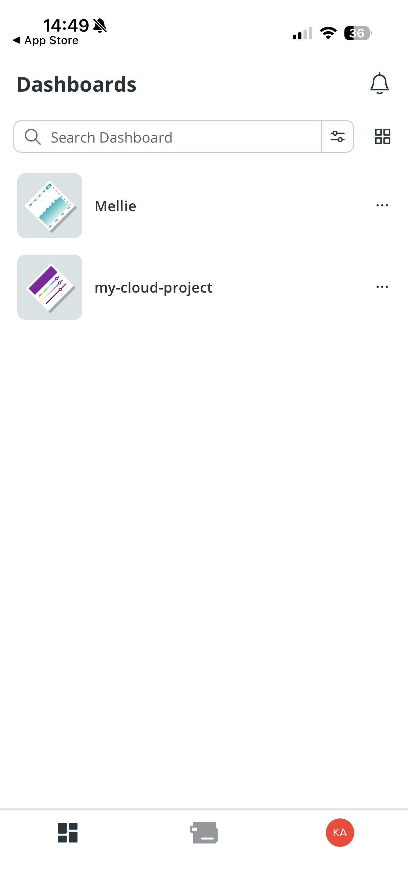
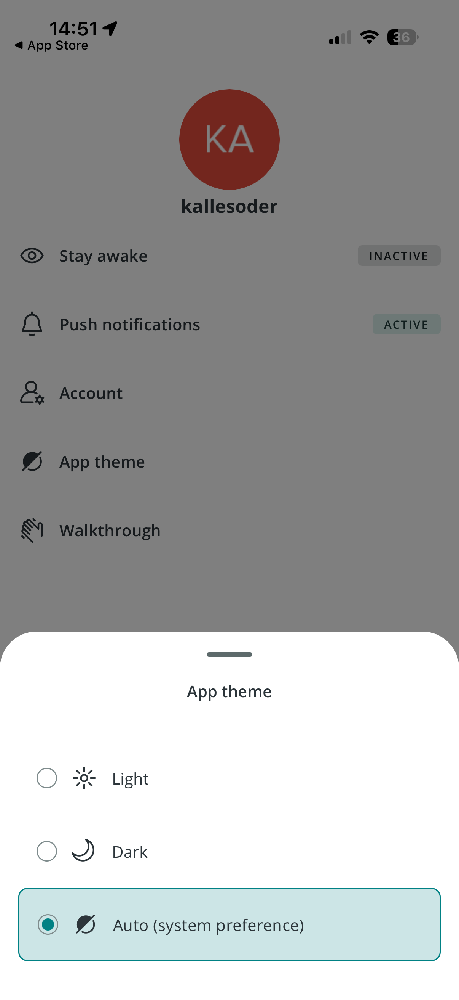
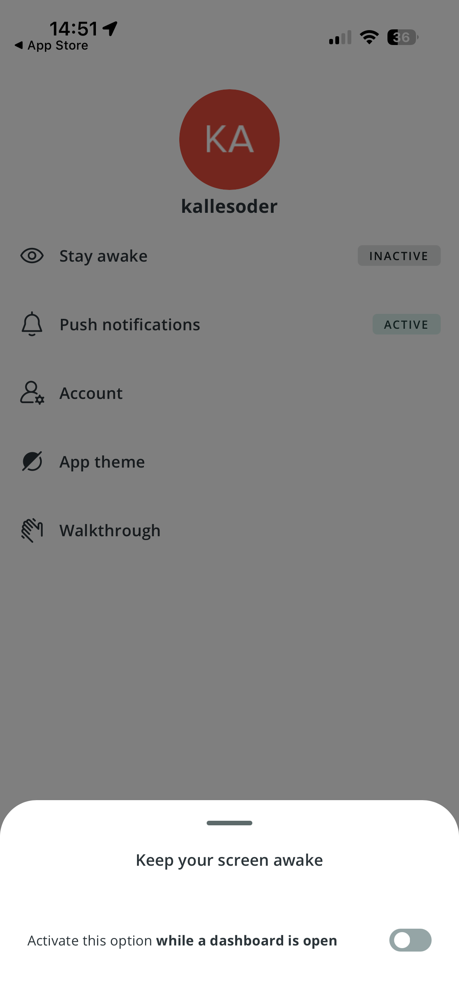

The **Arduino® IoT Remote app** is the mobile companion app for Arduino Cloud. After you install it and log in, the [Dashboards](/arduino-cloud/dashboards/dashboards) you built in the browser are available on your phone, ready to view and control.

## What You Can Do With the App

| Capability | Learn more |
|---|---|
| View and control your dashboards, search and filter them, and rearrange widgets for the phone screen | [Use Dashboards on Your Phone](/arduino-cloud/iot-remote-app/use-dashboards-on-phone) |
| Use your phone as a device and stream its sensors (GPS, accelerometer, compass and more) to Arduino Cloud. Available in your personal account only | [Use Your Phone as a Device](/arduino-cloud/iot-remote-app/use-phone-as-device) |
| Check your devices and add an Arduino board over Bluetooth® Low Energy | [Browse Devices & Data](/arduino-cloud/iot-remote-app/browse-devices-data) and [Set Up a Device Over Bluetooth](/arduino-cloud/devices/bluetooth-device-setup) |
| Receive push notifications sent by Triggers | [Push Notifications](/arduino-cloud/iot-remote-app/push-notifications) |
| Stream your phone's sensors and camera to an UNO Q or VENTUNO Q running Arduino App Lab | [Use Your Phone with Arduino App Lab](/arduino-cloud/iot-remote-app/arduino-app-lab) |
| Switch to dark mode, keep the screen awake, and manage notifications and accounts | [App Settings](#app-settings) |

## Hardware & Software Needed

- An Android phone with **Android 8.0 or later**, or an iPhone with **iOS 15.1 or later**.
- An [Arduino account](https://login.arduino.cc/login).
- The Arduino IoT Remote app:
  - [App Store (iOS)](https://apps.apple.com/us/app/arduino-iot-cloud-remote/id1514358431)
  - [Google Play (Android)](https://play.google.com/store/apps/details?id=cc.arduino.cloudiot)

## Installing the App

1. Install the Arduino IoT Remote app from the App Store or Google Play. Make sure your phone's operating system is up to date first.
2. Open the app and log in with your Arduino account. Use the same account you use for Arduino Cloud in the browser.
3. The **Dashboards** tab opens and lists your dashboards.

The tab bar at the bottom of the screen gives access to the main areas of the app:

- **Dashboards**: your dashboards, with a search bar, filters and a grid/list view toggle. See [Use Dashboards on Your Phone](/arduino-cloud/iot-remote-app/use-dashboards-on-phone).
- **Devices**: your devices, and the option to add a new one. See [Browse Devices & Data](/arduino-cloud/iot-remote-app/browse-devices-data).
- **Profile** (your avatar): the app settings.

## App Settings

Tap your avatar in the tab bar to open the settings. The following options are available:

- **Stay awake**: keeps the screen on while you view dashboards.
- **Push notifications**: shows whether push notifications are active or inactive. See [Push Notifications](/arduino-cloud/iot-remote-app/push-notifications).
- **Account**: the account in use in the app.
- **App theme**: switches between light and dark mode.
- **Walkthrough**: shows the introduction to the app again.

### Dark Mode

1. Tap your avatar to open the settings.
2. Tap **App theme**.
3. Select **Light**, **Dark**, or **Auto** to follow your phone's system preference.

The theme applies to the whole app, including your dashboards.

### Keep the Screen Awake

Turn on **Stay awake** to prevent the phone screen from turning off while a dashboard is open. This is useful when you use the phone as a control panel or a live display.

### Personal Account and Shared Spaces

The app shows the dashboards and devices of the account selected in the settings. Some features, such as [using your phone as a device](/arduino-cloud/iot-remote-app/use-phone-as-device), are available only when your personal account is selected, not in a shared space. See [Spaces](/arduino-cloud/spaces-plans-account/spaces) to learn more about spaces.

## Related Articles

- [Use Dashboards on Your Phone](/arduino-cloud/iot-remote-app/use-dashboards-on-phone)
- [Use Your Phone as a Device](/arduino-cloud/iot-remote-app/use-phone-as-device)
- [Browse Devices & Data](/arduino-cloud/iot-remote-app/browse-devices-data)
- [Push Notifications](/arduino-cloud/iot-remote-app/push-notifications)
- [Use Your Phone with Arduino App Lab](/arduino-cloud/iot-remote-app/arduino-app-lab)
