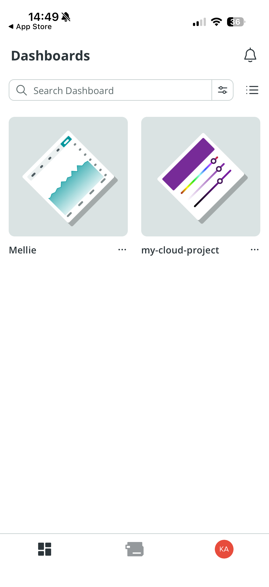
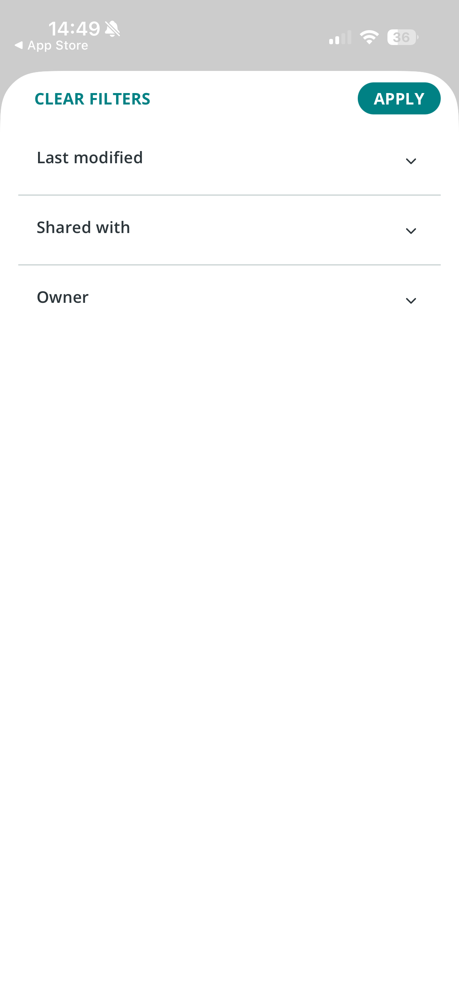
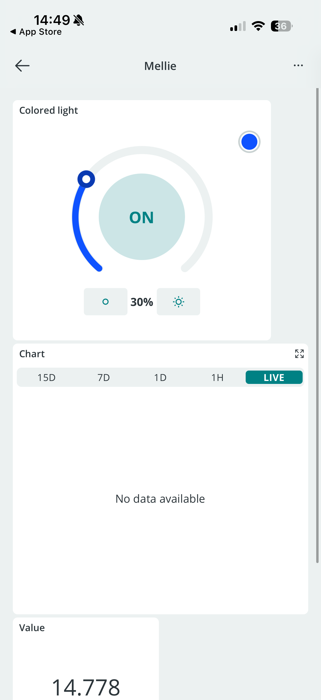
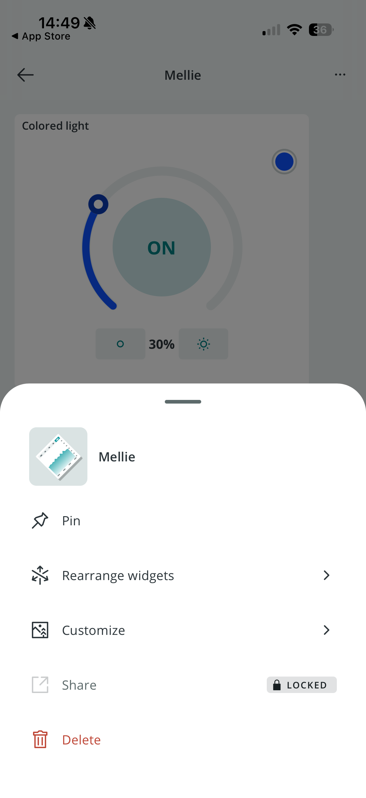

The IoT Remote app shows the same [Dashboards](/arduino-cloud/dashboards/dashboards) you build in the browser, adapted to fit a phone screen. Every widget stays live: a Switch still controls its device and a Chart still updates, so the app works as a remote control for your projects, not only as a viewer.

## Hardware & Software Needed

- The [IoT Remote app](/arduino-cloud/iot-remote-app/iot-remote-app-overview), installed and logged in with your Arduino® account.
- At least one [dashboard](/arduino-cloud/dashboards/dashboards) in Arduino Cloud.

## Finding a Dashboard

Your dashboards are listed in the **Dashboards** tab. To find a dashboard quickly:

- Type in the **search bar** to search dashboards by name.
- Tap the **grid/list toggle** to switch between a list and a grid of dashboard thumbnails.

- Tap the **filter** button to narrow the list by **Last modified**, **Shared with**, or **Owner**. Tap **Apply** to filter the list, or **Clear filters** to show all dashboards again.

## Viewing and Controlling a Dashboard

1. In the **Dashboards** tab, tap a dashboard to open it.
2. Interact with the widgets as you would in the browser. Interaction widgets, such as a Switch or a Slider, send values to the device. Visualization widgets, such as a Value or a Chart, show the incoming data.

Widgets backed by historical data, such as a Chart, let you select a time range to look back at earlier values.

## Dashboard Options

Tap the **...** menu in the top-right corner of an open dashboard to see its options:

- **Pin**: pins the dashboard so it is easy to find in the **Dashboards** tab.
- **Rearrange widgets**: moves and resizes widgets for the phone screen. See [Rearranging Widgets](#rearranging-widgets).
- **Customize**: changes how the dashboard is shown in the app.
- **Share**: shares the dashboard with other users. Sharing requires a paid plan and is locked on the Free plan. See [Share Dashboards](/arduino-cloud/dashboards/share-dashboards) and [Plans, Limits & Quotas](/arduino-cloud/spaces-plans-account/plans-limits-quotas).
- **Delete**: deletes the dashboard from your account.

<Alert type="warning">

Deleting a dashboard in the app deletes it from Arduino Cloud, so it is also removed from the browser.

</Alert>

## Rearranging Widgets

The app keeps its own phone layout, which you can change without affecting the layout in the browser:

1. Open a dashboard.
2. Tap the **...** menu in the top-right corner, then **Rearrange widgets**.
3. Press and hold a widget until it turns light blue, then drag it to move it. Drag a corner of the widget to resize it.
4. Leave the rearrange mode to save the layout.

<Alert type="info">

Rearranging widgets in the app only changes how the dashboard is shown on the phone. The widgets and their linked variables are shared with the browser, so removing or relinking a widget affects both.

</Alert>

## Switching Between Dashboard Pages

If a dashboard is split into [multiple pages](/arduino-cloud/dashboards/dashboard-pages), use the switch button at the bottom of the screen to move between pages. In edit mode, you can also change a page's position, name, and icon from the app. Adding, duplicating, and deleting pages is only available in the browser.

## Related Articles

- [IoT Remote App Overview](/arduino-cloud/iot-remote-app/iot-remote-app-overview)
- [Use Your Phone as a Device](/arduino-cloud/iot-remote-app/use-phone-as-device)
- [Browse Devices & Data](/arduino-cloud/iot-remote-app/browse-devices-data)
- [Working With Dashboards](/arduino-cloud/dashboards/dashboards)
- [Share Dashboards](/arduino-cloud/dashboards/share-dashboards)
