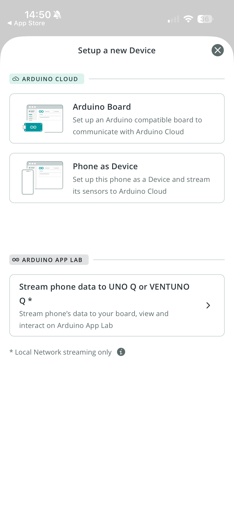
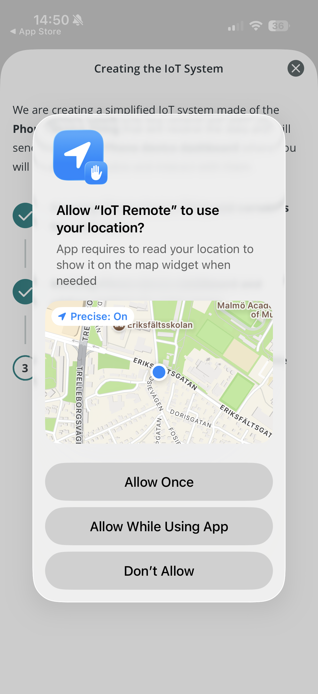
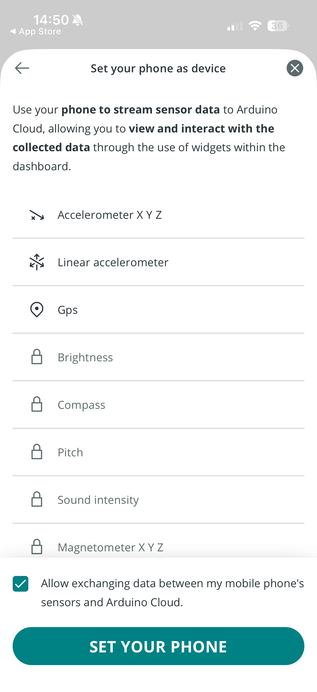
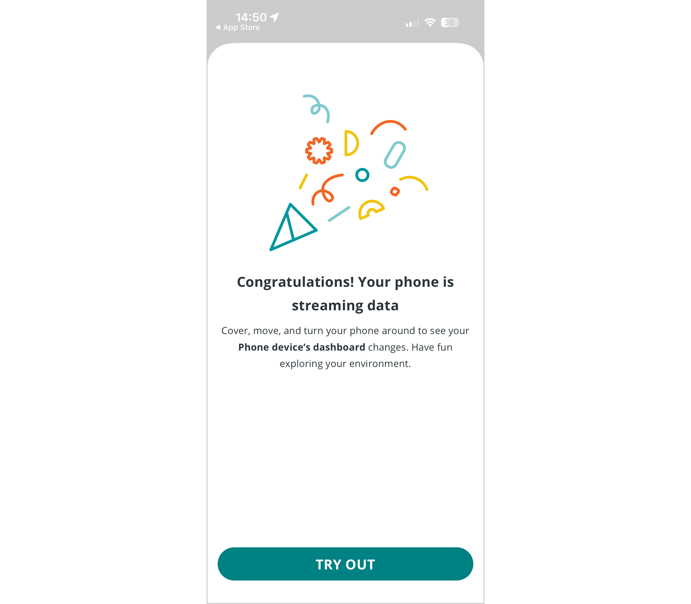
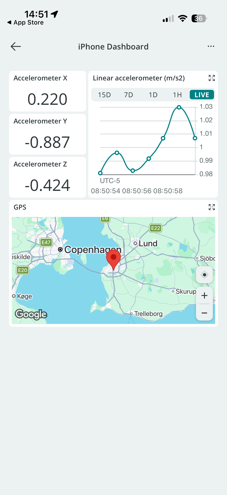

The IoT Remote app can turn your phone into an Arduino® Cloud device, with no extra hardware. The phone's built-in sensors, such as GPS, accelerometer, and compass, stream to [Cloud Variables](/arduino-cloud/things-data/cloud-variables). You can view them on a dashboard, store them as historical data, or sync them with another Thing to control a board, for example to turn a servo motor as you rotate your phone.

<Alert type="note">

Using your phone as a device is available only in your personal account (private space). It is not available in shared spaces. To check which account is in use, open the app settings by tapping your avatar. See [Spaces](/arduino-cloud/spaces-plans-account/spaces) to learn more.

</Alert>

## Hardware & Software Needed

- An Android phone or iPhone with the [IoT Remote app](/arduino-cloud/iot-remote-app/iot-remote-app-overview) installed.
- An [Arduino account](https://login.arduino.cc/login), with your personal account selected in the app.
- Optional: an Arduino Cloud compatible board, to use the phone's data to control hardware.

## Setting Up Your Phone as a Device

1. Open the IoT Remote app and make sure your personal account is selected in the settings.
2. Open the **Devices** tab and add a new device.
3. In **Setup a new Device**, select **Phone as Device**.

   

4. Allow the permissions the app asks for. For example, allow access to your location so the dashboard can show your phone's position on a map.

   

   <!--update map placement maybe?-->

5. Wait while the app creates the IoT system for your phone: the device, the Thing, its variables, and the dashboard.

   

6. When the setup is complete, close the wizard.

   

Your phone is now listed in the **Devices** tab, and its dashboard is listed in the **Dashboards** tab.

## What Gets Created

The setup creates the following resources in Arduino Cloud, named after your phone:

- A **device** representing your phone.
- A **[Thing](/arduino-cloud/things-data/things)** associated with the phone, with one Cloud Variable for each sensor value.
- A **[dashboard](/arduino-cloud/dashboards/dashboards)** named after the phone, for example `<phone name> Dashboard`, with widgets linked to the sensor variables.

Open the dashboard and move your phone around: tilt and rotate it, bring a magnet close to it, or make some noise, and watch the widgets update in real time. The example below shows an `iPhone Dashboard` with accelerometer values, a linear acceleration chart, and the phone's GPS position on a map.



<Alert type="info">

The Thing created for your phone cannot be programmed like a regular board. To use the phone's data in a sketch, sync its variables with another Thing. See [Using Phone Data to Control a Board](#using-phone-data-to-control-a-board).

</Alert>

## Available Sensors

The sensors you can stream depend on your phone. They can include:

| Sensor | Data |
|---|---|
| GPS | The phone's position, stored in a `Location` variable that you can show on a [map widget](/arduino-cloud/dashboards/track-location-map). |
| Accelerometer | Acceleration on the X, Y, and Z axes. |
| Linear accelerometer | Acceleration without the effect of gravity. |
| Gyroscope | Rotation of the phone. |
| Magnetometer | Strength of the magnetic field. |
| Compass | The direction the phone is pointing, from 0 to 360 degrees. |
| Microphone | Sound level. |
| Light sensor | Ambient light level. |

To see the exact variable names and types for your phone, open the phone's Thing in [Arduino Cloud](https://app.arduino.cc/things). The variables are ordinary [Cloud Variables](/arduino-cloud/things-data/cloud-variables): you can chart them, [export their historical data](/arduino-cloud/things-data/historical-data-export), and sync them with other Things.

## Phone Device Settings

In the **Devices** tab, tap your phone to open its settings. Two settings control how the phone sends data:

- **Background data collection**: when enabled, the phone keeps sending sensor data to Arduino Cloud while the app is closed or in the background. This option requires the Maker plan or higher. Without it, data is collected only while the app is open. See [Arduino Cloud plans](https://cloud.arduino.cc/plans).
- **Data streaming policy**: choose whether the phone sends sensor values **periodically**, at a set interval, or **on change**, only when a value changes.

## Using Phone Data to Control a Board

The phone's variables can be [synced](/arduino-cloud/things-data/sync-variables) with variables on another Thing. When the phone updates a variable, the synced variable on the other Thing gets the same value, so your phone can act as an input for a board. In the following example, the phone's compass controls the angle of a servo motor.

1. In [Arduino Cloud](https://app.arduino.cc/things), create a new [Thing](/arduino-cloud/things-data/things) and associate a Cloud-compatible board with it, for example a Nano 33 IoT.
2. Add a variable named `compass`. In the variable settings, select **Sync with other Things**, search for `compass`, and select the compass variable from your phone's Thing.
3. Connect a servo motor to pin `2` of the board.
4. Open the sketch of the Thing and add the servo code. The compass reports values from 0 to 360 degrees, while most small servo motors move within 90 or 180 degrees, so the sketch maps the value with `map()`:

   ```arduino
   #include "thingProperties.h"
   #include <Servo.h>

   Servo myServo;
   int mappedCompass;

   void setup() {
     Serial.begin(9600);
     delay(1500);

     myServo.attach(2);
     myServo.write(80);

     initProperties();
     ArduinoCloud.begin(ArduinoIoTPreferredConnection);
     setDebugMessageLevel(2);
     ArduinoCloud.printDebugInfo();
   }

   void loop() {
     ArduinoCloud.update();
     mappedCompass = map(compass, 0, 360, 0, 90);
     myServo.write(mappedCompass);
   }

   void onCompassChange() {
     // Runs every time the synced compass value changes.
   }
   ```

5. Upload the sketch and wait for the board to connect.
6. Open the IoT Remote app and rotate your phone. The servo motor follows the direction of the phone.

The same approach works with any sensor variable: for example, sync the light sensor to turn on a lamp in the dark, or the accelerometer to react when the phone is shaken. Synced variables must be of the same type.

## Related Articles

- [Add Your Phone](/arduino-cloud/devices/add-your-phone)
- [Use Dashboards on Your Phone](/arduino-cloud/iot-remote-app/use-dashboards-on-phone)
- [Browse Devices & Data](/arduino-cloud/iot-remote-app/browse-devices-data)
- [Sync Variables Between Things](/arduino-cloud/things-data/sync-variables)
- [Cloud Variables](/arduino-cloud/things-data/cloud-variables)
- [Track Location on a Map](/arduino-cloud/dashboards/track-location-map)
