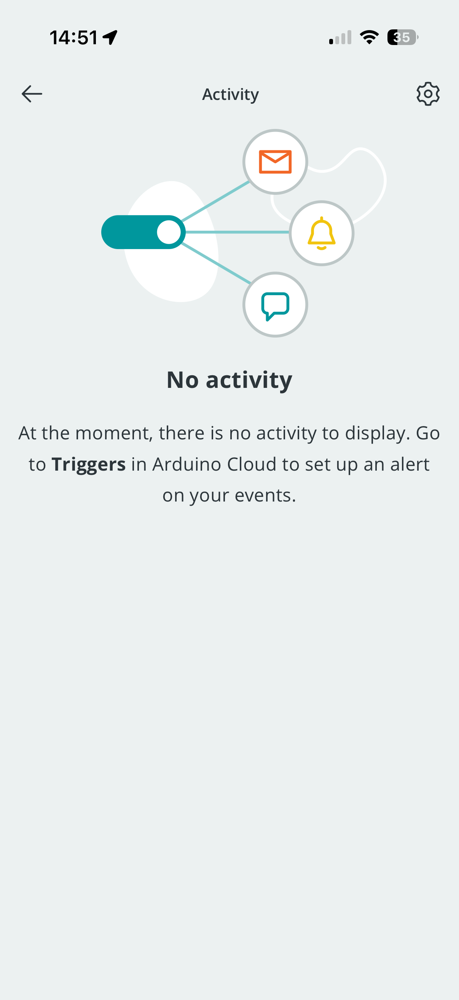

The IoT Remote app can receive **push notifications** from Arduino® Cloud. They alert you on your phone when something happens in your project, for example when a sensor value drops below a threshold or power consumption is too high.

## How Push Notifications Work

Push notifications are sent by [Triggers](/arduino-cloud/automations/triggers-and-alerts). A Trigger watches a Cloud Variable in Arduino Cloud and, when its condition is met, sends a push notification with the title and description you set. The notification is delivered to every phone that is logged in to your account in the IoT Remote app.

The condition is defined in the Trigger, not in the app. To create a Trigger that sends push notifications, see [Triggers & Alerts](/arduino-cloud/automations/triggers-and-alerts).

<Alert type="note">

Triggers require a paid plan, and the number of notifications per day depends on your plan. See [Arduino Cloud plans](https://cloud.arduino.cc/plans) for details.

</Alert>

## Hardware & Software Needed

- An Android phone or iPhone with the [IoT Remote app](/arduino-cloud/iot-remote-app/iot-remote-app-overview) installed and logged in.
- An Arduino Cloud account with a plan that includes Triggers.
- A Trigger configured to send push notifications.

## Turning Push Notifications On or Off

1. In the IoT Remote app, tap your avatar to open the settings.
2. Tap **Push notifications**. The setting shows whether notifications are **active** or **inactive**.
3. Allow the app to show notifications when your phone asks for permission. The permission prompt depends on your phone's operating system.

To stop receiving push notifications on a phone, turn them off in the same setting or in your phone's notification settings. To stop a notification for all phones, disable its Trigger in Arduino Cloud.

## Viewing Notifications

Notifications appear on your phone like those of any other app. To see the notifications you received in the app, tap the **bell** icon in the **Dashboards** tab.

## Related Articles

- [Triggers & Alerts](/arduino-cloud/automations/triggers-and-alerts)
- [IoT Remote App Overview](/arduino-cloud/iot-remote-app/iot-remote-app-overview)
- [Use Dashboards on Your Phone](/arduino-cloud/iot-remote-app/use-dashboards-on-phone)
