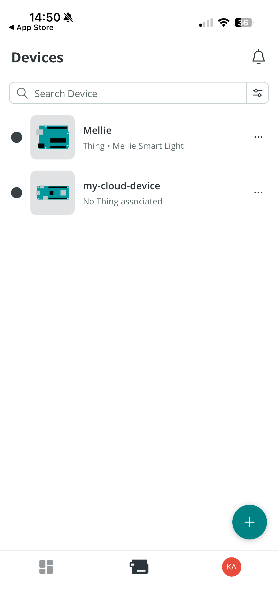
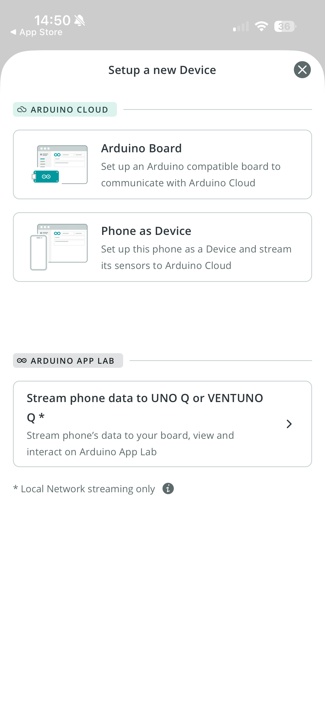

The **Devices** tab of the IoT Remote app lists your Arduino® Cloud [devices](/arduino-cloud/devices/devices-overview). Use it to check that a device is online without opening a browser, and to add a new device from your phone.

## Hardware & Software Needed

- The [IoT Remote app](/arduino-cloud/iot-remote-app/iot-remote-app-overview), installed and logged in with your Arduino account.

## Checking Your Devices

1. Open the **Devices** tab. Your devices are listed with their status: **Online** when the device is connected to Arduino Cloud, **Offline** when it is not. This is the same status shown in **Devices** in the browser.
2. Tap a device to open it and see its details and settings.

Check that a device is online before you expect new data from it. To learn what affects the device status, see [Device Status & Lifecycle](/arduino-cloud/devices/device-status-lifecycle).

## Adding a Device

1. In the **Devices** tab, add a new device.
2. In **Setup a new Device**, select one of the options:
   - **Arduino Board**: sets up a compatible Arduino board over Bluetooth® Low Energy. See [Set Up a Device Over Bluetooth](/arduino-cloud/devices/bluetooth-device-setup).
   - **Phone as Device**: sets up your phone as a device and streams its sensors to Arduino Cloud. See [Use Your Phone as a Device](/arduino-cloud/iot-remote-app/use-phone-as-device).
   - **Stream phone data to UNO Q or VENTUNO Q**: streams your phone's sensors and camera to an Arduino App Lab App over your local network, without using Arduino Cloud. See [Use Your Phone with Arduino App Lab](/arduino-cloud/iot-remote-app/arduino-app-lab).

## Viewing Device Data

The app shows a device's data through [dashboards](/arduino-cloud/iot-remote-app/use-dashboards-on-phone). Each widget shows the latest value of its linked [Cloud Variable](/arduino-cloud/things-data/cloud-variables), and widgets such as a Chart let you look back at [historical data](/arduino-cloud/things-data/historical-data-export) over a selected time range.

<Alert type="info">

To browse a device's data on your phone, build a dashboard in the browser with widgets linked to the device's variables. The dashboard is available in the app right away.

</Alert>

## Related Articles

- [Use Dashboards on Your Phone](/arduino-cloud/iot-remote-app/use-dashboards-on-phone)
- [Set Up a Device Over Bluetooth](/arduino-cloud/devices/bluetooth-device-setup)
- [Use Your Phone as a Device](/arduino-cloud/iot-remote-app/use-phone-as-device)
- [Device Status & Lifecycle](/arduino-cloud/devices/device-status-lifecycle)
