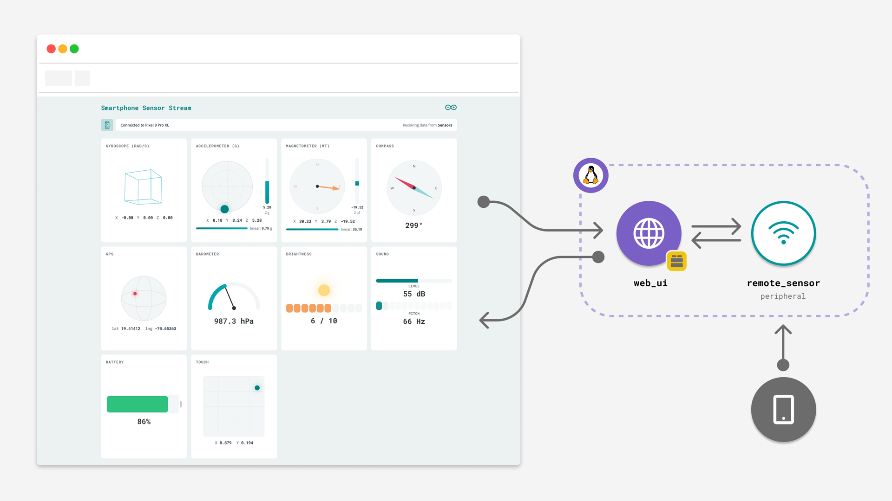
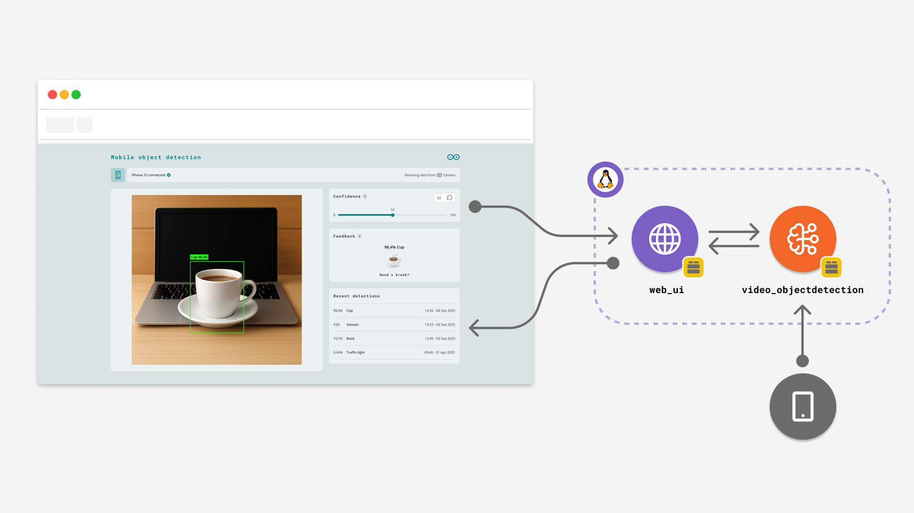

The IoT Remote app can stream your phone's sensors and camera directly to an [Arduino App Lab](/software/app-lab/) App running on your board. The App hosts a web interface that shows a QR code and a six-digit password: pair your phone with it, and the phone becomes a wireless sensor or camera for the App, for example to visualize motion data or to run object detection on a live video feed.

Note that only Linux based boards are supported (see [Hardware & Software Needed section](#hardware--software-needed))

<Alert type="info">

To learn more about using the IoT Remote App with Arduino App Lab, read the [IoT Remote App Integration for Arduino App Lab
](https://docs.arduino.cc/software/app-lab/integrations/companion-app/) article.

</Alert>

## Hardware & Software Needed

The following boards are supported:
- [Arduino® UNO™ Q](https://store.arduino.cc/products/uno-q) or
- [Arduino® VENTUNO™ Q](https://store.arduino.cc/products/ventuno-q)

To run the App, you will also need to download the Arduino App Lab:
- [Download Arduino App Lab](https://www.arduino.cc/en/software/#app-lab-section)

You will also need a smart phone that supports IoT Remote app:
- [Install the IoT Remote app](/arduino-cloud/iot-remote-app/iot-remote-app-overview)

## Pairing Your Phone

1. Download and install Arduino App Lab.
2. Run the App (choose one of the [example Apps listed below](#examples)) from Arduino App Lab. The web interface opens in your browser (or manually via `<board-name>.local:7000`) and shows a QR code and a six-digit password.
3. [Install the IoT Remote app](/arduino-cloud/iot-remote-app/iot-remote-app-overview) and log in with your Arduino account.
4. Pair your phone in one of two ways:
   - Scan the QR code with your phone's camera (outside the IoT Remote app), or
   - In the IoT Remote app, go to **Devices**, tap the **+** icon, select **Stream phone data to UNO Q or VENTUNO Q**, pick your board, then enter the password shown below the QR code.

Once connected, the web interface switches from the pairing view to the App's live view.

## Examples

The following examples from the [App Bricks Examples](https://github.com/arduino/app-bricks-examples) repository use the IoT Remote app as an input source.

### Smartphone Sensor Stream

This example turns your phone into a wireless multi-sensor device. Sensor readings are received by the board through the `remote_sensor` peripheral and forwarded to the `web_ui` Brick, where each metric drives an animated panel: accelerometer, gyroscope, magnetometer, compass, GPS, barometer, brightness, sound, battery and touch. Move and tilt your phone to see every panel react in real time.

- [Smartphone Sensor Stream on GitHub](https://github.com/arduino/app-bricks-examples/tree/main/inspirational/common/mobile-remote-sensor)

### Detect Objects on Smartphone Camera

This example uses your phone as a remote camera. The video stream is processed on the board by the `video_objectdetection` Brick, which runs a pre-trained model and draws bounding boxes around detected objects. The `web_ui` Brick shows the live feed, a confidence threshold slider, feedback for specific objects (such as a cup or a cat) and a list of recent detections.

- [Detect Objects on Smartphone Camera on GitHub](https://github.com/arduino/app-bricks-examples/tree/main/inspirational/common/mobile-video-generic-object-detection)

## Next Steps

- [Use Your Phone as a Device](/arduino-cloud/iot-remote-app/use-phone-as-device)
- [Arduino App Lab - IoT Remote App](/software/app-lab/integrations/companion-app/)
- [Arduino UNO Q Documentation](/hardware/uno-q/)
- [Arduino VENTUNO Q Documentation](/hardware/ventuno-q/)
