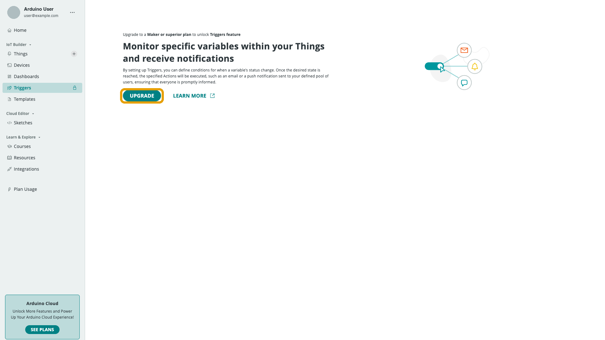

A **Trigger** watches a
[Cloud Variable](/arduino-cloud/things-data/cloud-variables) for a condition
(for example "temperature > 30") and fires an action when it's met — an
email, a push notification, or a webhook call. It's the tool for turning data
into alerts without writing any device-side logic.

## Plan Requirement

On a free-tier account, **Triggers** (`/triggers`) shows an upgrade prompt
instead of the feature itself:

<Alert type="note">

Triggers require a paid plan. On the free tier you can see the feature but not
create a Trigger.

</Alert>

## What a Trigger Is Made Of

Every Trigger combines a condition with an action:

- **A condition** — a variable, an operator, and a threshold or expression.
- **An action**, one of:
  - **Email** — sends to one or more recipients.
  - **Push notification** — delivered to the Arduino IoT Remote mobile app;
    see [Push Notifications](/arduino-cloud/iot-remote-app/push-notifications).
  - **Webhook** — calls an external URL; see
    [Webhooks](/arduino-cloud/automations/webhooks).

## Creating a Trigger

1. From [Arduino Cloud home](https://cloud.arduino.cc/home/), open **Triggers**
   and click **Add Trigger**.
2. Click **Cloud Variable**, select the **Thing** and **Variable** to watch,
   then **Link Variable**.
3. Select an **Action** — **Email**, push notification, or webhook. For Email,
   compose the message that's sent each time the Trigger fires. You can embed
   **dynamic data** using tags such as `{variable.timestamp}` and
   `{variable.value}`.
4. Press **Done**, then turn on the **State** switch to activate the Trigger.

The Trigger then evaluates as the variable updates and fires its action when
the condition is met. You can create as many Triggers as you need.

## Triggers vs. Thing-Level Webhooks

A Trigger's webhook action fires only when its condition matches, which is
different from the per-Thing
[data forwarding webhook](/arduino-cloud/automations/webhooks) that fires on
*every* variable update. Check both when debugging unexpected webhook calls.

## Next Steps

- [Device Online/Offline Alerts](/arduino-cloud/automations/device-online-offline-alerts)
- [Webhooks](/arduino-cloud/automations/webhooks)
- [Push Notifications](/arduino-cloud/iot-remote-app/push-notifications)
