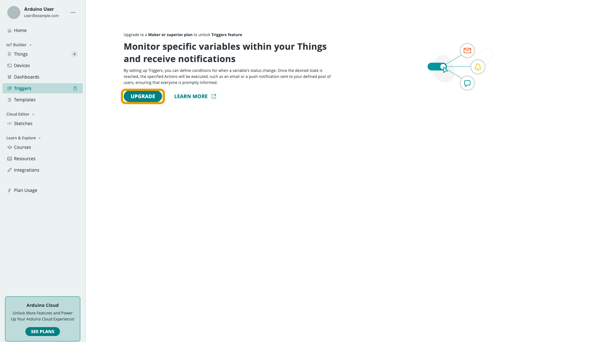

A **Trigger** reacts to a condition on a [Cloud Variable](/arduino-cloud/things-data/cloud-variables), such as a boolean being true or a string being assigned a value, and sends you a notification as soon as the condition is met. This is useful when you monitor data and need to know about a change as soon as it happens, from environmental readings to security events such as movement detection.

Triggers can also detect **device status**, sending an email or push notification whenever a device goes online or offline. See [Device Online/Offline Alerts](/arduino-cloud/automations/device-online-offline-alerts).

## Requirements

- An [Arduino Cloud](https://app.arduino.cc/) account with a **Maker** plan or higher.
- A [Cloud-compatible board](/arduino-cloud/reference/supported-boards-capabilities). This example uses the [Nano 33 IoT](https://store.arduino.cc/products/arduino-nano-33-iot), but any compatible board works.

On a Free plan, **Triggers** (`/triggers`) shows an upgrade prompt instead of the feature itself:



## Limitations

The only variable types supported by Triggers are:

- **Booleans**
- **Strings**

To alert on a numeric reading, such as a temperature above a threshold, evaluate the threshold in your sketch and set a boolean variable that the Trigger watches.

## What a Trigger Is Made Of

Every Trigger combines a condition with an action:

- **A condition** on a linked Boolean or String variable.
- **An action**, one of:
  - **Email** — a personalized message sent each time the Trigger fires.
  - **Push notification** — delivered to the Arduino IoT Remote mobile app; see [Push Notifications](/arduino-cloud/iot-remote-app/push-notifications).

## Creating a Trigger

1. Create a [Thing](/arduino-cloud/things-data/things) with a Boolean or String variable, attach your device, and upload a sketch that updates the variable (see the [example](#example-code) below). If you're new to this, follow the [Quickstart](/arduino-cloud/get-started/quickstart-first-project).
2. From [Arduino Cloud home](https://cloud.arduino.cc/home/), open **Triggers** and click **Add Trigger**.
3. Click **Cloud Variable**, select your **Thing** and **Variable**, then click **Link Variable**.
4. Select an **Action** (**Email** or push notification) and write the message. Add **dynamic data** with the tags `{variable.timestamp}` and `{variable.value}` shown below the form.
5. Click **Done**, then turn on the **State** switch to activate the Trigger. Change the variable (for example, press the button) and the notification arrives within a couple of seconds.

## Example Code

This sketch sets the Boolean `button` to `true` while a button on pin D3 is pressed. Add these lines to the generated sketch, with `pinMode(btnPin, INPUT);` in `setup()`:

```arduino
const int btnPin = 3;

void loop() {
  ArduinoCloud.update();
  button = (digitalRead(btnPin) == HIGH);
}
```

## Use Cases

- **Motion detection:** notify when a PIR sensor detects movement.
- **Plant monitoring:** notify when the soil needs water.
- **Environmental thresholds:** notify when a reading crosses a threshold evaluated in the sketch.

## Triggers vs. Webhooks

Triggers send emails and push notifications. To forward variable updates to an external service, use the Thing-level [data forwarding webhook](/arduino-cloud/automations/webhooks), which fires on every variable update.

## Next Steps

- [Device Online/Offline Alerts](/arduino-cloud/automations/device-online-offline-alerts)
- [Webhooks](/arduino-cloud/automations/webhooks)
- [Push Notifications](/arduino-cloud/iot-remote-app/push-notifications)
