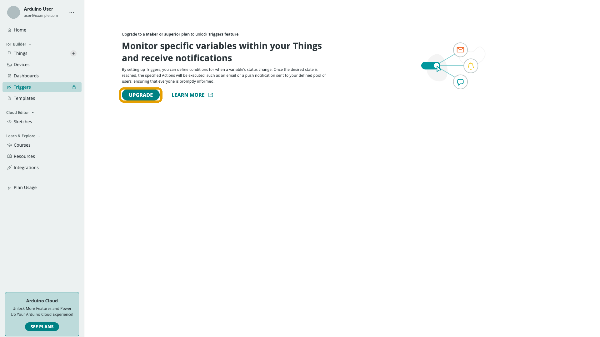
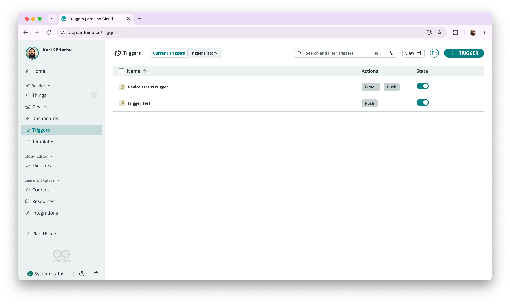
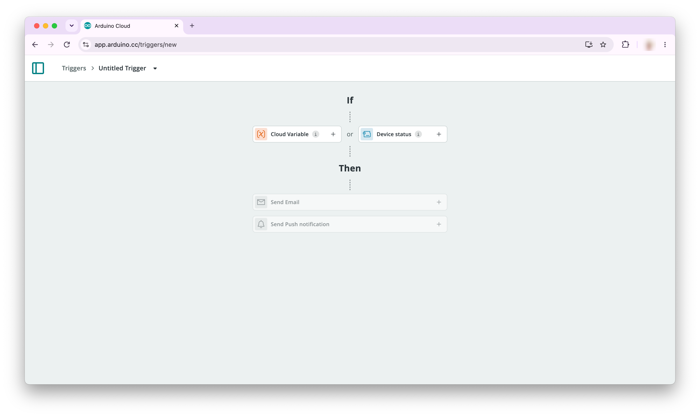
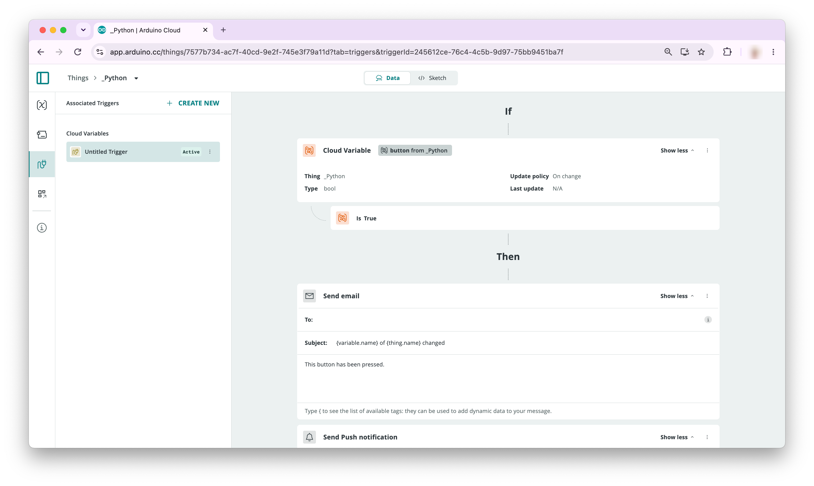
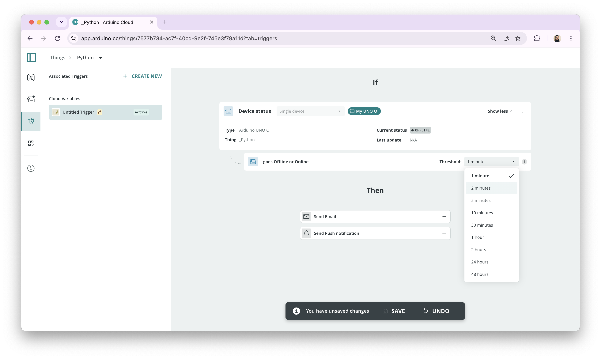
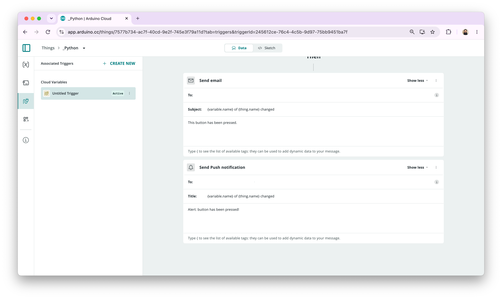

A **Trigger** watches for a condition in Arduino® Cloud and sends you a notification as soon as that condition is met. Every Trigger follows the same pattern: **If** something happens, **Then** send an email and/or a push notification.

There are two types of condition:

- **Cloud Variable:** a [Cloud Variable](/arduino-cloud/things-data/cloud-variables) meets a condition, such as a Boolean becoming true or a String being assigned a value. Use this to react to your *data*, from environmental readings to security events such as movement detection.
- **Device status:** a [device](/arduino-cloud/devices/devices-overview) goes online or offline. Use this to react to *connectivity*, for example to know the moment a device loses power, goes out of range or stops running its sketch.

Apart from the condition, both types are set up and managed in the same way.

## Hardware & Software Needed

- An [Arduino Cloud](https://app.arduino.cc/) account with a **Maker** plan or higher. See [Arduino Cloud plans](https://cloud.arduino.cc/plans).
- A [Cloud-compatible board](/arduino-cloud/reference/supported-boards-capabilities). The variable example on this page uses the [Nano 33 IoT](https://store.arduino.cc/products/arduino-nano-33-iot), but any compatible board works.
- A [Thing](/arduino-cloud/things-data/things) with your device attached.
- The [IoT Remote app](/arduino-cloud/iot-remote-app/push-notifications), if you want to receive push notifications.

On a Free plan, **Triggers** shows an upgrade prompt instead of the feature itself:



## How Triggers Work

Every Trigger combines a condition with one or more actions:

- **If:** the condition, either a **Cloud Variable** condition or a **Device status** condition.
- **Then:** the action, one or both of:
  - **Send Email:** a personalized message sent each time the Trigger fires.
  - **Send Push notification:** a notification delivered to the IoT Remote app. See [Push Notifications](/arduino-cloud/iot-remote-app/push-notifications).

You can create as many Triggers as you need, and each one can be turned on or off individually with its **State** switch.

## Managing Triggers

To see all your Triggers, select **Triggers** in the left navigation menu. The **Current Triggers** tab lists each Trigger with its name, its actions (**E-mail**, **Push**) and its **State** switch. The **Trigger History** tab shows the Triggers that have fired.



<!--you are showing your email here @karl in this image-->

You can also work with the Triggers that belong to a single Thing: open the Thing and select the Triggers tab. The **Associated Triggers** list shows the Thing's Triggers, and **+ Create New** adds a new one that is already associated with the Thing.

## Creating a Trigger

1. Create a Trigger in one of two ways:
   - Select **Triggers** in the left navigation menu and click **+ Trigger**.
   - Open a Thing, select its Triggers tab and click **+ Create New**.
2. In the **If** section, select the type of condition: **Cloud Variable** or **Device status**.

   

3. Configure the condition. See [Variable Triggers](#variable-triggers) or [Device Status Triggers](#device-status-triggers) below.
4. In the **Then** section, add **Send Email**, **Send Push notification** or both, and write the message. See [Notification Messages](#notification-messages).
5. Click **Save**.
6. Make sure the Trigger's **State** switch is on (**Active**). The Trigger now fires each time its condition is met.

## Variable Triggers

A variable Trigger fires when a Cloud Variable meets a condition you define.

### Limitations

The only variable types supported by Triggers are:

- **Boolean**
- **String**

To alert on a numeric reading, such as a temperature above a threshold, evaluate the threshold in your sketch and set a Boolean variable that the Trigger watches.

### Set Up a Variable Trigger

1. Create a Thing with a Boolean or String variable, attach your device, and upload a sketch that updates the variable (see the [example code](#example-code) below). If you are new to this, follow the [Quickstart](/arduino-cloud/get-started/quickstart-first-project).
2. Create a new Trigger and select **Cloud Variable** in the **If** section.
3. Select your **Thing** and **Variable**, then click **Link Variable**.
4. Choose the condition, for example **Is True** for a Boolean variable. The panel also shows the variable's type, its update policy and when it was last updated.
5. In the **Then** section, add the actions and write the messages.

   

6. Click **Save** and make sure the Trigger is **Active**.
7. Change the variable, for example by pressing the button. The notification arrives within a couple of seconds.

### Example Code

This sketch sets the Boolean `button` to `true` while a button connected to pin D3 is pressed, and to `false` when it is released. It is based on the sketch generated for your Thing, where `button` is declared in `thingProperties.h`:

```arduino
#include "thingProperties.h"

const int btnPin = 3;

void setup() {
  Serial.begin(9600);
  delay(1500);

  initProperties();
  ArduinoCloud.begin(ArduinoIoTPreferredConnection);

  pinMode(btnPin, INPUT);
}

void loop() {
  ArduinoCloud.update();
  button = (digitalRead(btnPin) == HIGH);
}
```

## Device Status Triggers

A device status Trigger fires when a device connects to or disconnects from Arduino Cloud. It reacts to the connection itself, so you do not need a variable or any extra code in your sketch.

The status comes from the device's connection to Arduino Cloud: MQTT for Arduino/C++ boards, ESP32/ESP8266 boards and manual (Python®, MicroPython, Node.js) devices, and the connector daemon for UNO Q and VENTUNO Q boards. You can see the same status in the **Status** column of the Devices list and on the device page. For details, see [Device Status & Lifecycle](/arduino-cloud/devices/device-status-lifecycle).

### Set Up a Device Status Trigger

1. Create a new Trigger and select **Device status** in the **If** section.
2. Select **Single device** and choose the device you want to track. The panel shows the device type, its Thing, its current status and when it was last updated.
3. Choose when to be notified: when the device **goes Online**, **goes Offline**, or **goes Offline or Online**.
4. Select a **Threshold**: how long after the status change the Trigger fires, for example 1 minute, 1 hour or 24 hours. A threshold avoids notifications for short connection drops.

   

5. In the **Then** section, add **Send Email**, **Send Push notification** or both, and write the messages.
6. Click **Save** and make sure the Trigger is **Active**.

<Alert type="info">

To check device connectivity from your own code instead, use the REST API or the Arduino Cloud CLI. See [CLI Commands: Devices](/arduino-cloud/apis-cli/cli-commands#devices).

</Alert>

## Notification Messages

Each action has its own message:

- **Send Email:** **To** (the recipient), **Subject** and message body.
- **Send Push notification:** **To** (the recipient), **Title** and message body.

You can add **dynamic data** to the subject, title and body with tags. Type `{` in a message field to see the list of available tags. For example:

- `{variable.name}`: the name of the variable.
- `{variable.value}`: the value of the variable when the Trigger fired.
- `{variable.timestamp}`: when the variable was updated.
- `{thing.name}`: the name of the Thing.

A subject such as `{variable.name} of {thing.name} changed` becomes, for example, "button of Doorbell changed" when the email is sent.



## Use Cases

- **Motion detection:** notify when a PIR sensor detects movement.
- **Plant monitoring:** notify when the soil needs water.
- **Environmental thresholds:** notify when a reading crosses a threshold evaluated in the sketch.
- **Device monitoring:** notify when a remote device goes offline, for example after a power cut, and again when it comes back online.

## Triggers vs. Webhooks

Triggers send emails and push notifications when a condition is met. To forward every variable update to an external service, use the Thing-level [data forwarding webhook](/arduino-cloud/automations/webhooks).

## Related Articles

- [Choose an Automation](/arduino-cloud/automations/choose-an-automation)
- [Push Notifications](/arduino-cloud/iot-remote-app/push-notifications)
- [Device Status & Lifecycle](/arduino-cloud/devices/device-status-lifecycle)
- [Webhooks](/arduino-cloud/automations/webhooks)
