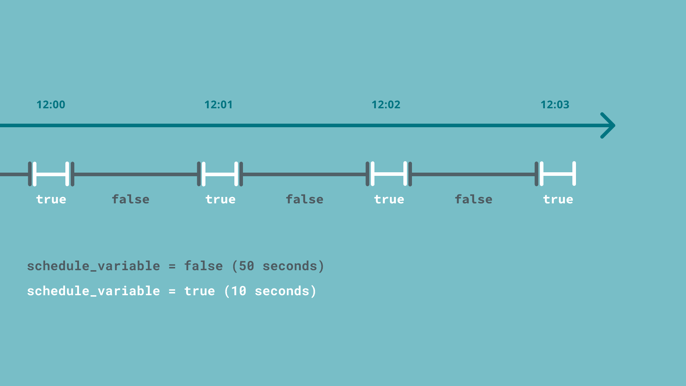
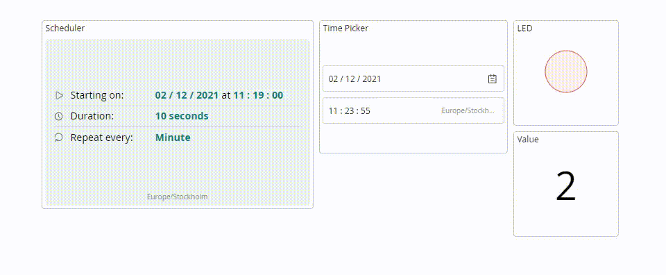

The **Scheduler** automates a variable's value on a recurring schedule,
entirely from a [Dashboard](/arduino-cloud/dashboards/dashboards) — no timing
logic to write in your sketch. It's built around a dedicated variable type,
`CloudSchedule`, and a matching **Scheduler** widget that configures when the
variable is "on." Typical uses are turning a light on and off at fixed times,
running an irrigation pump for a few minutes every morning, or firing any
periodic action a device needs.

## How It Works

A `CloudSchedule` variable holds a boolean-like state: **active** or
**inactive**. Your sketch only checks that state; the actual schedule (when it
turns on, for how long, how often) lives in the cloud and is set from the
widget:

```arduino
if (schedule_variable.isActive()) {
  // runs for as long as the schedule says "on"
}
```

Add a `CloudSchedule` like any other
[Cloud Variable](/arduino-cloud/things-data/cloud-variables), from the
**Time** category in the variable type picker.



### Core API Usage

In the sketch you only act on the state — typically driving an output while the
schedule is active and clearing it otherwise:

```arduino
if (schedule_variable.isActive()) {
  digitalWrite(relay, HIGH);   // active window, e.g. pump/light ON
} else {
  digitalWrite(relay, LOW);    // inactive window, OFF
}
```

You can declare multiple `CloudSchedule` variables to run independent jobs at
different times. A related `CloudTime` variable holds the current time and can
be read with `ArduinoCloud.getLocalTime()`:

```arduino
time_variable = ArduinoCloud.getLocalTime();
```

For an end-to-end build (Thing, device, dashboard, and the full sketch), see
[Smart Light Scheduler](/arduino-cloud/tutorials-projects/automate-smart-light-scheduler).


## Configuring a Recurring Schedule

Add a **Scheduler** widget to a dashboard, link it to the `CloudSchedule`
variable, and open its configuration:

| Parameter | Description |
|---|---|
| **Start** | Date and time of the first occurrence. |
| **End** | Date/time after which the schedule stops firing, or "never." |
| **Duration** | How long the "active" state lasts once triggered. |
| **Repeat every** | How often it recurs: minute, hour, day, week, month, or year. |

A job set to **start: today, end: never, duration: 10 seconds, repeat every:
minute** activates the variable for 10 seconds every minute, indefinitely:



<Alert type="note">

The schedule is interpreted using the Thing's
[Timezone](/arduino-cloud/things-data/things) — set it correctly before
relying on a schedule, otherwise the job fires at the wrong local time.

</Alert>

<Alert type="info">

The Scheduler widget only accepts `CloudSchedule` variables, and variable
names are case-sensitive — a mismatch between the sketch and the Thing's
variable name is the most common reason a schedule appears to do nothing.

</Alert>

## Next Steps

- [Choose an Automation](/arduino-cloud/automations/choose-an-automation)
- [Add & Link Widgets](/arduino-cloud/dashboards/add-link-widgets)
- [Cloud Variables](/arduino-cloud/things-data/cloud-variables)
