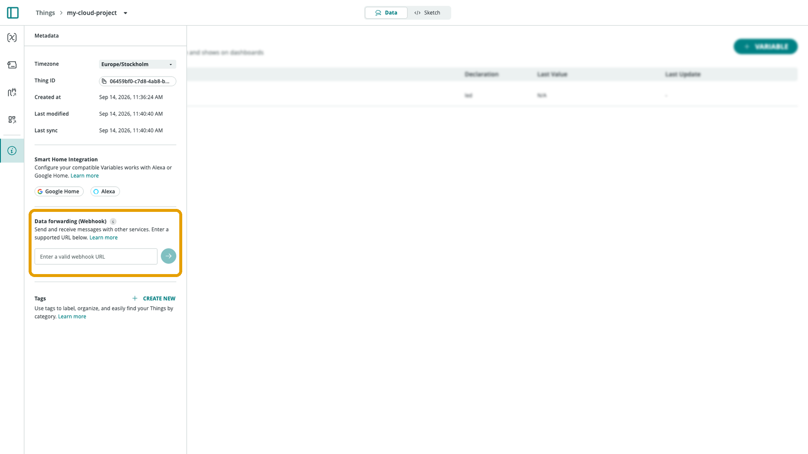
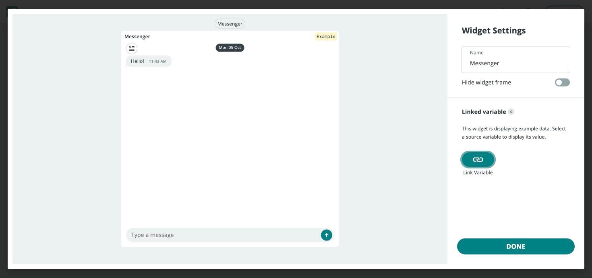

A **webhook** sends an HTTP request to a URL you specify whenever a variable on a Thing is updated, letting you connect a project to external systems — automation platforms, your own backend, a chat notification — without polling the API for changes.

Webhooks are configured per Thing, in the Thing's [Metadata panel](/arduino-cloud/things-data/things) under **Data forwarding (Webhook)**. To be notified only when a specific Boolean or String condition is met, use a [Trigger](/arduino-cloud/automations/triggers-and-alerts) instead, which sends an email or push notification.

## Thing-Level Data Forwarding

Enter a target URL in the Thing's Metadata panel, under **Data Forwarding (Webhook)**:



Every update to any variable on that Thing is then sent to that URL as an HTTP POST request with a JSON body:

```json
{
  "event_id": "EVENT_UUID",
  "webhook_id": "WEBHOOK_ID",
  "device_id": "DEVICE_UUID",
  "thing_id": "THING_UUID",
  "values": [
    {
      "id": "VARIABLE_01_ID",
      "name": "NAME_OF_VARIABLE_01",
      "value": "VARIABLE_01_VALUE",
      "persist": true,
      "updated_at": "DATE",
      "created_by": "USERID"
    },
    {
      "id": "VARIABLE_02_ID",
      "name": "NAME_OF_VARIABLE_02",
      "value": "VARIABLE_02_VALUE",
      "persist": false,
      "updated_at": "DATE",
      "created_by": "USERID"
    }
  ]
}
```

Arduino® Cloud shares five sets of values through the webhook:

- `event_id`: a unique ID for this webhook event.
- `webhook_id`: the ID of the webhook.
- `device_id`: the ID of the device attached to the Thing.
- `thing_id`: the ID of the Thing.
- `values`: an array with one object per variable in your Thing.

Each object in `values` contains:

- `id` and `name`: the variable's ID and name. A receiving service can use `name` to handle each variable differently.
- `value`: the variable's value.
- `persist`: `true` or `false`, depending on the variable's configuration.
- `updated_at`: the date and time of the last update.
- `created_by`: a user ID.

## Testing the Webhook

Before you connect a webhook to a real service, check that Arduino Cloud sends what you expect. The easiest way is to send the requests to a request inspection service, a website that gives you a temporary URL and displays every request it receives. Then change a variable from a dashboard so that the webhook fires on demand.

1. Open a request inspection service of your choice and copy the temporary URL it gives you.
2. Paste the URL in the Thing's **Data Forwarding (Webhook)** field and save it.
3. Make sure the device attached to the Thing is online.
4. Open a [Dashboard](/arduino-cloud/dashboards/dashboards) and add a widget that can change a variable of the Thing. For example, add a [Messenger widget](/arduino-cloud/reference/widget-catalog#messenger) and link it to a String variable, or a Switch widget linked to a Boolean variable.

   

5. Send a message from the Messenger widget, or toggle the Switch. This updates the linked variable, and the update makes Arduino Cloud send a webhook request.
6. Open the request inspection service. A new POST request appears, with the JSON body described above. Check the `name` and `value` fields of the variable you changed.

When the requests look correct, replace the temporary URL with the URL of the service you want to use.

<Alert type="warning">

Anyone with the URL of a request inspection service can see the requests sent to it. Use it only for testing, and avoid sending sensitive data to it.

</Alert>

## Connecting to External Platforms

The same webhook URL works with any platform that accepts an incoming HTTP request — IFTTT, Zapier, Google Apps Script, or a custom endpoint. For step-by-step setup against specific platforms (IFTTT, Zapier, Google Sheets), see [IFTTT, Zapier & Webhooks](/arduino-cloud/integrations/ifttt-zapier-webhooks).

## Related Articles

- [IFTTT, Zapier & Webhooks](/arduino-cloud/integrations/ifttt-zapier-webhooks)
- [Triggers & Alerts](/arduino-cloud/automations/triggers-and-alerts)
- [Things](/arduino-cloud/things-data/things)
