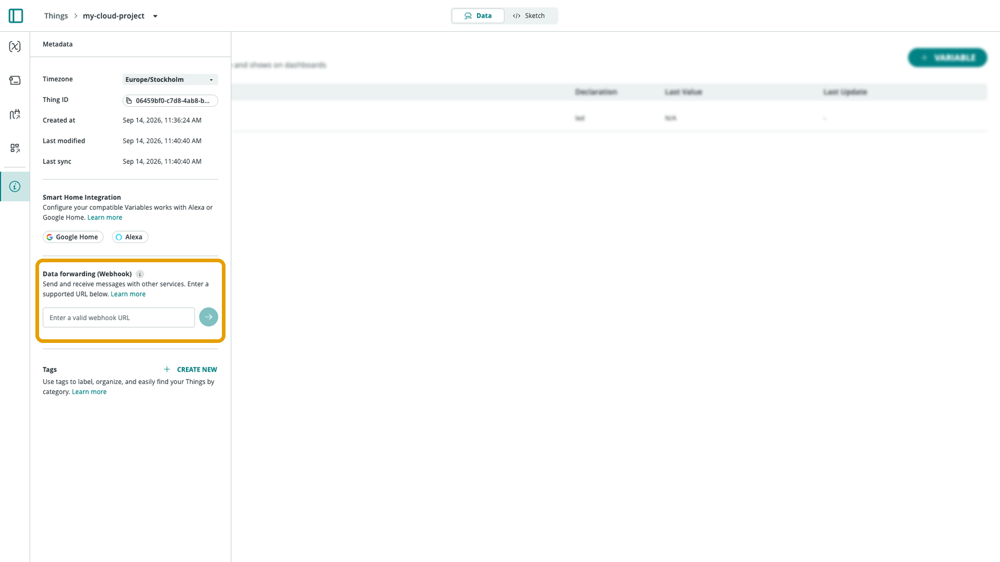

A **webhook** sends an HTTP request to a URL you specify whenever something happens in Arduino Cloud, letting you connect a project to external systems — automation platforms, your own backend, a chat notification — without polling the API for changes.

## Two Kinds of Webhook

There are two distinct places webhooks appear in Arduino Cloud; they serve different purposes and shouldn't be confused:

| Where | Fires on | Configured at |
|---|---|---|
| **Thing-level data forwarding** | Every update of *any* variable on that Thing | The Thing's [Metadata panel](/arduino-cloud/things-data/things) → "Data forwarding (Webhook)" |
| **Trigger action** | Only when a specific condition is met | A [Trigger](/arduino-cloud/automations/triggers-and-alerts)'s action (paid plan) |

Use Thing-level forwarding for "log everything this Thing does somewhere else"; use a [Trigger](/arduino-cloud/automations/triggers-and-alerts) when only specific conditions should fire the webhook.

## Thing-Level Data Forwarding

Enter a target URL in the Thing's Metadata panel, under **Data Forwarding (Webhook)**:



Every update to any variable on that Thing is then POSTed to that URL as JSON:

```json
{
  "event_id": "EVENT_UUID",
  "webhook_id": "WEBHOOK_ID",
  "device_id": "DEVICE_UUID",
  "thing_id": "THING_UUID",
  "values": [
    {
      "id": "VARIABLE_01_ID",
      "name": "NAME_OF_VARIABLE_01",
      "value": "VARIABLE_01_VALUE",
      "persist": true,
      "updated_at": "DATE",
      "created_by": "USERID"
    }
  ]
}
```

`values` contains one entry per variable that changed in that update — a consumer can key off `name` to route each variable's value differently. A [Messenger widget](/arduino-cloud/dashboards/add-link-widgets) bound to a String variable is a handy way to generate webhook events on demand:


## Trigger Webhooks

A [Trigger](/arduino-cloud/automations/triggers-and-alerts)'s action can also be a webhook, firing only when the Trigger's condition matches rather than on every update. That filtering is the main advantage over Thing-level forwarding, at the cost of requiring a paid plan.

## Connecting to External Platforms

The same webhook URL works with any platform that accepts an incoming HTTP request — IFTTT, Zapier, Google Apps Script, or a custom endpoint. For step-by-step setup against specific platforms (IFTTT, Zapier, Google Sheets), see [IFTTT, Zapier & Webhooks](/arduino-cloud/integrations/ifttt-zapier-webhooks).

## Next Steps

- [IFTTT, Zapier & Webhooks](/arduino-cloud/integrations/ifttt-zapier-webhooks)
- [Triggers & Alerts](/arduino-cloud/automations/triggers-and-alerts)
- [Things](/arduino-cloud/things-data/things)
