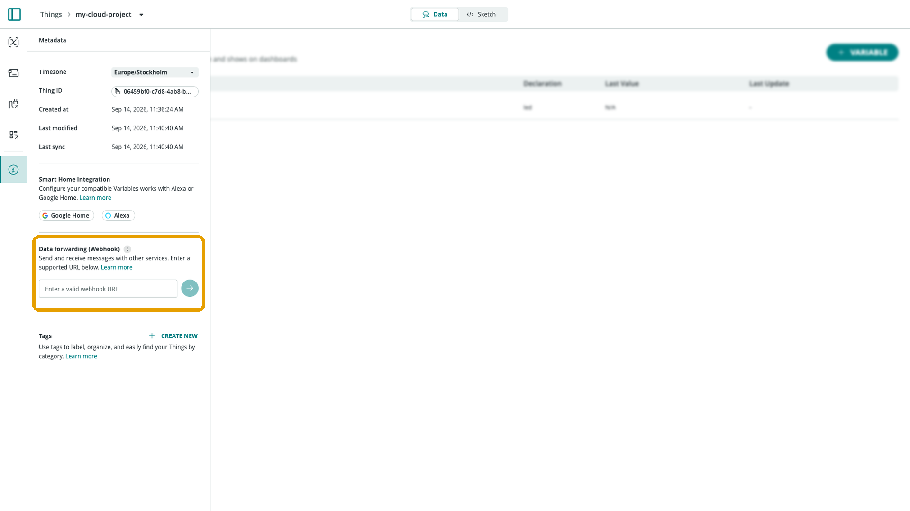
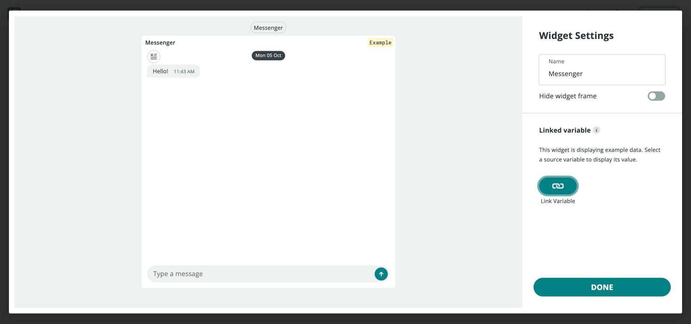

A **webhook** sends an HTTP request to a URL you specify whenever a variable on a Thing is updated, letting you connect a project to external systems — automation platforms, your own backend, a chat notification — without polling the API for changes.

Webhooks are configured per Thing, in the Thing's [Metadata panel](/arduino-cloud/things-data/things) under **Data forwarding (Webhook)**. To be notified only when a specific Boolean or String condition is met, use a [Trigger](/arduino-cloud/automations/triggers-and-alerts) instead, which sends an email or push notification.

## Thing-Level Data Forwarding

Enter a target URL in the Thing's Metadata panel, under **Data Forwarding (Webhook)**:



Every update to any variable on that Thing is then POSTed to that URL as JSON:

```json
{
  "event_id": "EVENT_UUID",
  "webhook_id": "WEBHOOK_ID",
  "device_id": "DEVICE_UUID",
  "thing_id": "THING_UUID",
  "values": [
    {
      "id": "VARIABLE_01_ID",
      "name": "NAME_OF_VARIABLE_01",
      "value": "VARIABLE_01_VALUE",
      "persist": true,
      "updated_at": "DATE",
      "created_by": "USERID"
    }
  ]
}
```

Arduino Cloud shares five sets of values through the webhook: `event_id`, `webhook_id`, `device_id`, `thing_id`, and `values`. `values` is an array of objects, each representing a variable in your Thing — a consumer can key off `name` to route each variable's value differently. A [Messenger widget](/arduino-cloud/dashboards/add-link-widgets) bound to a String variable is a handy way to generate webhook events on demand:



## Connecting to External Platforms

The same webhook URL works with any platform that accepts an incoming HTTP request — IFTTT, Zapier, Google Apps Script, or a custom endpoint. For step-by-step setup against specific platforms (IFTTT, Zapier, Google Sheets), see [IFTTT, Zapier & Webhooks](/arduino-cloud/integrations/ifttt-zapier-webhooks).

## Next Steps

- [IFTTT, Zapier & Webhooks](/arduino-cloud/integrations/ifttt-zapier-webhooks)
- [Triggers & Alerts](/arduino-cloud/automations/triggers-and-alerts)
- [Things](/arduino-cloud/things-data/things)
