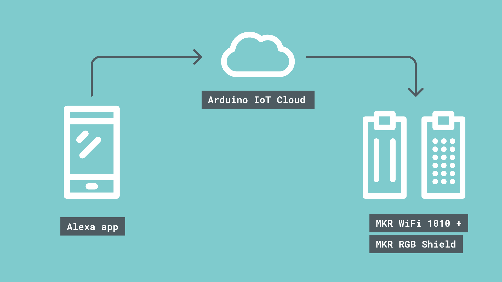
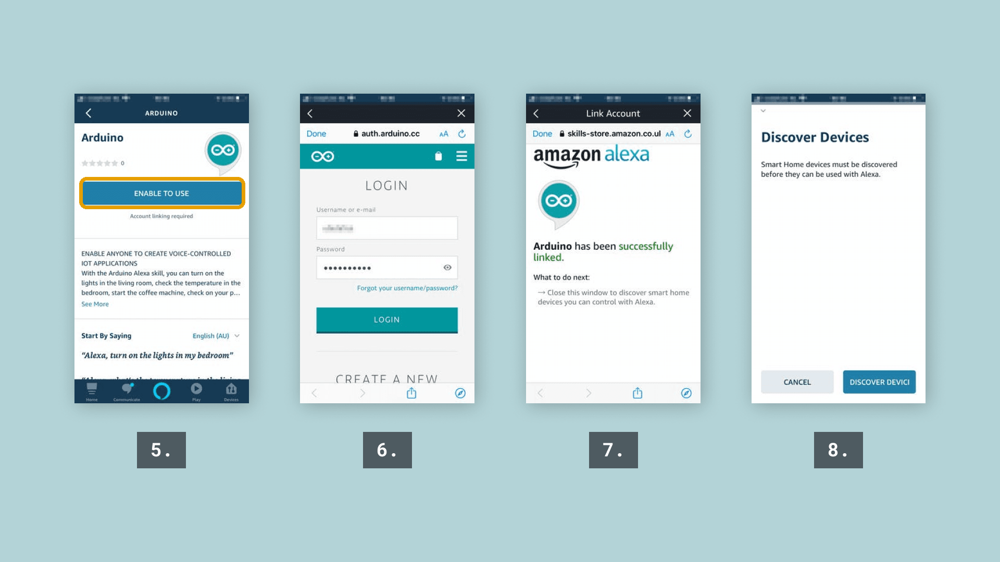
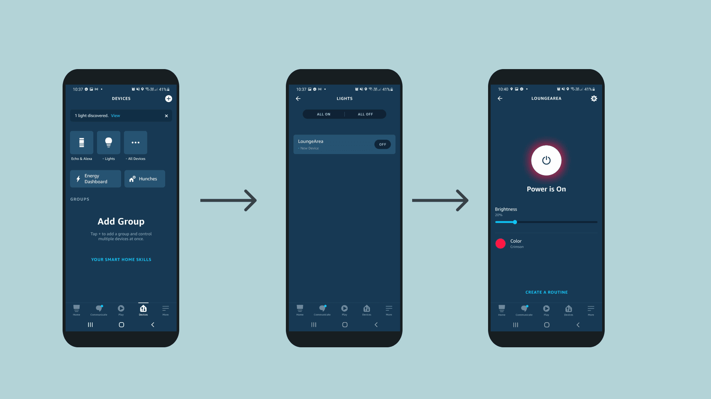

Arduino Cloud integrates with Amazon Alexa through the official **Arduino** Alexa skill, exposing compatible Cloud Variables as smart home devices that can be controlled by voice or from the Alexa app — for example, changing the color of an RGB matrix connected to an Arduino board just by asking Alexa.



## Enabling a Variable for Alexa

Open a Thing's [Metadata panel](/arduino-cloud/things-data/things) (info icon in the left rail) and toggle **Alexa** under "Smart Home Integration." Only variables of a smart-home-compatible type are exposed — a **Colored Light** variable, for instance, works well for a voice/app-controllable lamp or RGB matrix.

## Reacting to Alexa in a Sketch

Alexa writes directly to the linked Cloud Variable, so the sketch only needs an `on...Change()` callback that reads the new color and drives the hardware. For a `CloudColoredLight` variable named `loungeArea`, feeding an MKR RGB Shield:

```arduino
#include <ArduinoGraphics.h>
#include <Arduino_MKRRGB.h>
#include "thingProperties.h"

void setup() {
  Serial.begin(9600);
  delay(1500);

  MATRIX.begin();
  MATRIX.brightness(10);

  initProperties();
  ArduinoCloud.begin(ArduinoIoTPreferredConnection);
  setDebugMessageLevel(2);
  ArduinoCloud.printDebugInfo();
}

void loop() {
  ArduinoCloud.update();
}

void onLoungeAreaChange() {
  uint8_t r, g, b;
  loungeArea.getValue().getRGB(r, g, b);

  MATRIX.beginDraw();
  MATRIX.clear();
  MATRIX.noStroke();
  if (loungeArea.getSwitch()) {
    MATRIX.fill(r, g, b);
  } else {
    MATRIX.fill(0, 0, 0);
  }
  MATRIX.rect(0, 0, MATRIX.width(), MATRIX.height());
  MATRIX.endDraw();
}
```

`getSwitch()` reflects the on/off state Alexa also controls independently of color — a light can be "off" while retaining its last color value.

## Pairing the Alexa App

In the Alexa app: **Devices → Enable Smart Home Skills**, search for and enable the **Arduino** skill, then log in with your Arduino account to link it. Discovering devices afterward should surface every Alexa-enabled Cloud Variable as a controllable light:



Once discovered, a variable like `loungeArea` appears under the Alexa app's **Devices → Lights**, with the usual color/brightness controls Alexa provides for any smart light:



<Alert type="info">

If voice commands don't seem to reach the board, check the Serial Monitor first — the example sketch above prints the R/G/B values it receives, so seeing (or not seeing) that output quickly tells you whether the problem is on the Alexa/Cloud side or the board's own connection.

</Alert>

## Next Steps

- [Google Home](/arduino-cloud/integrations/google-home)
- [Things & Data](/arduino-cloud/things-data/things)
