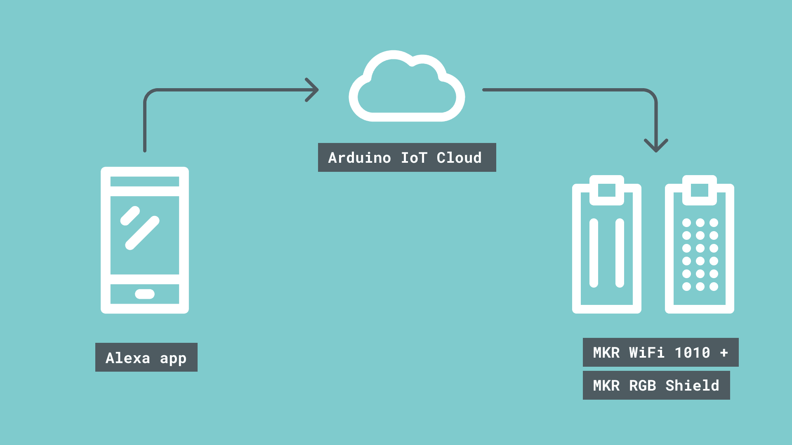
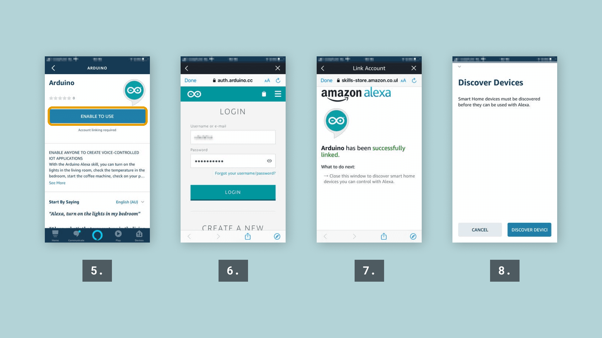
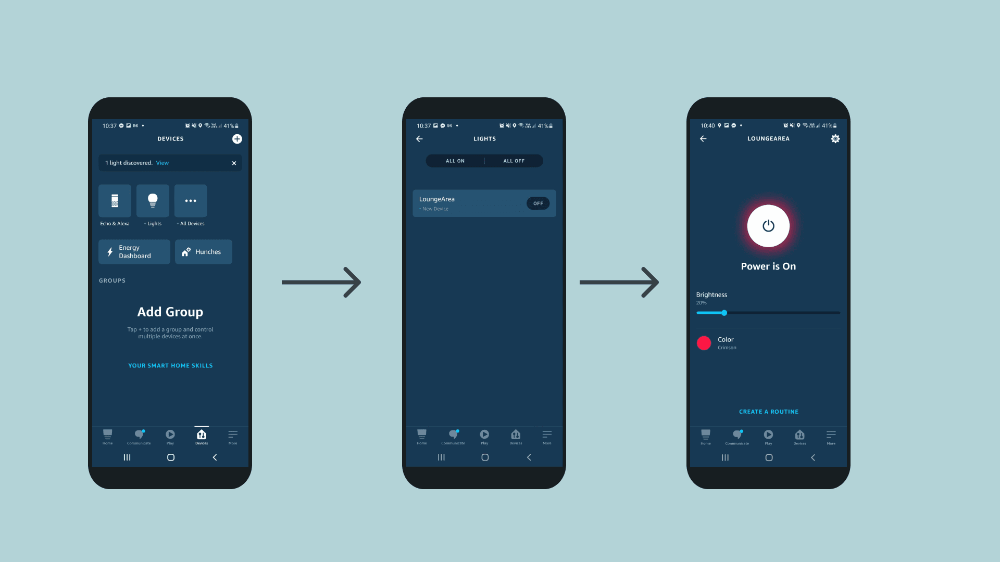

Arduino Cloud integrates with Amazon Alexa through the official **Arduino** Alexa skill, exposing compatible Cloud Variables as smart home devices that can be controlled by voice or from the Alexa app — for example, changing the color of an RGB matrix connected to an Arduino board just by asking Alexa.



This example focuses on the [MKR RGB Shield](https://store.arduino.cc/products/arduino-mkr-rgb-shield), but can be adapted to any other RGB pixels or matrices. All variable types that can be synchronized between Arduino Cloud and Alexa are listed in [Cloud Variables](/arduino-cloud/things-data/cloud-variables).

## Requirements

- An [Arduino Cloud](https://app.arduino.cc/) account.
- The [Arduino Alexa skill](https://www.amazon.com/Arduino-LLC/dp/B07ZT2PK2H) and the Amazon Alexa app ([App Store](https://apps.apple.com/us/app/amazon-alexa/id944011620), [Google Play](https://play.google.com/store/apps/details?id=com.amazon.dee.app&hl=en)).
- An [Arduino MKR WiFi 1010](https://store.arduino.cc/mkr-wifi-1010) with an [MKR RGB Shield](https://store.arduino.cc/arduino-mkr-rgb-shield) mounted on top. Any supported Wi-Fi® board and RGB matrix works, but the sketch below targets this combination.

## Cloud Setup

1. In [Arduino Cloud](https://app.arduino.cc/), create a Thing and attach your device. See [Arduino C++ Library](/arduino-cloud/device-libraries/arduino-cpp) if you are new to this.
2. Add a variable named `LoungeArea` of type **Colored Light**. In the sketch, it is available as `loungeArea`.
3. Open the Thing's [Metadata panel](/arduino-cloud/things-data/things) (info icon in the left rail) and toggle **Alexa** under "Smart Home Integration." Only smart-home-compatible variable types are exposed.

## Reacting to Alexa in a Sketch

Alexa writes directly to the linked Cloud Variable, so the sketch only needs the `onLoungeAreaChange()` callback to read the new color and drive the hardware. The `ArduinoGraphics` and `Arduino_MKRRGB` libraries control the MKR RGB Shield; adjust these lines for other matrices. Add `MATRIX.begin();` and `MATRIX.brightness(10);` to `setup()` in the generated sketch:

```arduino
#include <ArduinoGraphics.h>
#include <Arduino_MKRRGB.h>
#include "thingProperties.h"

void onLoungeAreaChange() {
  uint8_t r, g, b;
  loungeArea.getValue().getRGB(r, g, b);

  MATRIX.beginDraw();
  MATRIX.clear();
  MATRIX.noStroke();
  if (loungeArea.getSwitch()) {
    Serial.println("R:" + String(r) + " G:" + String(g) + " B:" + String(b));
    MATRIX.fill(r, g, b);
  } else {
    Serial.println("Lamp Off");
    MATRIX.fill(0, 0, 0);
  }
  MATRIX.rect(0, 0, MATRIX.width(), MATRIX.height());
  MATRIX.endDraw();
}
```

`getSwitch()` reflects the on/off state Alexa controls independently of color, so a light can be "off" while retaining its last color value. Upload the sketch and use the Serial Monitor to confirm the board connects to Arduino Cloud.

## Pairing the Alexa App

1. In the Alexa app, tap **Devices > Enable Smart Home Skills**.
2. Search for **Arduino** and enable the skill with that exact name.

    

3. Log in with your Arduino account to link Alexa and Arduino Cloud.
4. Discover devices. Every Alexa-enabled Cloud Variable appears as a light; when "1 light found and connected" shows, tap **Set Up Device** (adding it to a group is optional).
5. Open **Devices > Lights** and select `loungeArea` to change its color and brightness, or ask Alexa by voice. The changes are sent to the board, which updates the MKR RGB Shield.



<Alert type="info">

If voice commands don't seem to reach the board, check the Serial Monitor first — the example sketch above prints the R/G/B values it receives, so seeing (or not seeing) that output quickly tells you whether the problem is on the Alexa/Cloud side or the board's own connection.

</Alert>

## Next Steps

- [Google Home](/arduino-cloud/integrations/google-home)
- [Things & Data](/arduino-cloud/things-data/things)
