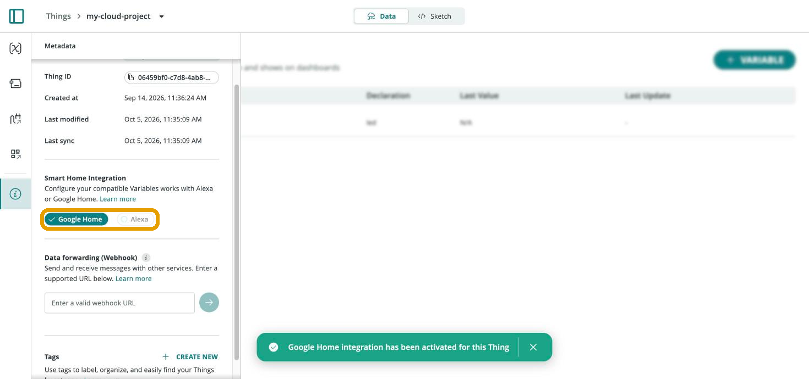
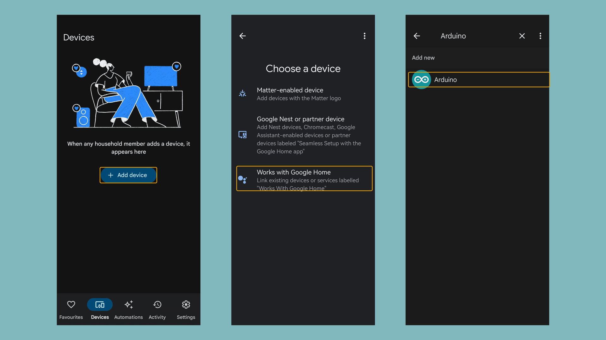

Arduino Cloud integrates with Google Home, exposing compatible Cloud Variables as smart home devices controllable through Google Assistant voice commands, the Google Home app, or Google Home routines.

## Enabling a Variable for Google Home

Open a Thing's [Metadata panel](/arduino-cloud/things-data/things) (info icon in the left rail) and toggle **Google Home** under "Smart Home Integration." Only variables of a smart-home-compatible type are exposed — for a simple on/off device, a variable under **Smart Home → Switch** (`CloudSwitch`) works well:



<Alert type="info">

Most Cloud Variable types compatible with smart home platforms work with both Alexa and Google Home — the type picker shows a small icon next to each type indicating which platform(s) it supports.

</Alert>

## Reacting to Google Home in a Sketch

Google Home writes directly to the linked Cloud Variable — the sketch just needs to reflect that value onto real hardware. For a `CloudSwitch` variable named `led`, driving the board's built-in LED:

```arduino
#include "thingProperties.h"

void setup() {
  Serial.begin(9600);
  delay(1500);

  initProperties();
  ArduinoCloud.begin(ArduinoIoTPreferredConnection);
  setDebugMessageLevel(2);
  ArduinoCloud.printDebugInfo();
}

void loop() {
  ArduinoCloud.update();
  digitalWrite(LED_BUILTIN, led);
}

// Called whenever Google Home (or anything else) changes "led"
void onLedChange() {
}
```

## Pairing the Google Home App

In the Google Home app: **Devices → Add Device → Works with Google Home**, then find and select the **Arduino** integration:



Link your Arduino account if prompted, then add each Google-Home-enabled Cloud Variable as its own device, assigning it to a room. From that point on, it responds to voice commands ("Hey Google, turn on ...") the same way any other Google Home smart device does.

## Next Steps

- [Amazon Alexa](/arduino-cloud/integrations/amazon-alexa)
- [Things & Data](/arduino-cloud/things-data/things)
