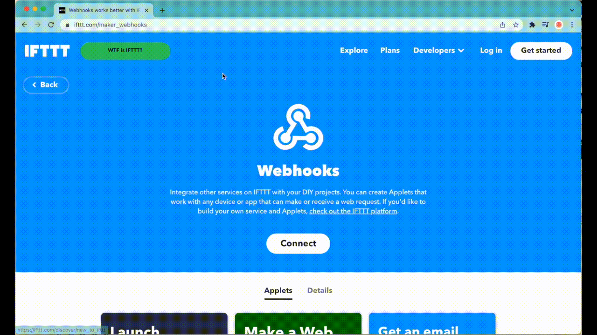
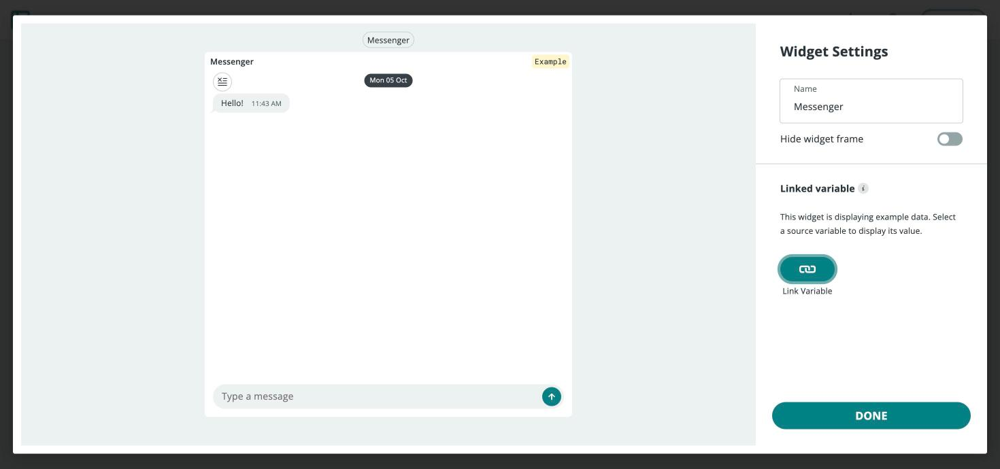

Any automation platform that accepts an incoming HTTP request can receive
Arduino Cloud data through a [webhook](/arduino-cloud/automations/webhooks).
This page covers connecting specific platforms — IFTTT, Zapier, and Google
services — to turn Cloud Variable updates into actions like appending a
spreadsheet row or sending a notification, without writing any backend code.

<Alert type="info">

This page assumes you have webhook forwarding set up on a Thing. See
[Webhooks](/arduino-cloud/automations/webhooks) for how data forwarding and
Trigger webhooks work and what the JSON payload looks like.

</Alert>

## How It Fits Together

Each platform exposes an **incoming webhook URL**. You paste that URL into the
Thing's **Data Forwarding (Webhook)** field (or a Trigger's webhook action),
and from then on every matching update is POSTed to the platform, which maps
the payload onto an action.

| Platform | Incoming URL comes from | Typical action |
|---|---|---|
| **IFTTT** | Webhooks service → Documentation | Google Sheets row, notification, smart-home action |
| **Zapier** | A "Webhooks by Zapier" → Catch Hook trigger | Any of Zapier's thousands of app actions |
| **Google Apps Script** | A deployed Web App URL | Custom script processing the JSON directly |

## Example: Logging Messages to Google Sheets via IFTTT

[IFTTT](https://maker.ifttt.com) can connect an Arduino Cloud webhook to a
**Google Sheets** action, turning Cloud Variable updates into spreadsheet rows.
An IFTTT Applet pairs a **Webhooks** trigger ("Receive a web request", named
e.g. `message`) with a **Google Sheets** action ("Add row to spreadsheet"):

IFTTT then exposes a webhook URL (under **My Services → Webhooks →
Documentation**) to paste into the Thing's Data Forwarding field. From that
point on, any Cloud Variable update on that Thing appends a row to the linked
spreadsheet — pairing this with a
[Messenger widget](/arduino-cloud/dashboards/add-link-widgets) turns every
message sent from a dashboard into a logged, timestamped row:

## Zapier and Google Services

The same pattern works with [Zapier](https://zapier.com/): create a
**Webhooks by Zapier → Catch Hook** trigger, copy the generated URL into the
Thing's forwarding field, and wire the "Zap" to any of Zapier's supported app
actions. For fully custom processing,
[Google Apps Script](https://developers.google.com/apps-script) can receive
the same JSON payload at a deployed Web App URL and act on it directly.

## Next Steps

- [Webhooks](/arduino-cloud/automations/webhooks)
- [Triggers & Alerts](/arduino-cloud/automations/triggers-and-alerts)
- [Node-RED](/arduino-cloud/integrations/node-red)
