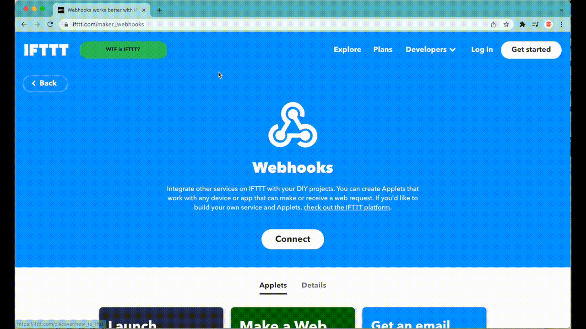
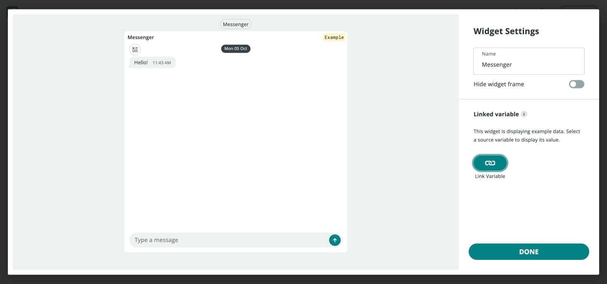

Any automation platform that accepts an incoming HTTP request can receive Arduino Cloud data through a [webhook](/arduino-cloud/automations/webhooks). This page covers connecting specific platforms — IFTTT, Zapier, and Google services — to turn Cloud Variable updates into actions like appending a spreadsheet row or sending a notification, without writing any backend code.

<Alert type="info">

This page assumes you have webhook forwarding set up on a Thing. See [Webhooks](/arduino-cloud/automations/webhooks) for how data forwarding works and what the JSON payload looks like.

</Alert>

## How It Fits Together

Each platform exposes an **incoming webhook URL**. You paste that URL into the Thing's **Data Forwarding (Webhook)** field, and from then on every matching update is POSTed to the platform, which maps the payload onto an action.

| Platform | Incoming URL comes from | Typical action |
|---|---|---|
| **IFTTT** | Webhooks service → Documentation | Google Sheets row, notification, smart-home action |
| **Zapier** | A "Webhooks by Zapier" → Catch Hook trigger | Any of Zapier's thousands of app actions |
| **Google Apps Script** | A deployed Web App URL | Custom script processing the JSON directly |

## Example: Logging Messages to Google Sheets via IFTTT

[IFTTT](https://maker.ifttt.com) can connect an Arduino Cloud webhook to a **Google Sheets** action, turning Cloud Variable updates into spreadsheet rows. In this example, String values sent from a **Messenger** widget are saved into a Google Sheet.

### Requirements

- An [Arduino Cloud](https://app.arduino.cc/) account and a [Cloud-compatible board](/arduino-cloud/reference/supported-boards-capabilities).
- [Arduino Create Agent](https://github.com/arduino/arduino-create-agent).
- An [IFTTT](https://maker.ifttt.com) account and a Google account.

### Steps

1. In IFTTT, click **Create** > **If This**, select **Webhooks** > **Receive a web request**, set the **Event Name** to `message`, and click **Create trigger**.
2. Click **Then That**, select **Google Sheets** > **Add row to spreadsheet**, keep the defaults, and click **Create action**, then **Continue** and **Finish**.

    

3. Copy the webhook URL from **profile picture > My Services > Webhooks > Documentation**.
4. In Arduino Cloud, create a Thing with a `message` variable of type **Character String**, and attach and configure your device.
5. Under **Data Forwarding (Webhook)**, click **Configure** and paste the IFTTT URL. Upload the generated sketch from the **Sketch** tab.
6. On a dashboard, add a [Messenger widget](/arduino-cloud/dashboards/add-link-widgets) and link it to the `message` variable.

    

7. Send a few messages from the widget. Each update is forwarded to IFTTT, which adds a timestamped row to the **IFTTT_Maker_Webhooks_Events** file in [Google Sheets](https://docs.google.com/spreadsheets).

Any Cloud Variable update on the Thing is forwarded, not just `message`. For the payload format, see [Webhooks](/arduino-cloud/automations/webhooks).

## Zapier and Google Services

The same pattern works with [Zapier](https://zapier.com/), which also offers a visual builder with real-time data preview: create a **Webhooks by Zapier > Catch Hook** trigger, copy the generated URL into the Thing's forwarding field, and connect the "Zap" to any of Zapier's supported app actions.

Google services can also receive webhook data:

- [**Google Cloud APIs**](https://cloud.google.com/apis/docs/overview): communicate with services such as Gmail, Translate, or Google Maps.
- [**Google Apps Script**](https://developers.google.com/apps-script): receive the JSON payload at a deployed Web App URL and act on Google Workspace files such as Sheets and Docs.

## Next Steps

- [Webhooks](/arduino-cloud/automations/webhooks)
- [Triggers & Alerts](/arduino-cloud/automations/triggers-and-alerts)
- [Node-RED](/arduino-cloud/integrations/node-red)
