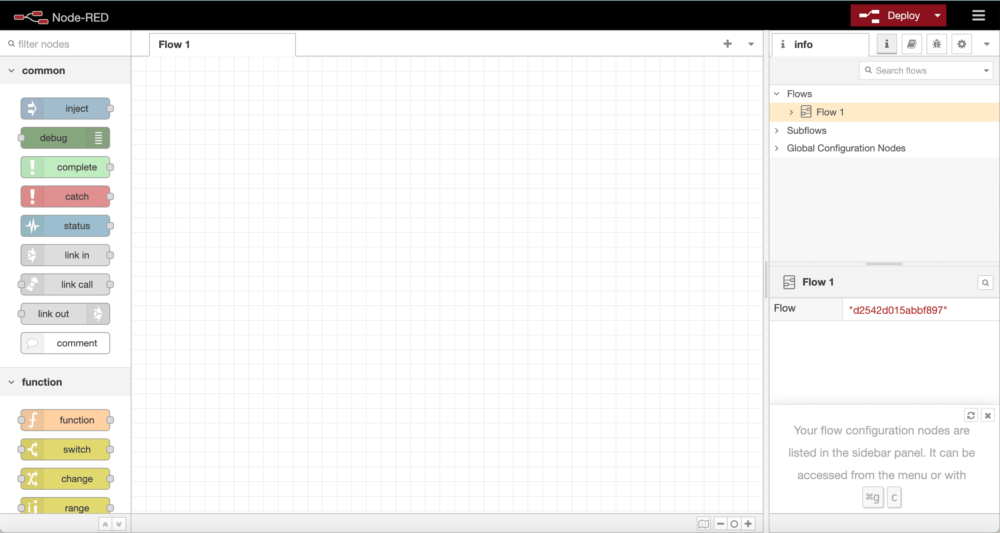
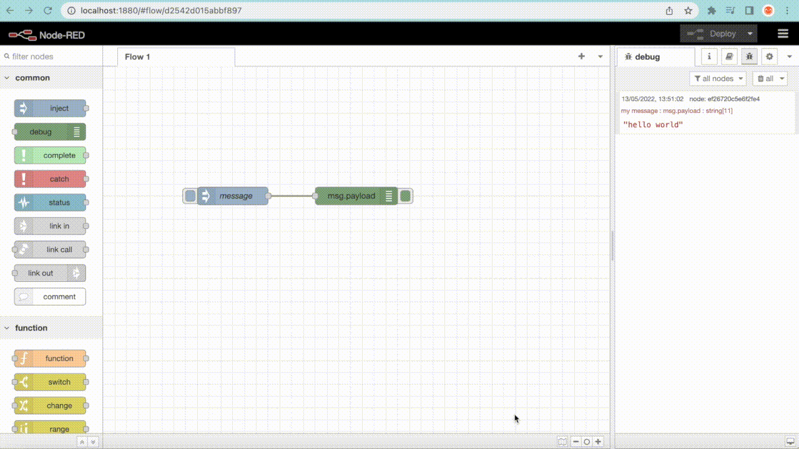
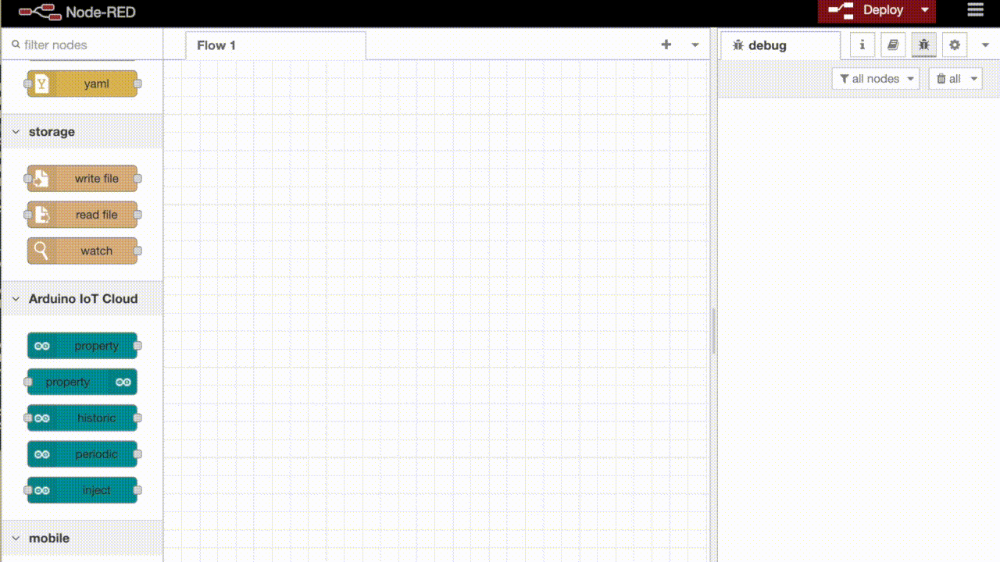

[Node-RED](https://nodered.org/) is a browser-based visual flow editor for wiring together hardware, APIs, and online services by connecting nodes on a canvas. Pairing it with Arduino Cloud lets a flow read and react to Cloud Variables — bridging a Thing's data to email/SMS notifications, home automation platforms, or custom JavaScript logic — without writing a standalone client application.

<Alert type="note">

Node-RED integration requires a paid Arduino Cloud plan.

</Alert>

## Requirements

- An [Arduino Cloud](https://app.arduino.cc/) account and a [Cloud-compatible board](/arduino-cloud/reference/supported-boards-capabilities).
- [Arduino Create Agent](https://github.com/arduino/arduino-create-agent).
- [Node.js](https://nodejs.org/en/) (check with `node --version`) and [Node-RED](https://nodered.org/).

## The Node-RED Editor

Node-RED runs locally. Install and start it from a terminal (omit `sudo` on Windows), then open `http://localhost:1880`. See the [Node-RED installation page](https://nodered.org/docs/getting-started/local) for details.

```shell
sudo npm install -g --unsafe-perm node-red
node-red
```

The editor has a header with the **Deploy** button and main menu, a **palette** of nodes on the left, the **workspace** in the middle where flows are wired together, and a **sidebar** on the right for node configuration and debugging.



To try a first flow:

1. Drag an **inject** node into the workspace, double-click it, set `msg.payload` to **string**, enter a message, and click **Done**.
2. Drag a **debug** node into the workspace and wire the inject node to it.
3. Open the debug tab in the sidebar, click **Deploy**, then click the inject node's button. The message is printed in the sidebar console.

## Installing the Arduino Cloud Nodes

The default palette doesn't include Arduino Cloud support. Open the menu > **Manage palette** > **Install** tab, search for **Arduino**, and install `@arduino/node-red-contrib-arduino-iot-cloud`:



<Alert type="info">

Search the palette manager (or npm) for the current package name/version before installing — Node-RED community packages are maintained outside Arduino Cloud's own release cycle.

</Alert>

This adds five Arduino Cloud nodes to the palette: **property in**, **property out**, **historic**, **periodic**, and **inject**. Hover over a node to see its description.

## Connecting a Flow to a Thing

A **property out** node reads a Cloud Variable's value into a flow:

1. Create an API key in [API Keys](https://app.arduino.cc/api-keys) and store the Client ID and Client Secret safely. See [REST API & SDKs](/arduino-cloud/apis-cli/rest-api-sdks).
2. Add a **property out** node, double-click it, and select **Add new Arduino-connection**.
3. Click the pen icon, enter the Client ID and Client Secret, and click **Add**.
4. Select the Thing and variable to read, for example a `humidity` variable.

    

5. Wire an **inject** node into the **property out** node and a **debug** node to its output, then click **Deploy**. The variable's live values are printed in the console.

This is the basic pattern every more complex flow builds on.

## Processing Values With a Function Node

A **function** node runs custom JavaScript against each message passing through the flow, which is useful for turning a raw stream of values into discrete events. Add this code in the node's **On Message** tab to only forward a value the first time it crosses above 60 (and again when it drops back below):

```js
let data = msg.payload;
let trigger = context.get("status");

if (typeof trigger == "undefined") trigger = false;

if (data > 60 && !trigger) {
  trigger = true;
  context.set("status", trigger);
  return msg;
}

if (data < 60 && trigger) {
  trigger = false;
  context.set("status", trigger);
  return msg;
}
```

Wired between the **property out** node and a debug/email/notification node, this turns a continuous reading into threshold-crossing alerts instead of a constant stream.

## Example: Email Alerts From a Sensor Reading

To email the filtered values, install `node-red-node-email` via **Manage palette** and replace the debug node with an **email** node configured with the recipient and sender details. For a complete walkthrough, see [Send Email Alerts With Node-RED](/arduino-cloud/application-notes/send-email-node-red).

## Next Steps

- [Send Email Alerts With Node-RED](/arduino-cloud/application-notes/send-email-node-red)
- [IFTTT, Zapier & Webhooks](/arduino-cloud/integrations/ifttt-zapier-webhooks)
- [APIs & CLI](/arduino-cloud/apis-cli/developer-overview)
