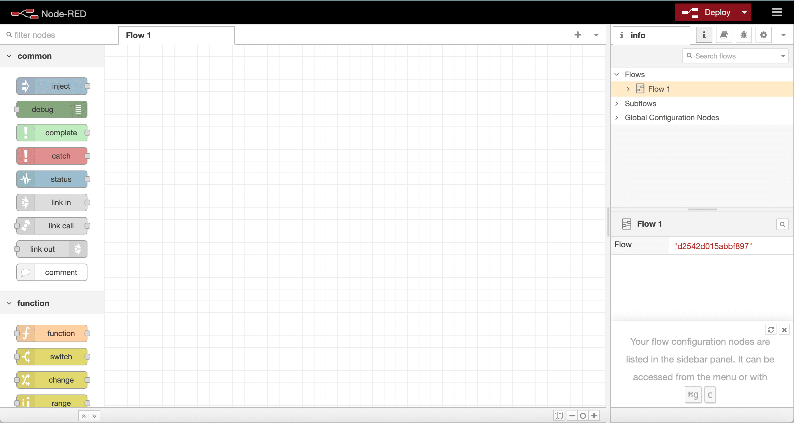
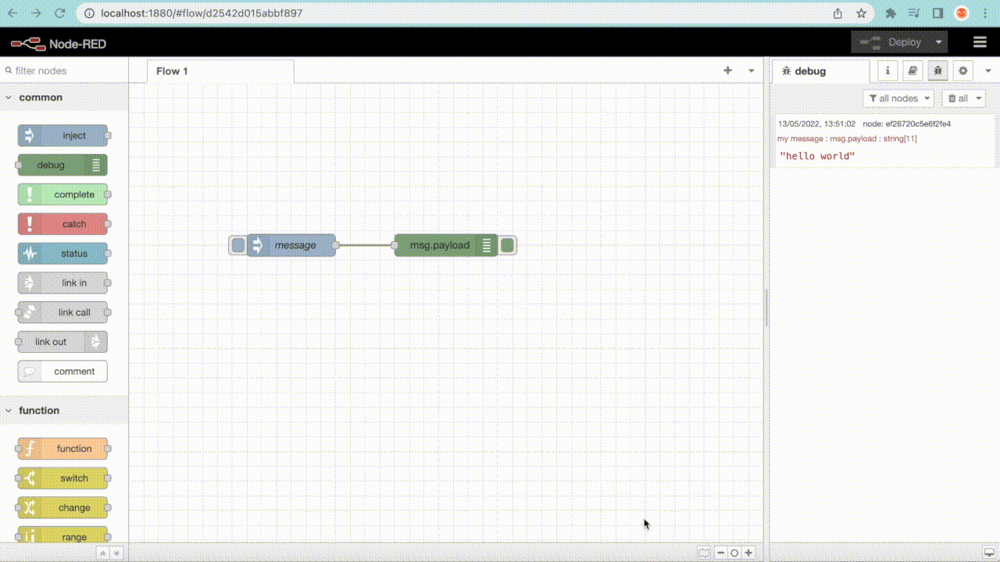
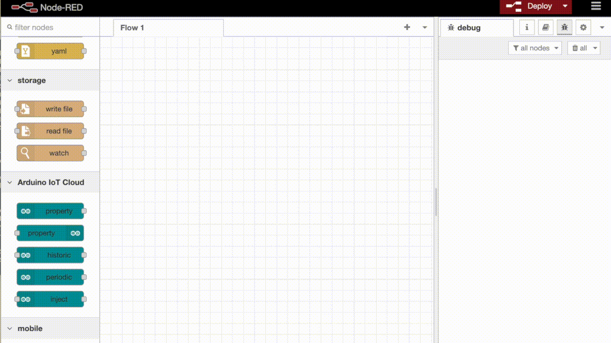

[Node-RED](https://nodered.org/) is a browser-based visual flow editor for
wiring together hardware, APIs, and online services by connecting nodes on a
canvas. Pairing it with Arduino Cloud lets a flow read and react to Cloud
Variables — bridging a Thing's data to email/SMS notifications, home
automation platforms, or custom JavaScript logic — without writing a
standalone client application.

<Alert type="note">

Node-RED integration requires a paid Arduino Cloud plan.

</Alert>

## The Node-RED Editor

Node-RED runs locally (`npm install -g --unsafe-perm node-red`, then `node-red`
to start it, opening at `http://localhost:1880`). Its editor has a header with
the **Deploy** button, a **palette** of nodes on the left, the **workspace** in
the middle where flows are wired together, and a **sidebar** on the right for
node configuration and debugging.



A flow is built by dragging nodes from the palette into the workspace and
wiring them together — an `inject` node (to trigger a message) connected to a
`debug` node (to print it to the sidebar console) is the simplest possible
flow.

## Installing the Arduino Cloud Nodes

The palette's default nodes don't include Arduino Cloud support — install it
via the palette manager (menu → **Manage palette** → **Install** tab),
searching for **Arduino** and installing
`@arduino/node-red-contrib-arduino-iot-cloud`:



<Alert type="info">

Search the palette manager (or npm) for the current package name/version
before installing — Node-RED community packages are maintained outside Arduino
Cloud's own release cycle.

</Alert>

This adds five Arduino Cloud nodes to the palette: **property in**, **property
out**, **historic**, **periodic**, and **inject**.

## Connecting a Flow to a Thing

A **property out** node reads a Cloud Variable's value into a flow. Its
configuration needs an Arduino connection, authenticated with a Client
ID/Secret from [API Keys](/arduino-cloud/apis-cli/rest-api-sdks), and then a
specific Thing + variable to read from:



Once connected, an `inject` node wired into the **property out** node, with a
`debug` node on its output, prints the Cloud Variable's live value into the
Node-RED console — the basic pattern every more complex flow builds on.

## Processing Values With a Function Node

A **function** node runs custom JavaScript against each message passing through
the flow — useful for turning a raw stream of values into discrete events. For
example, to only forward a value the first time it crosses above 60 (and again
when it drops back below):

```js
let data = msg.payload;
let trigger = context.get("status");

if (typeof trigger == "undefined") trigger = false;

if (data > 60 && !trigger) {
  trigger = true;
  context.set("status", trigger);
  return msg;
}

if (data < 60 && trigger) {
  trigger = false;
  context.set("status", trigger);
  return msg;
}
```

Wired between the **property out** node and a debug/email/notification node,
this turns a continuous reading into threshold-crossing alerts instead of a
constant stream.

## Example: Email Alerts From a Sensor Reading

For a complete walkthrough — a Thing exposing a humidity variable, a **property
out** node pulling it into Node-RED, a function node filtering it to
threshold-crossing events, and an email node sending a notification — see
[Send Email Alerts With Node-RED](/arduino-cloud/tutorials-projects/send-email-node-red).

## Next Steps

- [Send Email Alerts With Node-RED](/arduino-cloud/tutorials-projects/send-email-node-red)
- [IFTTT, Zapier & Webhooks](/arduino-cloud/integrations/ifttt-zapier-webhooks)
- [APIs & CLI](/arduino-cloud/apis-cli/developer-overview)
