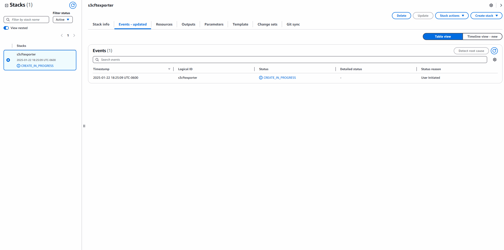
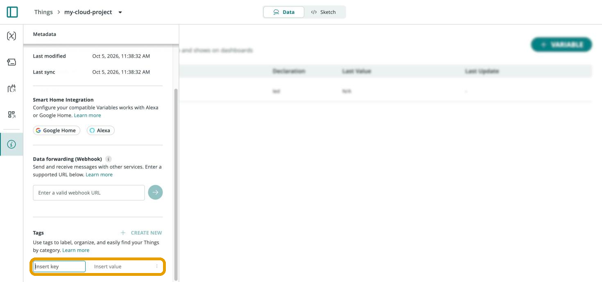
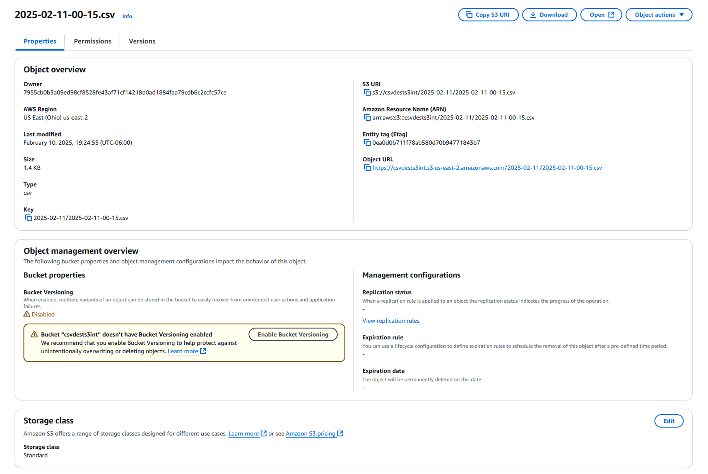
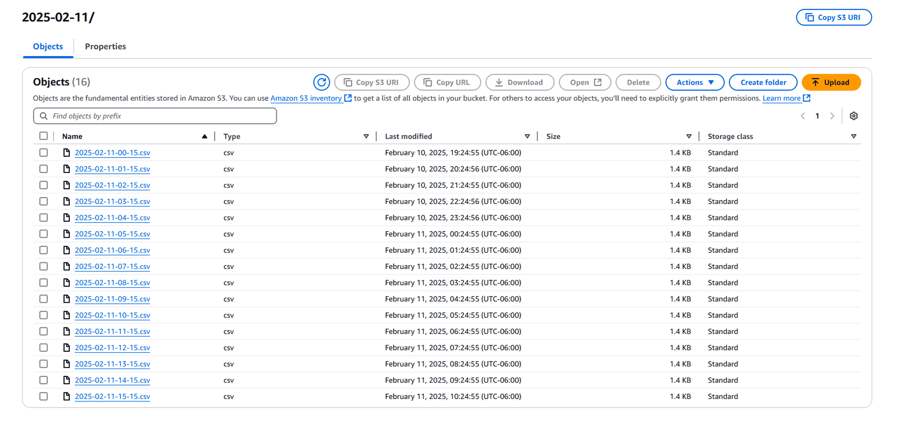

The **Arduino AWS S3 CSV Exporter** extracts time-series data from Arduino
Cloud and publishes it as CSV files to an AWS S3 bucket. A scheduled AWS Lambda
function runs the extraction at a configurable interval, so historical data
from your Things ends up in your own data store for warehousing and offline
analysis.



By default the stack extracts data every hour, aggregates samples at a
five-minute resolution, and stores structured CSV files in S3. Extraction can
be filtered by tags to include only specific Things.

<Alert type="note">

This integration requires an AWS account with permission to deploy Lambda,
S3, IAM, EventBridge, and SSM resources, plus an Arduino Cloud
[API key and secret](/arduino-cloud/apis-cli/rest-api-sdks). The exporter and its
CloudFormation template are maintained in the
[arduino/aws-s3-integration](https://github.com/arduino/aws-s3-integration)
repository.

</Alert>

## How It Works

A Lambda function written in Go runs on an **AWS EventBridge** schedule. Each
run retrieves data from the selected Arduino Things, aggregates it (numeric
values are averaged over the aggregation period; non-numeric values are
sampled), generates a CSV file, and uploads it to the destination S3 bucket.
Time-series data is exported in UTC, and all Things in the account are included
unless filtered by tags.

## Deployment Outline

Setup is driven by a CloudFormation template from the project's
[releases](https://github.com/arduino/aws-s3-integration/releases):

1. Create two S3 buckets — a **temporary bucket** for the Lambda binaries and
   template, and a **CSV destination bucket** (in the region you'll deploy to).
2. Upload the Lambda `.zip` and CloudFormation `.yaml` to the temporary bucket.
3. In **CloudFormation → Create stack**, point at the template's S3 URL and
   fill in the required parameters: Arduino API key, API secret, the code
   bucket, and the CSV destination bucket.
4. Optionally set tag filters, a Space ID, and resolution/scheduling settings.
5. Create the stack and wait for `CREATE_COMPLETE`.

### Required IAM Permissions

CloudFormation needs these managed policies to provision the stack:

| Resource | IAM Policy |
|---|---|
| CloudFormation stack creation | `AWSCloudFormationFullAccess` |
| S3 bucket management | `AmazonS3FullAccess` |
| IAM role creation | `IAMFullAccess` |
| Lambda deployment | `AWSLambda_FullAccess` |
| EventBridge rule configuration | `AmazonEventBridgeFullAccess` |
| SSM parameter management | `AmazonSSMFullAccess` |

### Configurable Parameters

These are pre-filled during stack creation and editable later in AWS Parameter Store:

| Parameter | Description |
|---|---|
| `/arduino/s3-exporter/{stack-name}/iot/api-key` | IoT API key |
| `/arduino/s3-exporter/{stack-name}/iot/api-secret` | IoT API secret |
| `/arduino/s3-exporter/{stack-name}/iot/org-id` | Organization/Space ID (optional) |
| `/arduino/s3-exporter/{stack-name}/iot/filter/tags` | Tag filter, e.g. `tag=value` (optional) |
| `/arduino/s3-exporter/{stack-name}/iot/samples-resolution` | Aggregation resolution (optional) |
| `/arduino/s3-exporter/{stack-name}/iot/scheduling` | Execution schedule |
| `/arduino/s3-exporter/{stack-name}/iot/align_with_time_window` | Align extraction with time windows |
| `/arduino/s3-exporter/{stack-name}/destination-bucket` | S3 destination bucket |
| `/arduino/s3-exporter/{stack-name}/enable_compression` | Enable gzip compression for CSV uploads |

## Filtering by Tags

To export only specific Things, add a tag to each Thing under its **Metadata**
section, then supply a tag filter at deployment time:



The tag filter is stored in AWS Parameter Store and can be edited later:

```bash
/arduino/s3-exporter/{stack-name}/iot/filter/tags
```

## The Exported CSV

Each run writes date-organized CSV files into the destination bucket, one row
per sampled property:



The files share a consistent column layout:

```csv
timestamp,thing_id,thing_name,property_id,property_name,property_type,value,aggregation_statistic
2025-02-09T23:10:23Z,7d715bb9-...,C33Proto_AWSS3Bench,12dfa2f0-...,measuredAirQuality,FLOAT,1.3084187,LAST_VALUE
```

Files are stored in date-based folders for chronological retrieval:



## Monitoring

Once deployed, three AWS services give visibility into the exporter: **Lambda**
runs the extraction, **CloudWatch** logs each execution and records metrics
(invocations, duration, errors), and **EventBridge** triggers the scheduled
runs.

## Next Steps

- [Things & Data](/arduino-cloud/things-data/things)
- [API Keys](/arduino-cloud/apis-cli/rest-api-sdks)
- [Integrations Overview](/arduino-cloud/integrations/integrations-overview)
