The **Arduino® AWS S3 CSV Exporter** extracts time-series data from Arduino Cloud and publishes it as CSV files to an AWS S3 bucket. A scheduled AWS Lambda function runs the extraction at a configurable interval, so historical data from your Things ends up in your own data store for warehousing, long-term storage, and offline analysis.

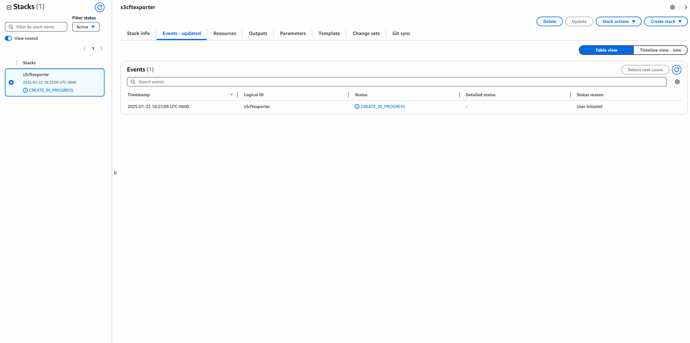

By default, the stack extracts data every hour, aggregates samples at a five-minute resolution, and stores structured CSV files in S3. Extraction can be filtered by tags to include only specific Things. The exporter and its CloudFormation template are maintained in the [arduino/aws-s3-integration](https://github.com/arduino/aws-s3-integration) repository.

## Hardware & Software Needed

- An [Arduino Cloud](https://app.arduino.cc/) account with at least one Thing that collects data.
- An Arduino Cloud [API key and secret](/arduino-cloud/apis-cli/rest-api-sdks).
- An [AWS account](https://docs.aws.amazon.com/iot/latest/developerguide/setting-up.html#sign-up-for-aws) with the IAM permissions listed in [Required IAM Permissions](#required-iam-permissions).
- The Lambda binaries (`.zip`) and CloudFormation template (`.yaml`) from the exporter's [releases page](https://github.com/arduino/aws-s3-integration/releases).
- Optionally, the [Go programming language](https://go.dev/) (version 1.22 or higher) if you want to [build the exporter yourself](#building-the-code).

## How It Works

A Lambda function written in Go runs on an **AWS EventBridge** schedule. Each run:

1. Retrieves data from the selected Arduino Cloud Things.
2. Aggregates it over the configured resolution. Numeric values are averaged over the aggregation period, while non-numeric values, such as strings, are sampled at the specified resolution.
3. Generates a CSV file and uploads it to the destination S3 bucket.

Time-series data is exported in **UTC**. All Things in the account are included unless you [filter them by tags](#filtering-by-tags). Both the extraction period and the aggregation resolution are configurable.

## Required IAM Permissions

The exporter is deployed with a [CloudFormation template](https://github.com/arduino/aws-s3-integration/releases), which provisions and configures all the AWS resources automatically: a Lambda function, an EventBridge rule that triggers it, and the parameters it reads. CloudFormation needs the following [IAM](https://docs.aws.amazon.com/IAM/latest/UserGuide/introduction.html) managed policies to do this:

| Resource | IAM Policy |
|---|---|
| CloudFormation stack creation | `AWSCloudFormationFullAccess` |
| S3 bucket management | `AmazonS3FullAccess` |
| IAM role creation | `IAMFullAccess` |
| Lambda deployment | `AWSLambda_FullAccess` |
| EventBridge rule configuration | `AmazonEventBridgeFullAccess` |
| SSM parameter management | `AmazonSSMFullAccess` |

If you don't have an administrative user yet, see [Create an administrative user](https://docs.aws.amazon.com/iot/latest/developerguide/setting-up.html#create-an-admin) in the AWS documentation.

## Creating the S3 Buckets

Before deploying the CloudFormation stack, create two S3 buckets:

- **Temporary bucket:** stores the Lambda binaries and the CloudFormation template used for the deployment.
- **CSV destination bucket:** stores all the generated CSV files. It must be in the same AWS region where you deploy the CloudFormation stack.

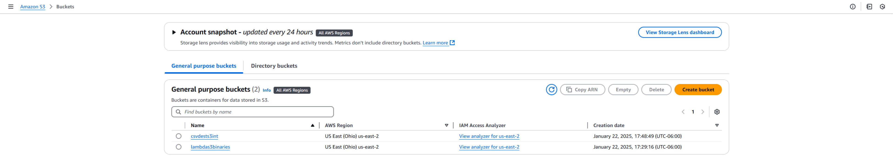

To create a bucket, open **Amazon S3** in the AWS Management Console and select **Create bucket**. The creation form groups its options into sections such as **General configuration**, **Object ownership**, **Block public access**, **Bucket versioning**, **Tags**, **Default encryption**, and **Advanced settings**.

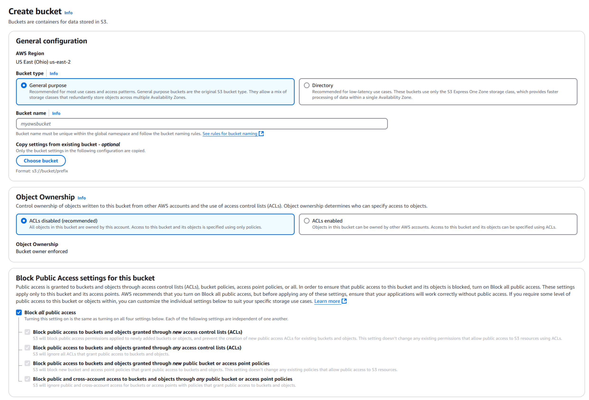

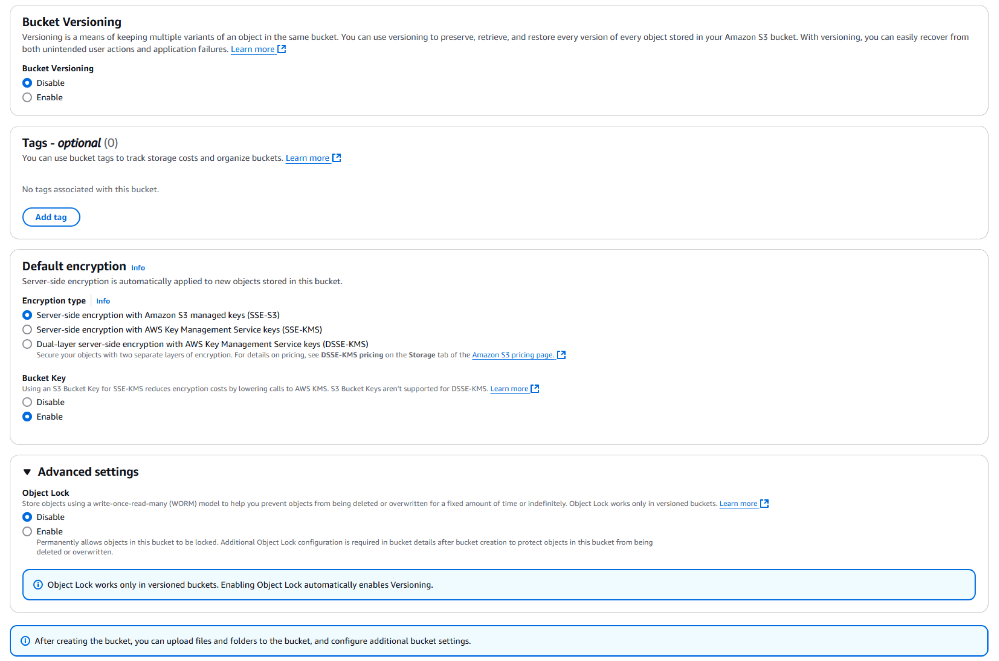

For this integration, set a bucket name and keep the bucket type as **General purpose**. The other settings can keep their default values unless you need specific customizations. Select **Create bucket** to finish. The new bucket is listed under **General purpose buckets**.

### Temporary Bucket

In the examples below, the temporary bucket is named `lambdas3binaries`.

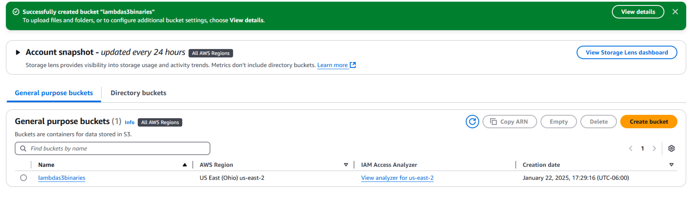

Upload the deployment files to it:

1. Open the `lambdas3binaries` bucket in **Amazon S3**.

   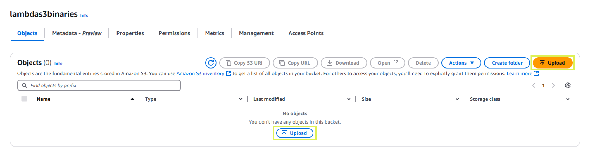

2. In the **Objects** panel, select **Upload**.
3. Add the Lambda binaries (`.zip`) and the CloudFormation template (`.yaml`), either with the file browser or by dragging them into the upload area.

   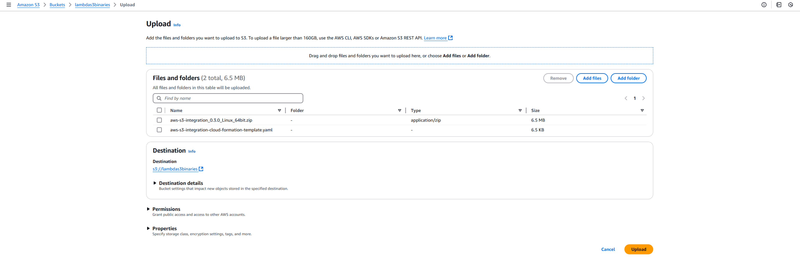

4. Select **Upload**. A confirmation screen appears when the upload completes.

   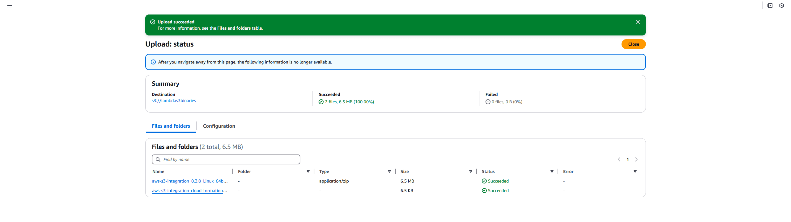

The files are now listed under the **Objects** tab of the bucket:

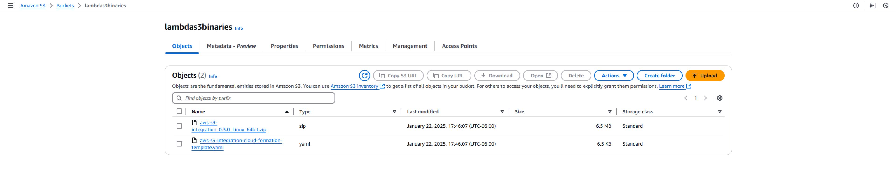

### CSV Destination Bucket

Create a second bucket in the same way, making sure the same AWS region is selected. In the examples below, it's named `csvdests3int`. The default **Object Ownership** and **Block Public Access** settings keep the bucket private, which is the recommended configuration.

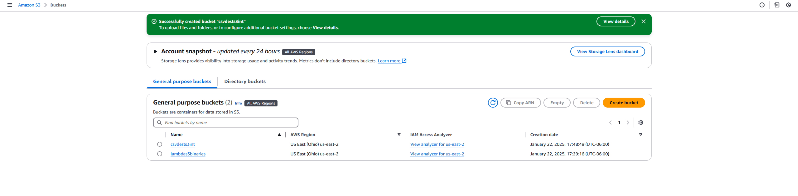

Once created, the bucket appears among your S3 buckets:

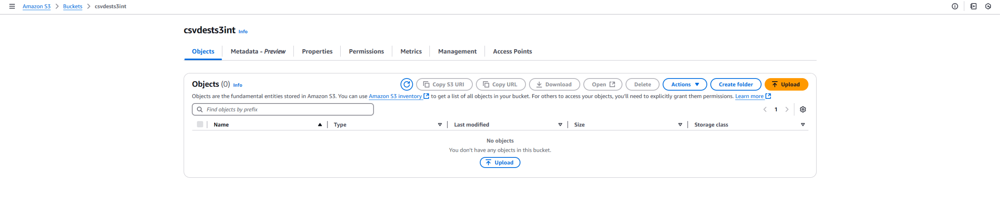

Creating folders in the destination bucket is optional, since the exporter creates the folder structure it needs automatically. If you want to organize files yourself, open the bucket's **Objects** tab, select **Create folder**, and enter a folder name.

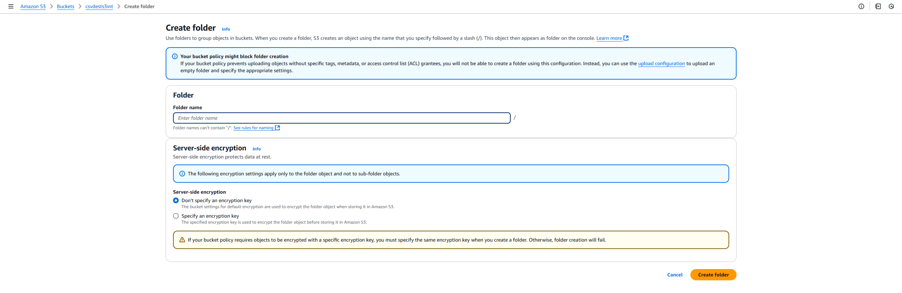

During folder creation, you can also configure **server-side encryption**. By default, the folder uses the bucket's encryption settings, but you can specify a custom encryption key.

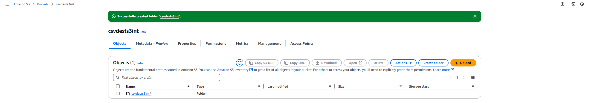

## Deploying the CloudFormation Stack

### Creating the Stack

1. Open **AWS CloudFormation** and select **Create stack**.

   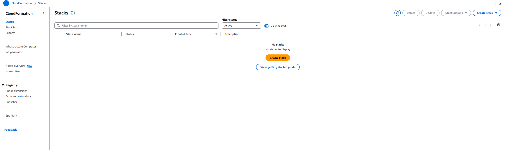

2. Select **Choose an existing template**, and enter the **Object URL** of the CloudFormation template stored in your temporary bucket in the **Amazon S3 URL** field.

   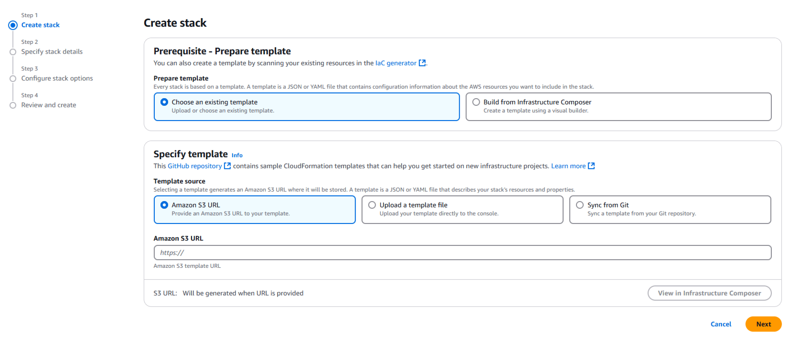

   The Object URL has the following format:

   ```bash
   https://arduino-s3-data-exporter-deployment.s3.amazonaws.com/deployment.yaml
   ```

3. Continue to the **Specify stack details** step and fill in the stack parameters described below.

   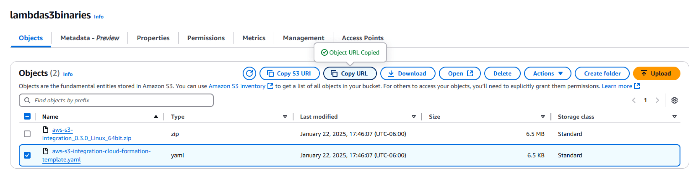

4. Review the configuration and continue.

   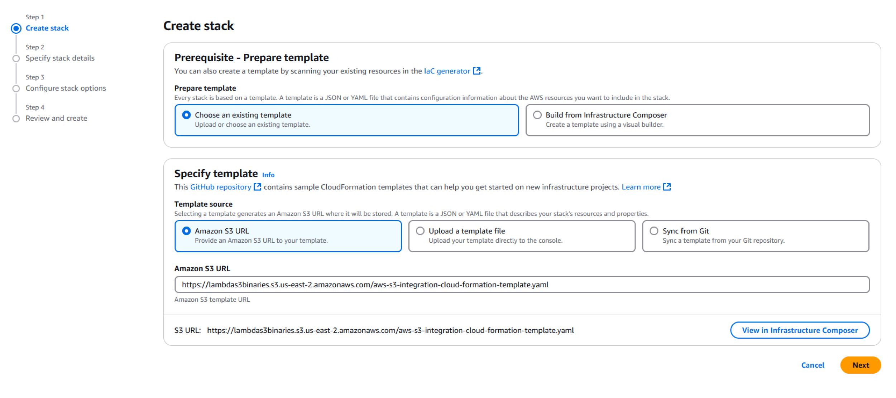

### Stack Parameters

In the **Specify stack details** step, enter a stack name and the parameters:

- **Mandatory:** the Arduino API key and secret (`IotApiKey` and `IotApiSecret`), the bucket containing the Lambda `.zip` file (`LambdaCodeS3Bucket`), and the CSV destination bucket (`csvdests3int` in this example).
- **Optional:** tag filter, organization ID (the Space ID in Arduino Cloud), and data resolution settings.

To create the API key and secret, see [REST API & SDKs](/arduino-cloud/apis-cli/rest-api-sdks).

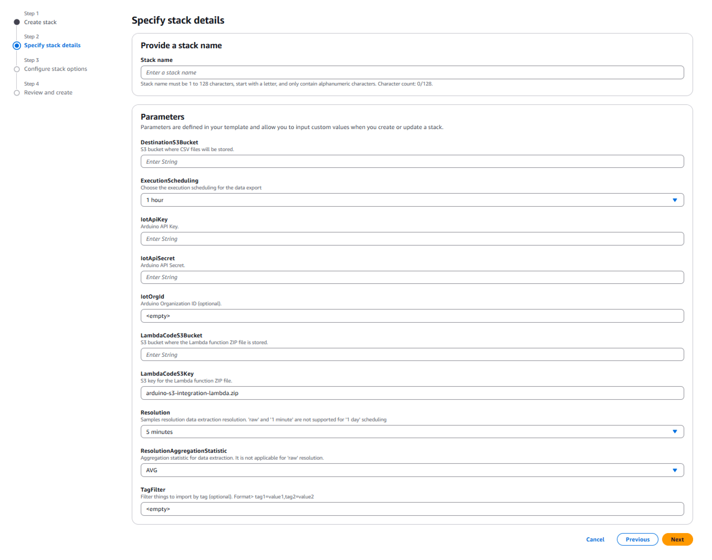

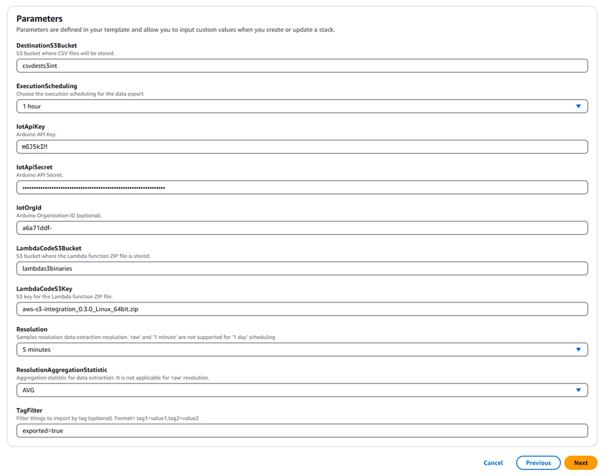

Additional parameters set the execution schedule and the resolution, which define how often data is exported and how it's aggregated. Once all parameters are filled in, continue to the review stage to verify the configuration:

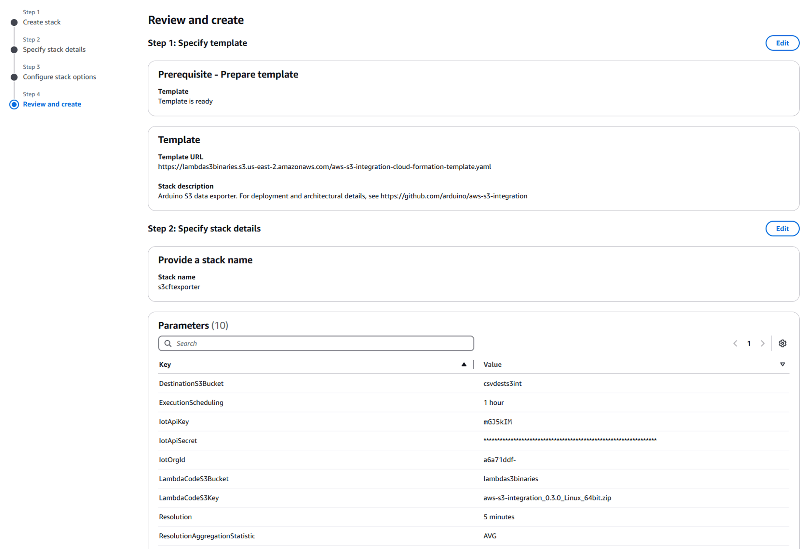

The review screen summarizes the selected template, the stack name, and all parameters before the deployment starts:

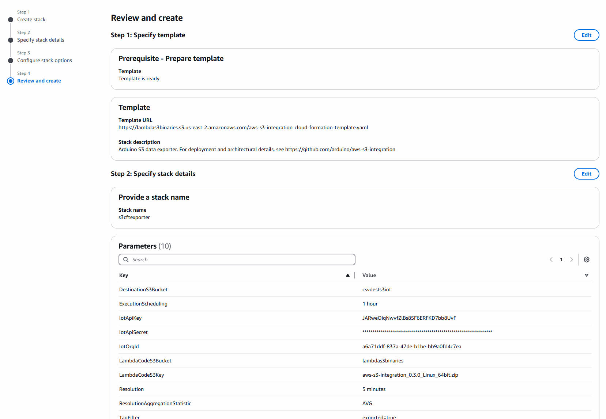

### Configurable Parameters

The parameters are pre-filled in **AWS Parameter Store** during stack creation, and you can edit them later:

| Parameter | Description |
|---|---|
| `/arduino/s3-exporter/{stack-name}/iot/api-key` | IoT API key |
| `/arduino/s3-exporter/{stack-name}/iot/api-secret` | IoT API secret |
| `/arduino/s3-exporter/{stack-name}/iot/org-id` | Organization/Space ID (optional) |
| `/arduino/s3-exporter/{stack-name}/iot/filter/tags` | Tag filter, for example `tag=value` (optional) |
| `/arduino/s3-exporter/{stack-name}/iot/samples-resolution` | Aggregation resolution (optional) |
| `/arduino/s3-exporter/{stack-name}/iot/scheduling` | Execution schedule |
| `/arduino/s3-exporter/{stack-name}/iot/align_with_time_window` | Align extraction with time windows |
| `/arduino/s3-exporter/{stack-name}/destination-bucket` | S3 destination bucket |
| `/arduino/s3-exporter/{stack-name}/enable_compression` | Enable gzip compression for CSV uploads |

### Filtering by Tags

To export only specific Things, tag them in Arduino Cloud and set a tag filter in the stack:

1. In Arduino Cloud, open the Thing and go to its **Metadata** section.

   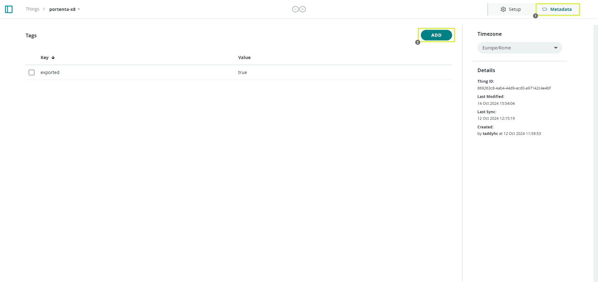

2. Select **ADD** and define a tag with a **key** and a **value**.

   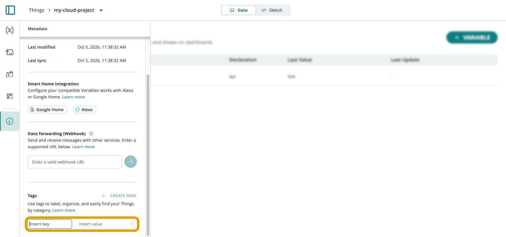

3. When creating the CloudFormation stack, enter the tag filter. It's stored in the following parameter, which you can edit later:

   ```bash
   /arduino/s3-exporter/{stack-name}/iot/filter/tags
   ```

   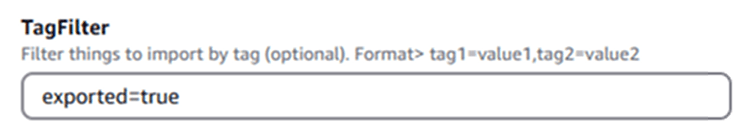

To learn more about Thing metadata, see [Things](/arduino-cloud/things-data/things).

### Time Alignment

By default, the data extraction is aligned with the function's execution time. To align the extraction with specific time windows instead, adjust the following parameter:

```bash
/arduino/s3-exporter/{stack-name}/iot/align_with_time_window
```

### Monitoring the Stack Build

After you confirm the stack creation, CloudFormation starts deploying the resources. The **Stacks** section lists the new stack with the status `CREATE_IN_PROGRESS`:

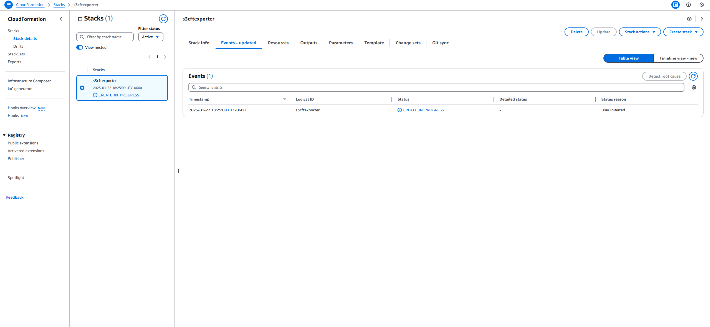

The **Events** tab logs each resource creation in real time, with timestamps and details:

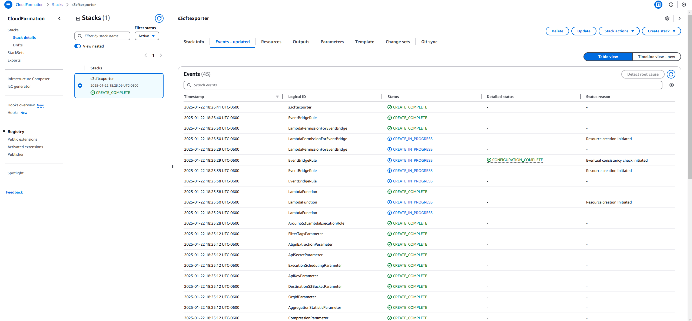

When all resources are deployed, the status changes to `CREATE_COMPLETE`. The **Stack info** tab shows the stack ID, description, creation time, and other metadata:

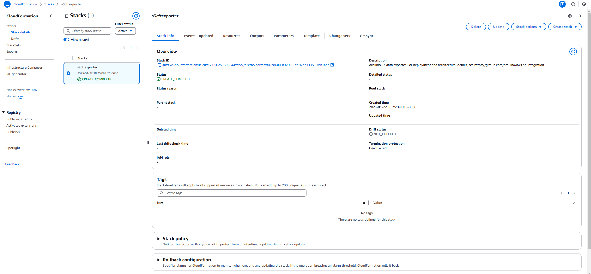

The exporter now runs on the configured schedule.

## The Exported CSV Files

With the default configuration, the Lambda function runs every hour and retrieves data from the Things that match the tag filter:

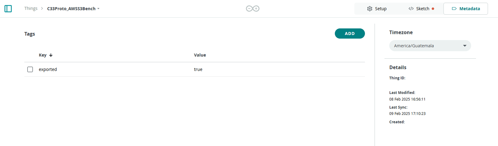

### File Storage and Organization

CSV files are stored in the destination bucket in a date-based hierarchy. Each folder corresponds to an extraction date:

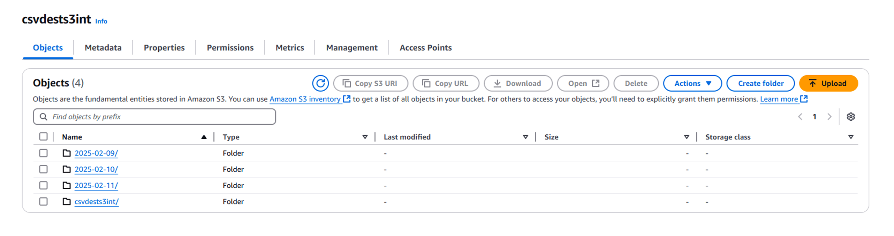

Inside each folder, the CSV files are named by timestamp, which gives a chronological view of the exported data:

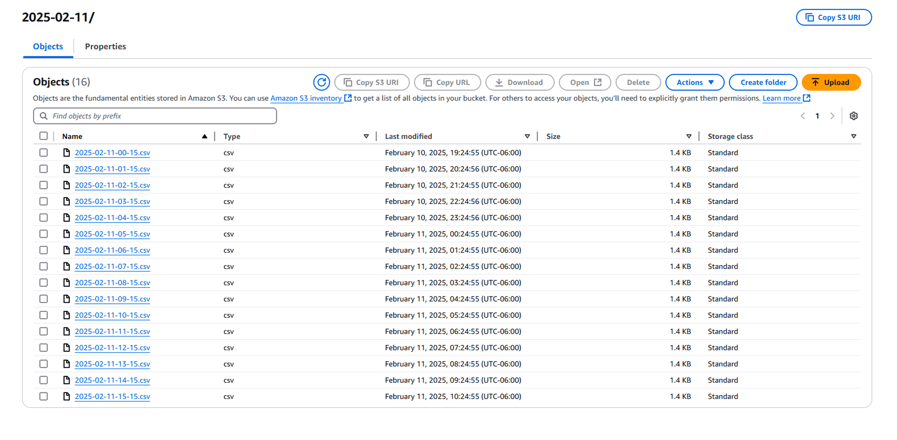

Open a file's **object details** page to see its size, storage class, last modified timestamp, and S3 URI for automated access. You can download the file from this page or from the bucket's object list:

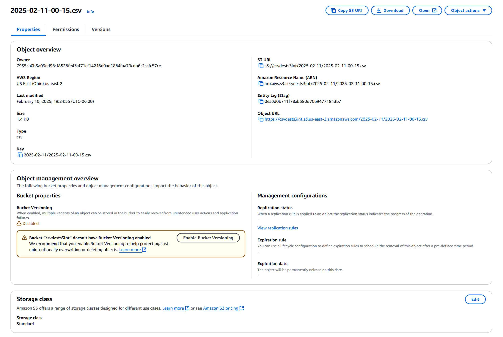

### File Format

All files share the same column layout. Each row is a data sample from one property of a Thing:

```csv
timestamp,thing_id,thing_name,property_id,property_name,property_type,value,aggregation_statistic
```

For example:

```csv
2025-02-09T21:46:39Z,7d715bb9-96ce-4cf1-8f86-c9f3dfbebfb6,C33Proto_AWSS3Bench,f75dcacf-dadd-406e-b1d0-239a9c624dce,measuredAirQualityInterpreted,CHARSTRING,Very Good,LAST_VALUE
2025-02-09T23:10:23Z,7d715bb9-96ce-4cf1-8f86-c9f3dfbebfb6,C33Proto_AWSS3Bench,12dfa2f0-8a36-4973-acda-d5551e170ffc,measuredAirQuality,FLOAT,1.3084187507629395,LAST_VALUE
2025-02-09T23:10:23Z,7d715bb9-96ce-4cf1-8f86-c9f3dfbebfb6,C33Proto_AWSS3Bench,9e94245d-fe3a-4f6a-9b4c-1afb74a10fab,measuredCO2,FLOAT,430.4429931640625,LAST_VALUE
2025-02-09T21:46:39Z,7d715bb9-96ce-4cf1-8f86-c9f3dfbebfb6,C33Proto_AWSS3Bench,30bac618-1d9c-4846-9cde-5466efd4c782,measuredSulfurOdor,BOOLEAN,FALSE,LAST_VALUE
```

| Column | Description |
|---|---|
| `timestamp` | Sample time in UTC |
| `thing_id` / `thing_name` | The Thing the sample comes from |
| `property_id` / `property_name` | The Cloud Variable the sample comes from |
| `property_type` | The variable type, for example `FLOAT`, `BOOLEAN`, or `CHARSTRING` |
| `value` | The sampled or aggregated value |
| `aggregation_statistic` | How the value was obtained, for example `LAST_VALUE` |

## Monitoring the Exporter

Three AWS services give visibility into the deployed exporter: **Lambda** runs the extraction, **CloudWatch** logs each execution and records metrics, and **EventBridge** triggers the scheduled runs.

### Lambda

The Lambda function overview shows the function name, its **Amazon Resource Name (ARN)**, and the trigger that runs it, **EventBridge (CloudWatch Events)**:

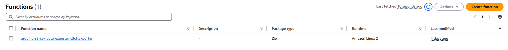

The configuration section shows the runtime, execution history, and triggers, and lets you manage destinations, environment variables, and error handling:

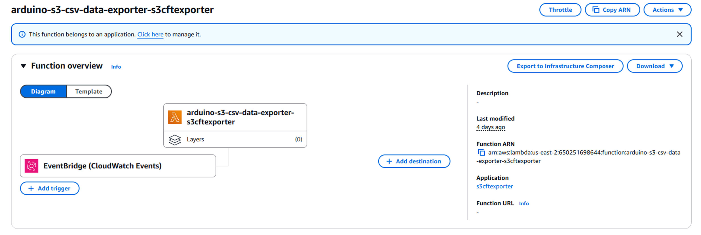

### CloudWatch

CloudWatch metrics show invocation frequency, execution duration, success rate, and error rates:

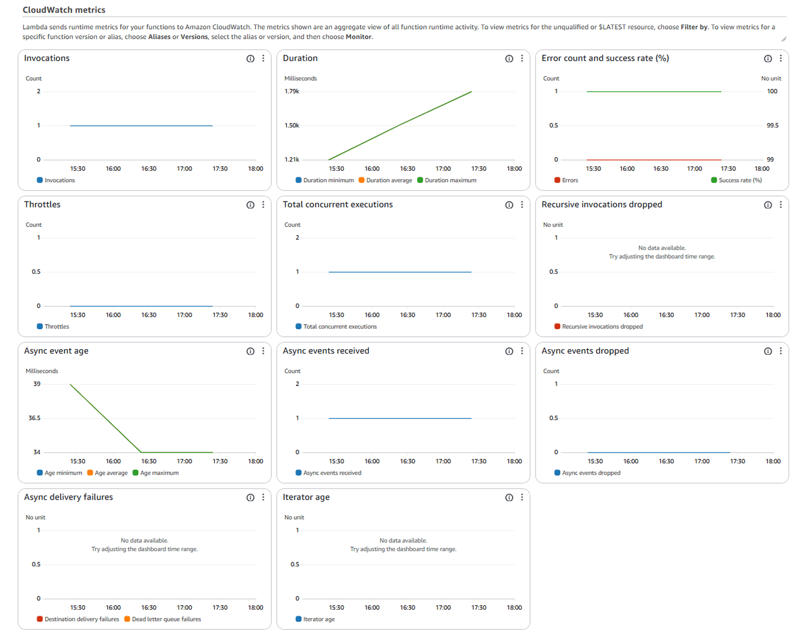

CloudWatch logs keep a record of every run, including timestamps, request IDs, memory use, and billed duration:

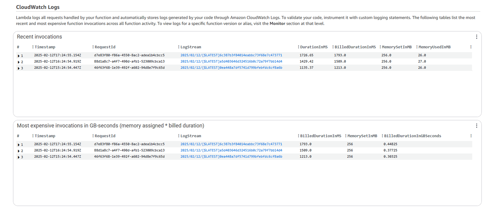

The detailed log of a run shows the applied filters, aggregation parameters, and time window alignment, along with the upload status of each file and any warnings or errors. Use it to check that the exporter can connect to Arduino Cloud with the configured API key:

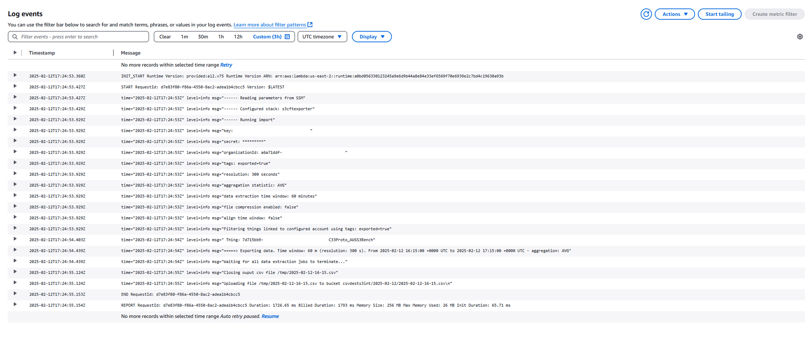

### EventBridge

EventBridge schedules the Lambda function. The **Rules** page lists the rule that triggers the exporter. Its type is **Scheduled Standard** and its status is **Enabled**:

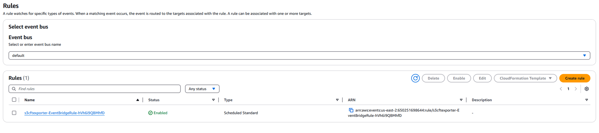

The rule details show the rule ARN, the target Lambda function, and the configured schedule:

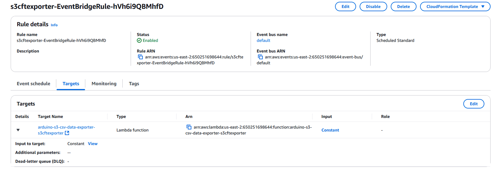

In the Lambda function, the EventBridge trigger confirms the connection between the rule and the function:

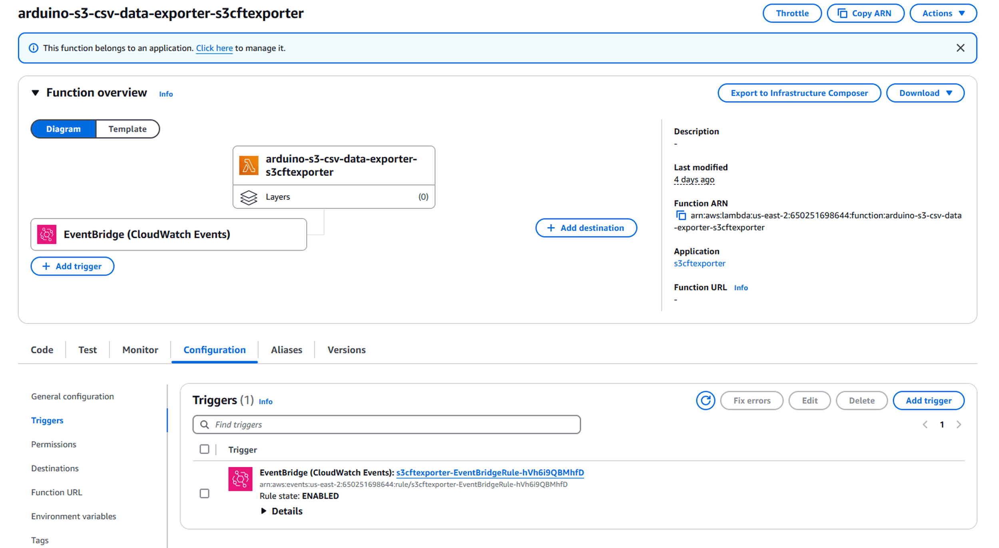

## Building the Code

Precompiled binaries are available on the [releases page](https://github.com/arduino/aws-s3-integration/releases). If you want to customize or test the exporter before deploying it, you can build it from source. See the [AWS S3 CSV Exporter repository](https://github.com/arduino/aws-s3-integration) for build instructions.

For more information about the AWS services used by the exporter, see the [AWS Lambda](https://docs.aws.amazon.com/lambda/), [Amazon S3](https://docs.aws.amazon.com/s3/), and [AWS CloudFormation](https://docs.aws.amazon.com/AWSCloudFormation/latest/UserGuide/Welcome.html) documentation.

## Related Articles

- [Historical Data Export](/arduino-cloud/things-data/historical-data-export)
- [Things](/arduino-cloud/things-data/things)
- [REST API & SDKs](/arduino-cloud/apis-cli/rest-api-sdks)
- [Integrations Overview](/arduino-cloud/integrations/integrations-overview)
- [Arduino Cloud for Business](/arduino-cloud/business/arduino-cloud-for-business)
