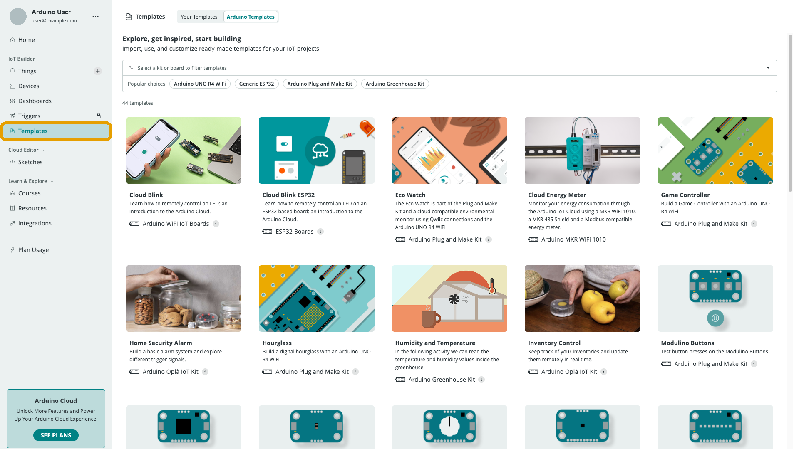
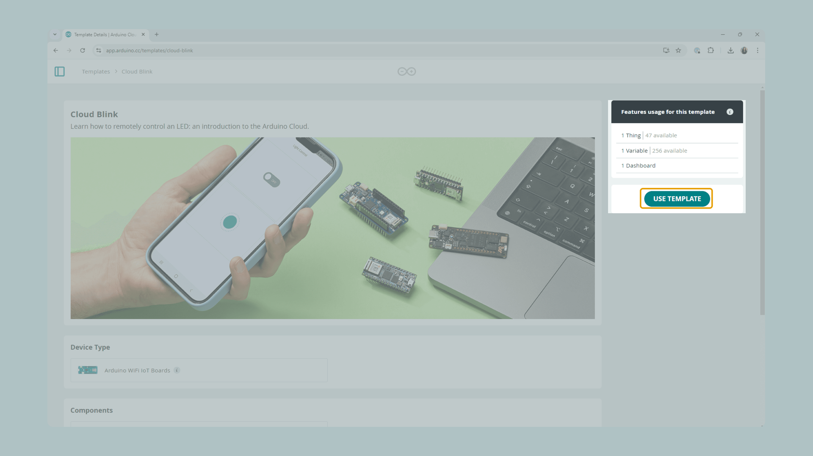

A **Template** bundles one or more Things and their variables with matching Dashboards and, where the project needs them, [Triggers](/arduino-cloud/automations/triggers-and-alerts). You can spin up the same setup repeatedly instead of rebuilding it by hand each time. Official templates cover common starter projects (e.g. "Cloud Blink," a simple remote LED switch); custom templates are your own saved setups.

## Browsing the Gallery

**Templates** in the left navigation shows official and custom templates, grouped by category and compatible board:

Each template's page describes what the project does, the hardware it needs, and how many [Things](/arduino-cloud/things-data/things), [Variables](/arduino-cloud/things-data/cloud-variables), and [Dashboards](/arduino-cloud/dashboards/dashboards) it creates, along with any Triggers.

## Applying a Template

With a compatible board connected over USB, **Use Template** provisions everything automatically — the Device, its network credentials, the Thing(s) and Variables, the generated sketch, the Dashboard(s), and any Triggers included in the template:

<Alert type="note">

The Free plan limits how many Things you can have — if you're already at that limit, **Use Template** is disabled until you delete an existing Thing or upgrade the plan. See the [Plans and Feature Matrix](/arduino-cloud/reference/plans-feature-matrix).

</Alert>

## Editing an Applied Template

Once applied, a template's Dashboard and Thing are regular, fully editable resources — add or remove widgets from the Dashboard's Edit mode, or open the matching Thing (same name as the template) to add variables or change its sketch.

## Templates in the Classroom

Templates give students a hands-on way to explore sensor data, cloud computing, and IoT across subjects:

| Subject | Templates |
|---|---|
| Physics | [Thermodynamics](https://app.arduino.cc/templates/ventilation), [Pressure, temperature and light](https://app.arduino.cc/templates/humidity-and-temperature) |
| Chemistry | [Soil properties](https://app.arduino.cc/templates/soil-moist), [Monitoring indoor air quality](https://app.arduino.cc/templates/thermostat-control) |
| Biology | [Photosynthesis and respiration](https://app.arduino.cc/templates/photosynthesis), [Studying indoor plant growth](https://app.arduino.cc/templates/natural-and-artificial-light), [Weather Stations](https://app.arduino.cc/templates/personal-weather-station) |
| Computer Science | [Remote LED Control](https://app.arduino.cc/templates/cloud-blink), [Greenhouse Monitoring](https://app.arduino.cc/templates/watering), [Introducing Sensor technology](https://app.arduino.cc/templates/remote-controlled-lights), [Basics of structuring data](https://app.arduino.cc/templates/sparkfun-weather-station), [Loops, Pointers, Arrays and Functions](https://app.arduino.cc/templates/puzzle-box) |
| Arts and Design | [Fun and Games](https://app.arduino.cc/templates/pavlovs-cat), [UI Design of industrial systems](https://app.arduino.cc/templates/smart-garden), [Ideation and prototyping easy to use home projects](https://app.arduino.cc/templates/plant-watering-kit), [Emotional expressions through technology](https://app.arduino.cc/templates/thinking-about-you) |

For classes or workshops, set up a [shared space](/arduino-cloud/education/shared-spaces) and add every participant's individual account to it.

## Next Steps

- [Custom Templates](/arduino-cloud/templates/custom-templates)
- [Clone & Bulk-Create](/arduino-cloud/templates/clone-bulk-create)
