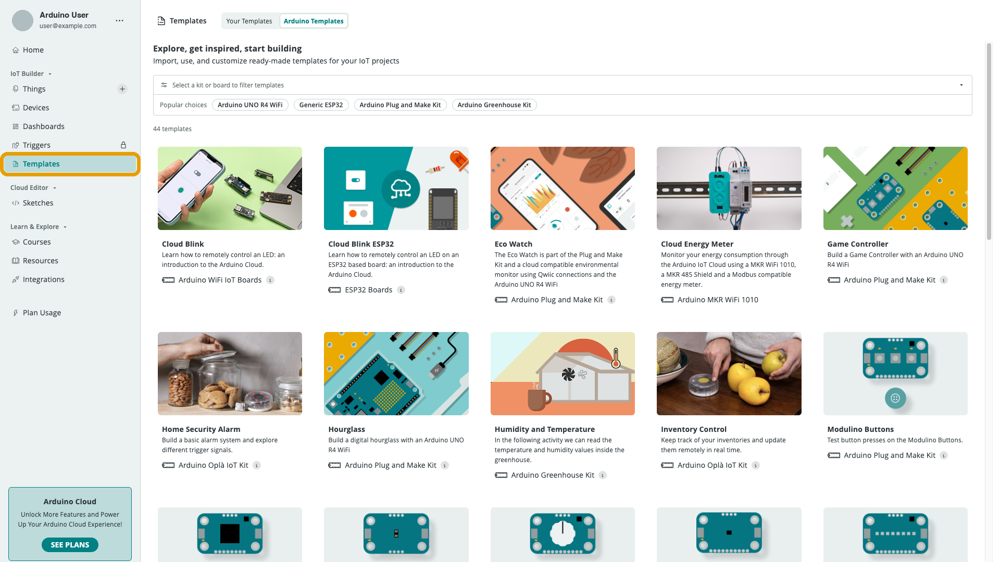

A **Template** bundles a Thing's variable layout with a matching Dashboard, so
you can spin up the same setup repeatedly instead of rebuilding it by hand each
time. Official templates cover common starter projects (e.g. "Cloud Blink," a
simple remote LED switch); custom templates are your own saved setups.

## Browsing the Gallery

**Templates** in the left navigation (`/templates`) shows official and custom
templates, grouped by category and compatible board:

Each template's page describes what the project does, the hardware it needs,
and how many [Things](/arduino-cloud/things-data/things),
[Variables](/arduino-cloud/things-data/cloud-variables), and
[Dashboards](/arduino-cloud/dashboards/dashboards) it creates.

## Applying a Template

With a compatible board connected over USB, **Use Template** provisions
everything automatically — the Device, its network credentials, the Thing(s)
and Variables, the generated sketch, and the Dashboard(s):

<Alert type="note">

A free-plan account is limited to two Things at a time — if you're already at
that limit, **Use Template** is disabled until you delete an existing Thing or
upgrade the plan.

</Alert>

## Editing an Applied Template

Once applied, a template's Dashboard and Thing are regular, fully editable
resources — add or remove widgets from the Dashboard's Edit mode, or open the
matching Thing (same name as the template) to add variables or change its
sketch.

## Next Steps

- [Custom Templates](/arduino-cloud/templates/custom-templates)
- [Clone & Bulk-Create](/arduino-cloud/templates/clone-bulk-create)
