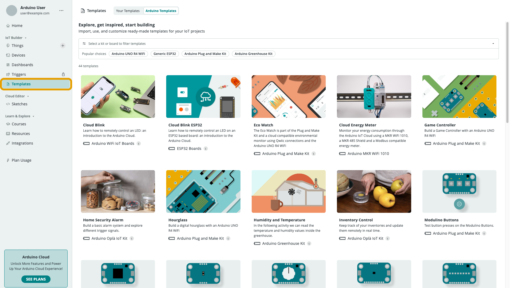
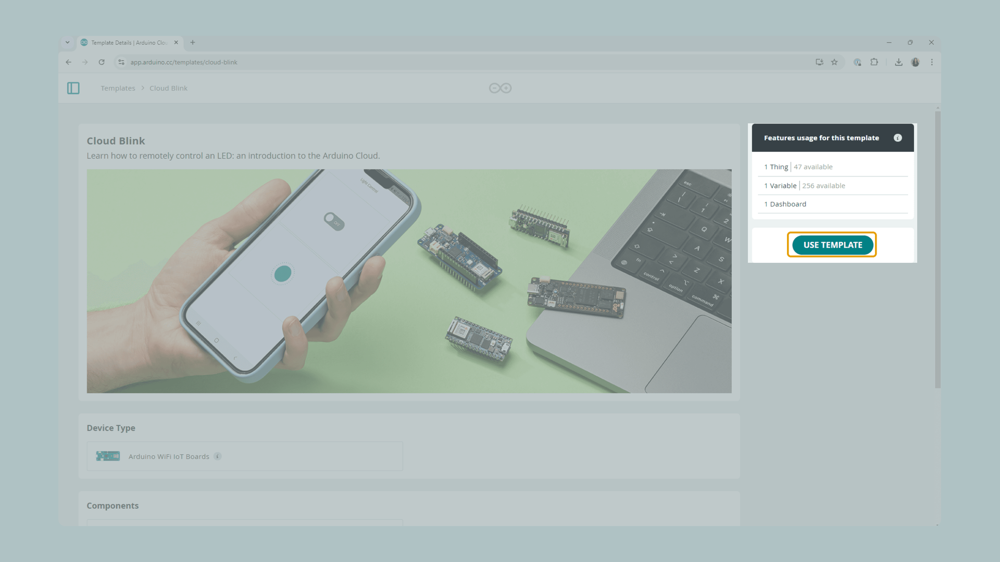

A **Template** bundles one or more [Things](/arduino-cloud/things-data/things) and their [variables](/arduino-cloud/things-data/cloud-variables) with matching [Dashboards](/arduino-cloud/dashboards/dashboards) and, where the project needs them, [Triggers](/arduino-cloud/automations/triggers-and-alerts). You can spin up the same setup repeatedly instead of rebuilding it by hand each time. Official templates cover common starter projects (e.g. "Cloud Blink," a simple remote LED switch); custom templates are your own saved setups.

## Browsing the Gallery

**Templates** in the left navigation shows official and custom templates, grouped by category and compatible board:

Each template's page describes what the project does, the hardware it needs, and how many Things, Variables, Dashboards and Triggers it creates.

## Applying a Template

With a compatible board connected over USB, **Use Template** provisions everything automatically — the Device, its network credentials, the Thing(s) and Variables, the generated sketch, the Dashboard(s), and any Triggers included in the template:

<Alert type="note">

A free-plan account is limited to two Things at a time — if you're already at that limit, **Use Template** is disabled until you delete an existing Thing or upgrade the plan.

</Alert>

## Editing an Applied Template

Once applied, a template's Dashboard and Thing are regular, fully editable resources — add or remove widgets from the Dashboard's Edit mode, or open the matching Thing (same name as the template) to add variables or change its sketch.

## Templates in a Business Context

Custom templates let you capture a working setup once and replicate it across sites, customers, and solutions. Instead of rebuilding the same Things, Dashboards, and Triggers for every installation, save the setup as a template and apply it to each new device. See [Custom Templates](/arduino-cloud/templates/custom-templates) to create your own, and [Clone & Bulk-Create](/arduino-cloud/templates/clone-bulk-create) to apply them at scale.

## Templates in the Classroom

Templates are a quick way to introduce students to IoT concepts, such as sensor data collection and remote control, without building a project from scratch. See [Arduino Cloud for Education](/arduino-cloud/education/arduino-cloud-for-education#templates-in-the-classroom) for ideas on using templates across different subjects.

## Related Articles

- [Custom Templates](/arduino-cloud/templates/custom-templates)
- [Clone & Bulk-Create](/arduino-cloud/templates/clone-bulk-create)
