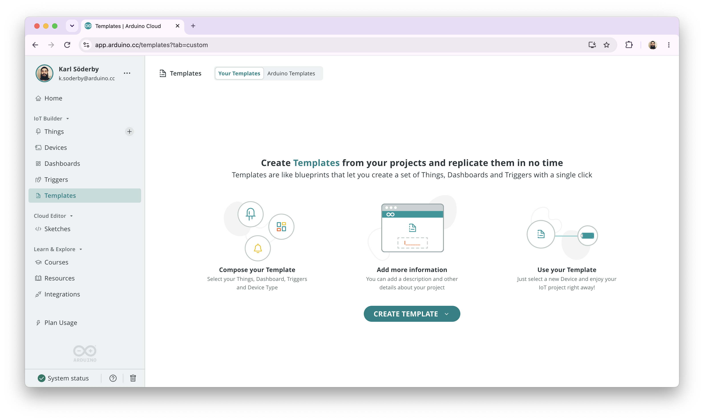
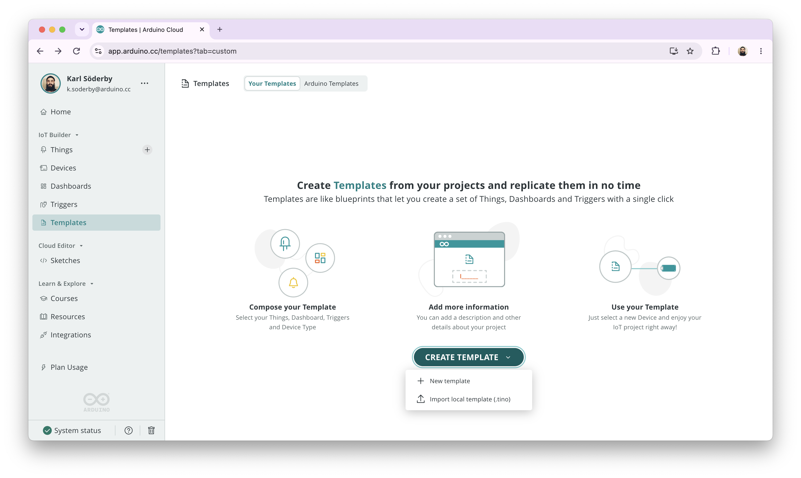
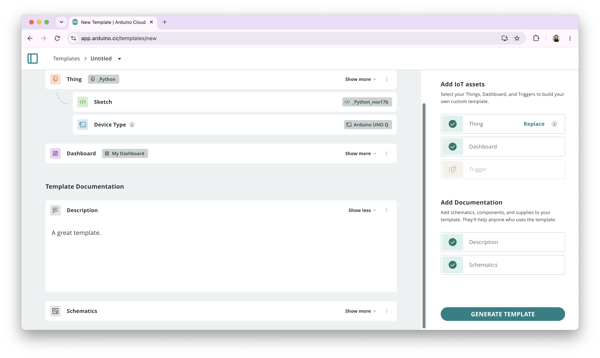
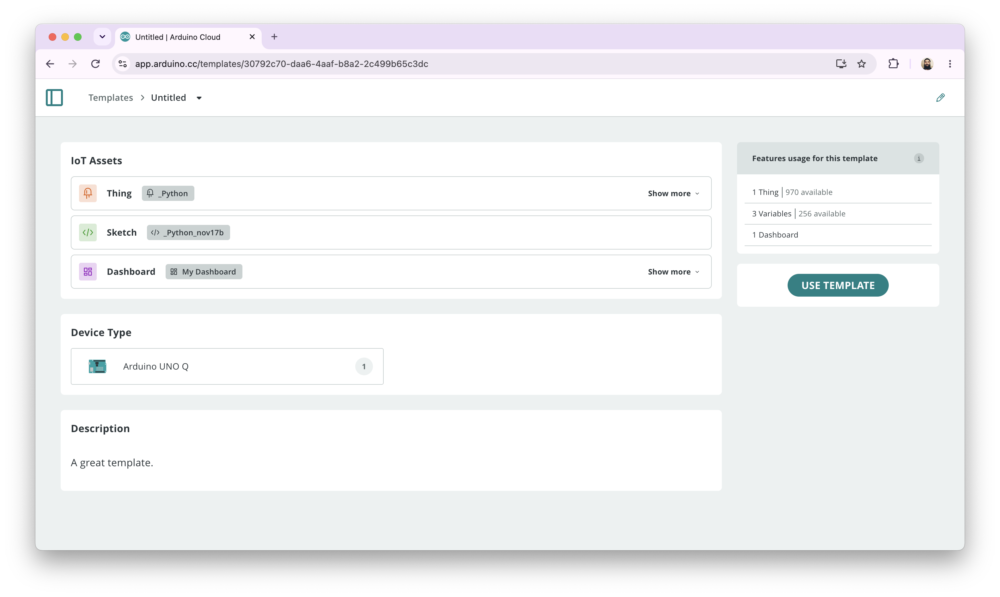

Beyond the official template gallery (see [Use Templates](/arduino-cloud/templates/use-templates)), you can save your own Thing + Dashboard + Trigger setup as a **custom template** for reuse — either by yourself later, or shared with others as a `.tino` archive.

## Managing Custom Templates From the Web UI

From the **Templates** page in the sidebar, the top has two tabs: **Your Templates** (your own custom templates, made or imported from a `.tino` file) and **Arduino® Templates** (the official gallery).



To create a custom template from an existing project:

1. In **Your Templates**, click **+** and select **New template**. The same menu also lets you import a local template (`.tino`) file.

   

2. Add a **Thing** — click **Thing**, search for and select one of your existing Things, then **Add to Template**.
3. Add a **Dashboard** the same way (it may offer to add the dashboard already associated with your Thing as a shortcut).
4. Optionally add **Triggers** linked to the Thing's variables, so the automations are recreated together with the project.
5. Optionally add documentation — a description, wiring diagrams, schematics.

   

6. Click **Generate Template**. It then appears under **Your Templates**.

   

Exiting before clicking **Generate Template** discards your progress.

To share a template, click the three dots on its card and choose **download (.tino)**.

## Managing Custom Templates From the Terminal

Custom templates are packaged as `.tino` archives and managed with `arduino-cloud-cli template`:

```bash
# List your custom templates
arduino-cloud-cli template list

# Export one as a shareable .tino archive
arduino-cloud-cli template export -t <templateID>

# Import one someone else shared with you
arduino-cloud-cli template import -f <template.tino>

# Apply it to a specific device
arduino-cloud-cli template apply -d <deviceID> -t <templateID> -p "<prefix>" -n SECRET_SSID=<ssid>,SECRET_OPTIONAL_PASS=<pwd>
```

<Alert type="note">

Triggers are not supported by the CLI yet. To create a custom template that includes Triggers, use the web UI as described above.

</Alert>

See [Clone & Bulk-Create](/arduino-cloud/templates/clone-bulk-create) and [CLI Commands: Templates](/arduino-cloud/apis-cli/cli-commands#templates) for the full reference.

## Related Articles

- [Organize Resources With Smart Folders](/arduino-cloud/things-data/smart-folders)
- [Clone & Bulk-Create](/arduino-cloud/templates/clone-bulk-create)
- [Use Templates](/arduino-cloud/templates/use-templates)
