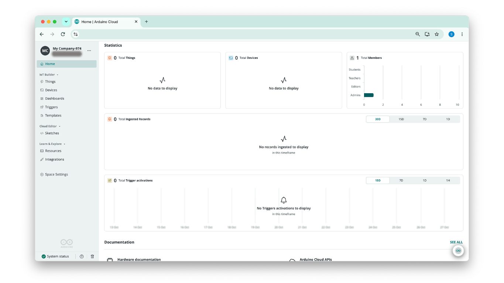

A **space** is a self-contained workspace in Arduino Cloud holding its own Things, Dashboards, devices, and members. Every account has a private personal space; team plans add **shared spaces** that any number of members can work in together, with access governed by [roles](/arduino-cloud/spaces-plans-account/members-roles).

## Personal vs Shared Spaces

| Space | For | Members |
|---|---|---|
| **My Cloud** (personal) | Projects you don't want to share | Just you |
| **Shared Space** | Team, classroom, or company projects | Any number, with assigned roles |

Your personal space ("My Cloud") is created automatically and is free. By default it includes **two Things, unlimited dashboards, and 100 MB of sketch storage**, which can be further extended and customized from your **My Plans** settings.

## Creating and Naming a Space

When a team plan is activated, you're asked to name the space (company or classroom name). You can rename it later from **Space Settings → General → Edit Info**:

Additional shared spaces require purchasing an additional plan.

## Switching Between Spaces

If you own or belong to more than one space, switch between them from the account button in the top-left corner — all spaces you can access are listed there. With four or more spaces, a **Switch space** selector appears. The selector always shows which space you're currently working in.

If you belong to more than one space, you can also open the [Spaces Overview](/arduino-cloud/spaces-plans-account/spaces-overview) to see statistics, plan usage, and devices across all of your spaces at once.

## Space Statistics on the Home Page

Every space's **Home** page includes a **Statistics** section, below **Recent Files**. It gives you an at-a-glance read of the space's status without having to open the Things, Devices, members, or Triggers pages one by one. Each widget shows an icon and a headline total, with a chart below that breaks the number down:

| Widget | Headline Number | Breakdown | Time Range |
|---|---|---|---|
| **Total Things** | All Things in the space | **Active** vs. **Inactive** Things | — |
| **Total Devices** | All devices in the space | **Online** vs. **Offline** devices | — |
| **Total Members** | All members of the space | Members per role, for example **Students**, **Teachers**, **Editors**, and **Admins** | — |
| **Total Ingested Records** | Data records received from the space's devices | Records over time | **30D**, **15D**, **7D**, **1D** |
| **Total Trigger activations** | How many times the space's [Triggers](/arduino-cloud/automations/triggers-and-alerts) fired | Activations over time | **15D**, **7D**, **1D**, **1H** |

The roles listed in **Total Members** depend on the role set configured for the space (see [Members & Roles](/arduino-cloud/spaces-plans-account/members-roles)).

The time-based widgets each have their own **time-range selector** in the top-right corner to change the observation window. When there's nothing to show, a widget displays an empty state, such as "No data to display", or "No records ingested to display in this timeframe" for the selected window.

To see the same statistics summed across every space you belong to, use the [Spaces Overview](/arduino-cloud/spaces-plans-account/spaces-overview#statistics-across-all-spaces).

## Space Settings

Open **Space Settings** from the sidebar to configure a shared space:

| Tab | Purpose |
|---|---|
| **General** | View space info and edit the space name |
| **Custom Branding** | [Assign a custom logo and URL](/arduino-cloud/spaces-plans-account/custom-branding) |
| **Manage Members** | [Add and manage members](/arduino-cloud/spaces-plans-account/members-roles) |
| **Roles & Permissions** | [Role-based access control](/arduino-cloud/spaces-plans-account/members-roles) |
| **Plan Usage** | View feature and resource usage |

## Next Steps

- [Spaces Overview](/arduino-cloud/spaces-plans-account/spaces-overview)
- [Members & Roles](/arduino-cloud/spaces-plans-account/members-roles)
- [Custom Branding](/arduino-cloud/spaces-plans-account/custom-branding)
- [Plans, Limits & Quotas](/arduino-cloud/spaces-plans-account/plans-limits-quotas)
