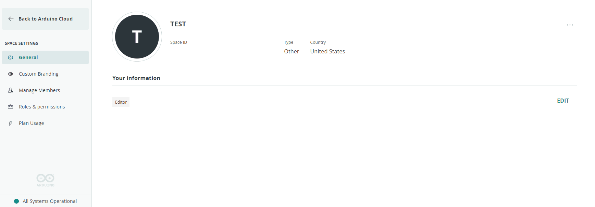

A **space** is a self-contained workspace in Arduino Cloud holding its own Things, Dashboards, devices, and members. Every account has a private personal space; team plans add **shared spaces** that any number of members can work in together, with access governed by [roles](/arduino-cloud/spaces-plans-account/members-roles).

## Personal vs Shared Spaces

| Space | For | Members |
|---|---|---|
| **My Cloud** (personal) | Projects you don't want to share | Just you |
| **Shared Space** | Team, classroom, or company projects | Any number, with assigned roles |

Your personal space ("My Cloud") is created automatically and is free. By default it includes **two Things, unlimited dashboards, and 100 MB of sketch storage**, which can be further extended and customized from your **My Plans** settings.

## Creating and Naming a Space

When a team plan is activated, you're asked to name the space (company or classroom name). You can rename it later from **Space Settings → General → Edit Info**:

Additional shared spaces require purchasing an additional plan.

## Switching Between Spaces

If you own or belong to more than one space, switch between them from the account button in the top-left corner — all spaces you can access are listed there. With four or more spaces, a **Switch space** selector appears. The selector always shows which space you're currently working in.

## Space Settings

Open **Space Settings** from the sidebar to configure a shared space:

| Tab | Purpose |
|---|---|
| **General** | View space info and edit the space name |
| **Custom Branding** | [Assign a custom logo and URL](/arduino-cloud/spaces-plans-account/custom-branding) |
| **Manage Members** | [Add and manage members](/arduino-cloud/spaces-plans-account/members-roles) |
| **Roles & Permissions** | [Role-based access control](/arduino-cloud/spaces-plans-account/members-roles) |
| **Plan Usage** | View feature and resource usage |

## Next Steps

- [Members & Roles](/arduino-cloud/spaces-plans-account/members-roles)
- [Custom Branding](/arduino-cloud/spaces-plans-account/custom-branding)
- [Plans, Limits & Quotas](/arduino-cloud/spaces-plans-account/plans-limits-quotas)
