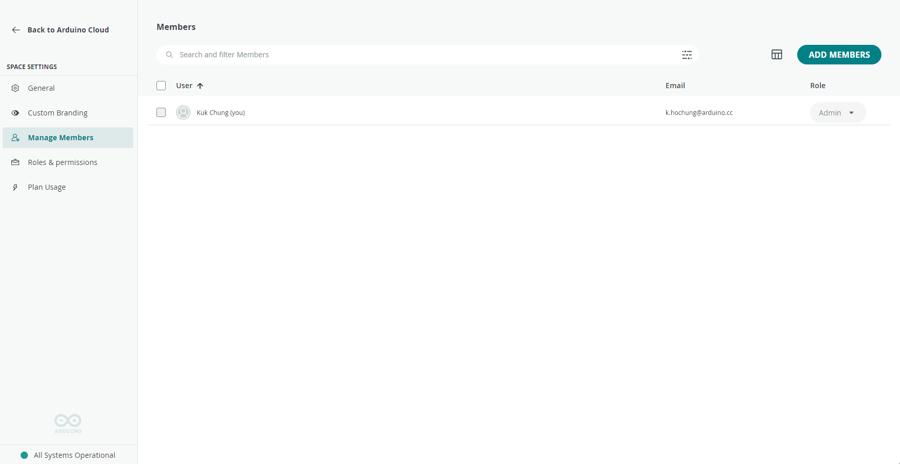
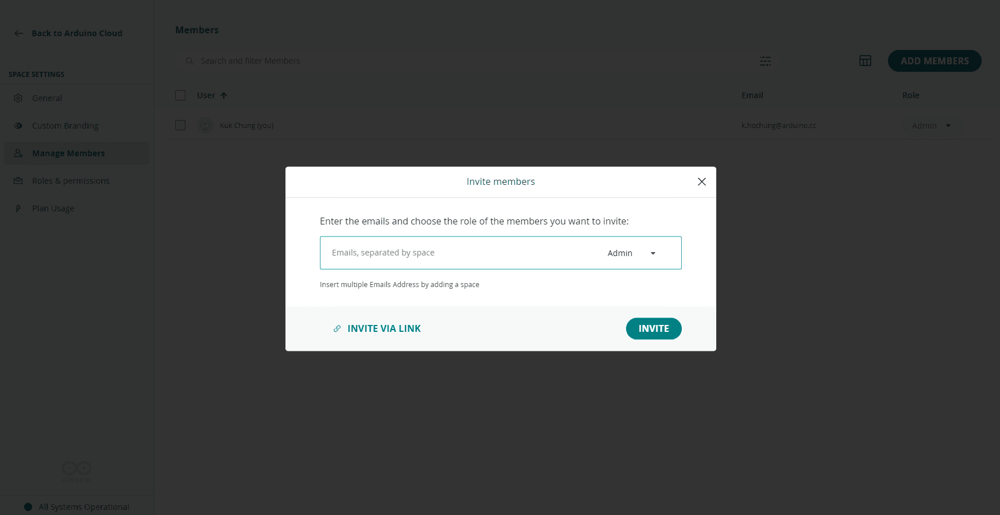

A shared space can have any number of members, and **role-based access control
(RBAC)** determines what each member can do within it. The person who activates
the plan and creates the space becomes an **Admin**; Admins invite other
members and assign their roles.

## Roles

| Role | Can do |
|---|---|
| **Admin** | Full control — manage Things, dashboards, devices, members, and billing |
| **Editor** | Create and edit Things, variables, dashboards, devices, and sketches; no member or billing management |
| **Service Account** | A non-personal account dedicated to creating and maintaining API keys |

A space can have multiple Admins with identical permissions. The table below
summarizes the key differences:

| Capability | Admin | Editor | Service Account |
|---|---|---|---|
| Create/edit/delete Things, variables, dashboards | ✓ | ✓ | |
| Create/edit/delete webhooks (API) | | | ✓ |
| Add/edit/delete devices | ✓ | ✓ | |
| Add members and assign roles | ✓ | | |
| Payment / plan management | ✓ | | |

<Alert type="info">

Keep at least one **Service Account** per shared space, linked to a
non-personal email address. API keys created under it won't be lost if a
personal account is later removed.

</Alert>

## Managing Members

Open **Manage Members** under **Space Settings** to see everyone with access to
the space and their current role:

## Inviting a New Member

Select **ADD MEMBERS** in the top-right corner, enter the email addresses of
the people to invite, and assign each a role:

Invitees receive an email with a link to join the space. Once they accept, they
appear in the members list and can start working according to their assigned
role.

## Next Steps

- [Spaces](/arduino-cloud/spaces-plans-account/spaces)
- [Plans, Limits & Quotas](/arduino-cloud/spaces-plans-account/plans-limits-quotas)
