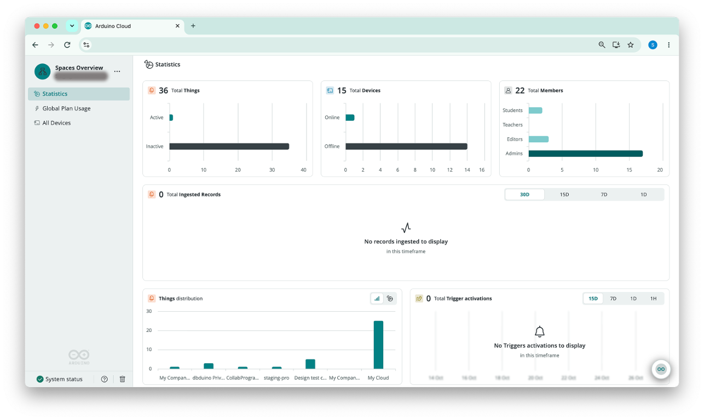
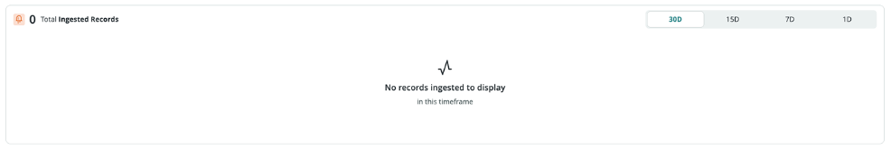

The **Statistics** section gives you an at-a-glance read of how a [space](/arduino-cloud/spaces-plans-account/spaces) is being used: how many Things and devices it has, who its members are, how much data its devices send, and how often its [Triggers](/arduino-cloud/automations/triggers-and-alerts) fire. You get this overview without opening the Things, Devices, members, or Triggers pages one by one.

## Where to Find Statistics

Statistics are shown in two places:

| Location | Shows | Available To |
|---|---|---|
| **Home** page of a space, below **Recent Files** | Statistics for that space only | Any user with access to the space |
| **Statistics** in the [Spaces Overview](/arduino-cloud/spaces-plans-account/spaces-overview) | Statistics summed across every space you belong to | Users who belong to more than one space |

Both locations use the same widgets. The Spaces Overview adds a **Things distribution** chart, and its charts break values down by space instead of by Thing.

## Statistics Widgets

Each widget shows an icon and a headline total, with a chart below that breaks the number down. In the Spaces Overview, every total is the sum across all of your spaces.

| Widget | Headline Number | Breakdown | Time Range |
|---|---|---|---|
| **Total Things** | All Things | **Active** vs. **Inactive** Things | — |
| **Total Devices** | All devices | **Online** vs. **Offline** devices | — |
| **Total Members** | All members | Members per role, for example **Students**, **Teachers**, **Editors**, and **Admins** | — |
| **Total Ingested Records** | Data records received from devices | Records per day, compared with the plan's daily limit (see [Ingested Records Usage Chart](#ingested-records-usage-chart)) | **30D**, **15D**, **7D**, **1D** |
| **Total Trigger activations** | How many times Triggers fired | Activations over time | **15D**, **7D**, **1D**, **1H** |

The roles listed in **Total Members** depend on the role set configured for the space (see [Members & Roles](/arduino-cloud/spaces-plans-account/members-roles)).

The time-based widgets each have their own **time-range selector** in the top-right corner, so changing the range on one widget doesn't affect the others. When there's nothing to show, a widget displays an empty state, such as "No data to display", or "No records ingested to display in this timeframe" for the selected window.

### Things Distribution Chart in the Spaces Overview

The Spaces Overview adds a **Things distribution** widget that breaks **Total Things** down by space, with one bar per space (for example **My Cloud** and each shared space). Use the toggle in the top-right corner of the widget to switch between a **bar chart** and a **pie chart**.

Use it to spot which space holds most of your Things before you move projects between spaces or decide which space needs a larger plan.

## Ingested Records Usage Chart

Every Arduino® Cloud plan includes a **Daily Ingested Records** limit: the maximum number of data points that can be processed per day from your connected devices. The **Total Ingested Records** widget shows how many records your devices actually send each day, and how that compares with your plan's limit. Use it to keep track of your usage trend and see how close you are to the limit.

The chart is available on every plan, from Free to Enterprise. Plans only differ in the value of the daily limit shown on the chart. To see each plan's limit, check **Plan Usage** for a space or [Global Plan Usage](/arduino-cloud/spaces-plans-account/spaces-overview#global-plan-usage) in the Spaces Overview.

<Alert type="info">

The Daily Ingested Records limit is **informational only** at this stage, so it isn't enforced. Going over the limit doesn't block data ingestion or trigger any restriction. The chart gives you visibility and lead time to adjust your usage ahead of a possible future point where the limit becomes enforced.

</Alert>

### Reading the Chart

| Element | Description |
|---|---|
| **Daily bars** | One bar per day, showing the number of records ingested that day |
| **Time range** | Select **1D**, **7D**, **15D**, or **30D** in the top-right corner to change how many days are shown |
| **Limit line** | A horizontal line showing the plan's Daily Ingested Records limit, so you can compare each day's bar against it at a glance |
| **Bar segments** | Each bar is split into segments, one per contributing Thing or space, with a legend identifying each segment |
| **Tooltip** | Hover over or select a day to see that day's total and the percentage of the daily limit it represents, for example "Total: 224,549 (2% of daily limit)" |

### Breakdown by Thing or by Space

The segments in each bar, and the contributors listed in the tooltip, depend on where you open the chart:

| Location | Each Bar Is Broken Down By | Tooltip Shows |
|---|---|---|
| **Space Home page** | **Thing**: how many records each Thing in the space contributed that day | The day's total and its percentage of the limit, plus the top contributing Things with their record count and percentage of the limit |
| **Spaces Overview** | **Space**: how many records each of your spaces contributed that day | The day's total and its percentage of the limit, broken down by space |

On a space's Home page, the per-Thing breakdown shows which Things send the most data. In the Spaces Overview, the per-space breakdown shows which spaces contribute most to your overall ingestion.

### How the Limit Line Is Calculated

| Location | Limit Line Shows |
|---|---|
| **Space Home page** | The Daily Ingested Records limit of that space's own plan |
| **Spaces Overview** | The **highest** Daily Ingested Records limit among all of your spaces |

In the Spaces Overview, your spaces may be on different plans. The limit line there is the highest single limit, not a sum or an average of all the limits. For example, if you belong to a Free-plan space with a lower limit and a Team-plan space with a higher limit, the Spaces Overview chart shows the Team-plan limit.

To check a specific space against its own limit, open that space's Home page, or look at its **Daily Ingested Records** row in [Global Plan Usage](/arduino-cloud/spaces-plans-account/spaces-overview#global-plan-usage).

### Reducing Your Ingested Records

If your daily bars are close to or above the limit line:

- Use the per-Thing breakdown on the space's Home page to find the Things that contribute the most records.
- Send updates less often from those Things. For example, set a [Cloud Variable](/arduino-cloud/things-data/cloud-variables#update-policy)'s **Update Policy** to **Periodically** with a longer interval, or raise the change threshold of an **On change** variable so small fluctuations aren't sent.
- If your project needs the data volume, consider upgrading the space to a plan with a higher limit (see [Plans, Limits & Quotas](/arduino-cloud/spaces-plans-account/plans-limits-quotas)).

## Next Steps

- [Spaces Overview](/arduino-cloud/spaces-plans-account/spaces-overview)
- [Plans, Limits & Quotas](/arduino-cloud/spaces-plans-account/plans-limits-quotas)
- [Cloud Variables](/arduino-cloud/things-data/cloud-variables)
- [Triggers & Alerts](/arduino-cloud/automations/triggers-and-alerts)
