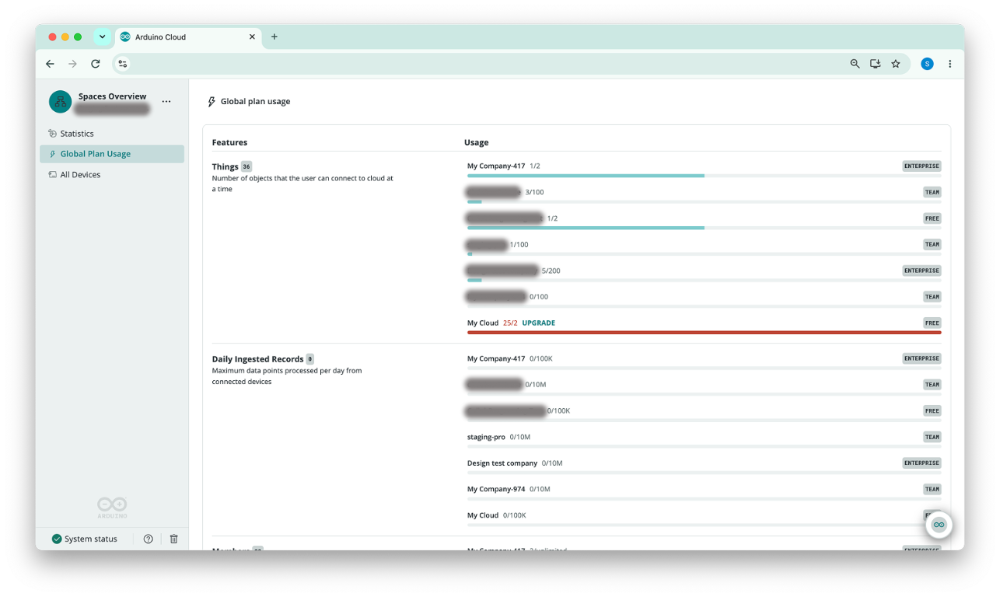
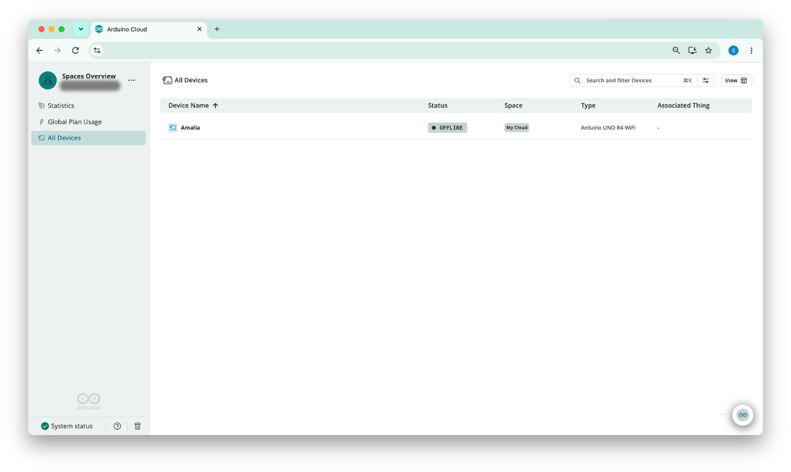

The **Spaces Overview** is a read-across view of every [space](/arduino-cloud/spaces-plans-account/spaces) you belong to. A single space only shows its own Things, devices, and members. The Spaces Overview adds them up across all of your spaces, compares each space's plan consumption side by side, and lists every device in one table. Use it to answer questions like "how many Things do I have in total?", "which space is about to hit its plan limit?", or "which space is this device in?" without switching from space to space.

<Alert type="info">

The Spaces Overview is available only if you belong to **more than one space**, for example your personal **My Cloud** space plus one or more shared spaces. If you only have your personal space, you won't see it.

</Alert>

## Opening the Spaces Overview

The Spaces Overview is a context of its own, just like a space. You open it the same way you switch between spaces: click the account button in the top-left corner, and pick **Spaces Overview** from the list of spaces you can access. While it's open, the top-left corner of the sidebar shows **Spaces Overview** in place of a space name.

The left sidebar shows the Spaces Overview navigation, which has three sections:

| Section | Shows | Use It To |
|---|---|---|
| **Statistics** | Things, devices, members, ingested records, and Trigger activations summed across all of your spaces, plus how your Things are spread across them | Get an account-wide picture of your usage |
| **Global Plan Usage** | Usage against the plan limit for each feature in each space, along with each space's plan tier | Find spaces that are close to, or over, their limits |
| **All Devices** | Every device from every space in a single table | Find a device and see which space it belongs to |

To go back to working inside a specific space, select that space from the same account button.

<Alert type="warning">

Needs verification: confirm the exact label and position of the **Spaces Overview** entry in the space selector against the live UI before publishing.

</Alert>

## Statistics Across All Spaces

The **Statistics** section uses the same widgets as the Statistics section on a space's Home page, but each value is the **sum across every space you belong to**: total Things, devices, members, ingested records, and Trigger activations. It also adds a **Things distribution** chart that shows how your Things are spread across your spaces.

Charts here break values down **by space** instead of by Thing. For example, the **Total Ingested Records** chart shows how many records each space contributed per day, and its limit line shows the highest Daily Ingested Records limit among your spaces.

See [Space Statistics](/arduino-cloud/spaces-plans-account/space-statistics) for details on every widget, including the [Ingested Records Usage Chart](/arduino-cloud/spaces-plans-account/space-statistics#ingested-records-usage-chart).

## Global Plan Usage

Each space has its own [plan](/arduino-cloud/spaces-plans-account/plans-limits-quotas), with its own limits, so you can reach the limit in one space while another still has room. The **Global Plan Usage** section puts every space in one table so you can audit them all in one pass, without opening each space's **Plan Usage** page.

The table is grouped by **feature**, with one row for each plan-limited resource, including:

| Feature | Description |
|---|---|
| **Things** | Number of objects that the user can connect to the cloud at a time |
| **Daily Ingested Records** | Maximum data points processed per day from connected devices |
| **Members** | Members in each space |

The **Features** column shows the feature name, a short description, and a badge with your total across all spaces, for example the total number of Things you have. The **Usage** column lists every space you belong to, and for each space shows:

- The **space name** and its current **usage against the limit**, for example `3/100` Things, `0/10M` daily ingested records, or a limit of `unlimited`.
- A **progress bar** that fills up as usage approaches the limit.
- The space's **plan tier** badge on the right, such as **FREE**, **TEAM**, or **ENTERPRISE**.

When a space goes **over its limit**, its usage and progress bar turn red, and an **UPGRADE** link appears next to the usage. For example, `25/2` Things on a Free plan means the space holds 25 Things while its plan allows 2.

### Finding Spaces Close to Their Limits

To decide where you need to upgrade or move resources:

1. Open the **Spaces Overview** and select **Global Plan Usage**.
2. For each feature, look for spaces whose progress bar is almost full or shown in red.
3. Check the plan tier badge for that space. A space on a lower tier may need an upgrade, while a space on a higher tier may have room to take over some of the load.
4. Select **UPGRADE** next to a space that's over its limit, or switch into the space to move resources, such as deleting unused Things or reassigning members.

For what each tier includes, see [Plans, Limits & Quotas](/arduino-cloud/spaces-plans-account/plans-limits-quotas) and the [Plans & Feature Matrix](/arduino-cloud/reference/plans-feature-matrix).

## All Devices Across Your Spaces

Normally a device only appears on the **Devices** page of the space it was registered in. That makes it hard to find a device when you don't remember which space it lives in. The **All Devices** section fixes this by listing every device from every space you belong to in one table:

| Column | Description |
|---|---|
| **Device Name** | The name given to the device when it was added. The table is sorted alphabetically by this column by default. |
| **Status** | Whether the device is currently **ONLINE** or **OFFLINE** (see [Device Status & Lifecycle](/arduino-cloud/devices/device-status-lifecycle)) |
| **Space** | A badge with the name of the space the device belongs to, for example **My Cloud** |
| **Type** | The board or device type, for example **Arduino® UNO™ R4™ WiFi** |
| **Associated Thing** | The [Thing](/arduino-cloud/things-data/things) the device is linked to, or `-` if it isn't linked to any Thing |

The toolbar above the table has three controls:

| Control | Use It To |
|---|---|
| **Search and filter Devices** | Search for a device by name. Press `⌘K` on macOS to jump to the field. |
| **Filter** (button next to the search field) | Narrow the list down to the devices you're looking for |
| **View** | Customize how the table is displayed |

### Locating a Device's Space

1. Open the **Spaces Overview** and select **All Devices**.
2. Type the device name into the **Search and filter Devices** field.
3. Read the **Space** column to see which space the device belongs to.
4. To configure the device, switch into that space and open the device from its **Devices** page.

## Next Steps

- [Space Statistics](/arduino-cloud/spaces-plans-account/space-statistics)
- [Spaces](/arduino-cloud/spaces-plans-account/spaces)
- [Members & Roles](/arduino-cloud/spaces-plans-account/members-roles)
- [Plans, Limits & Quotas](/arduino-cloud/spaces-plans-account/plans-limits-quotas)
- [Devices Overview](/arduino-cloud/devices/devices-overview)
