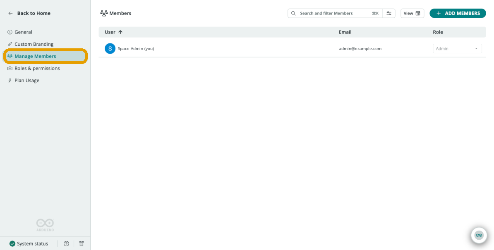
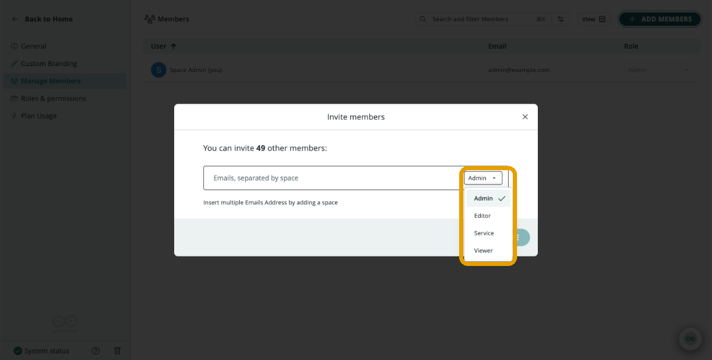
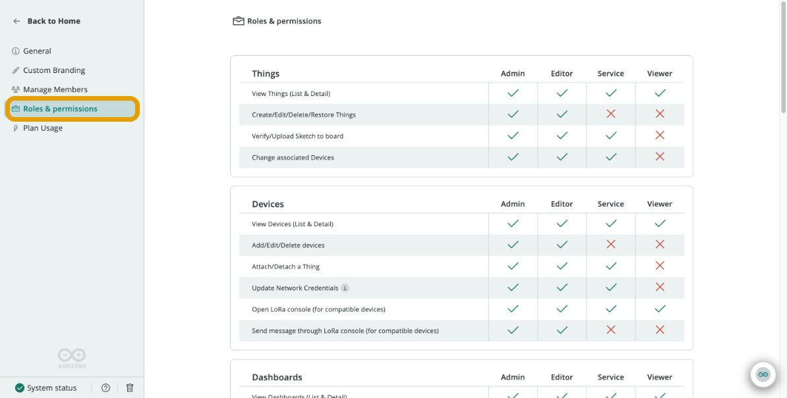

A shared space can have any number of members, and **role-based access control (RBAC)** determines what each member can do within it. Every member of a shared space is assigned a role, and that role determines which resources the member can view and which actions the member can perform in that space.

The person who activates the plan and creates the space becomes an **Admin**. A space can have multiple Admins with identical permissions. Admins (and, in Education spaces, Teachers) invite other members and assign their roles.

The available roles depend on the type of shared space:

| Space Type | Available Roles |
|---|---|
| **Business** (Team and Enterprise) | Admin, Editor, Service, Viewer |
| **Education** | Admin, Teacher, Student |

Permissions are enforced in the same way across all supported clients, including the Arduino Cloud web app, the [IoT Remote app](/arduino-cloud/iot-remote-app/use-dashboards-on-phone), the [Arduino Cloud CLI](/arduino-cloud/apis-cli/cli-devices), and the [REST API](/arduino-cloud/apis-cli/rest-api-sdks).

<Alert type="info">

The permissions described on this page apply within the selected shared space. A member's role, and therefore their permissions, can differ between spaces.

</Alert>

## Business Space Roles

Team and Enterprise spaces support the following roles:

| Role | Access Level |
|---|---|
| **Admin** | Full access to resources, member management, space settings, and plan management. |
| **Editor** | Full editing access to shared resources. Editors can view the members list and the roles and permissions, but cannot manage members, custom branding, or payments. |
| **Service** | Operational access with limited editing permissions. Service members can perform selected device, dashboard, Trigger, Template, Sketch, and recovery operations, but cannot manage members, custom branding, or payments. |
| **Viewer** | Read-only access, plus selected non-destructive interactions: interacting with dashboard widgets, downloading historical data, opening the LoRa® console, downloading Sketches, and opening the Serial Monitor. |

### Business Space Permissions

A check mark (✓) means that the role can perform the action.

| Area | Action | Admin | Editor | Service | Viewer |
|---|---|:---:|:---:|:---:|:---:|
| Things | View Things (list and detail) | ✓ | ✓ | ✓ | ✓ |
| Things | Create, edit, and delete Things | ✓ | ✓ | | |
| Things | Create, edit, and delete Cloud variables | ✓ | ✓ | | |
| Things | Change associated devices | ✓ | ✓ | ✓ | |
| Things | Create, edit, and delete metadata information | ✓ | ✓ | | |
| Devices | View devices (list and detail) | ✓ | ✓ | ✓ | ✓ |
| Devices | Add, edit, and delete devices | ✓ | ✓ | | |
| Devices | Update network credentials | ✓ | ✓ | ✓ | |
| Devices | Open LoRa console | ✓ | ✓ | ✓ | ✓ |
| Devices | Send messages through LoRa console | ✓ | ✓ | | |
| Dashboards | View dashboards (list and detail) | ✓ | ✓ | ✓ | ✓ |
| Dashboards | Create, edit, and delete dashboards | ✓ | ✓ | | |
| Dashboards | Interact with widgets | ✓ | ✓ | ✓ | ✓ |
| Dashboards | Download historical data | ✓ | ✓ | ✓ | ✓ |
| Dashboards | View or open linked Things | ✓ | ✓ | ✓ | ✓ |
| Dashboards | Share dashboards | ✓ | ✓ | | |
| Triggers | View Triggers (list and detail) | ✓ | ✓ | ✓ | ✓ |
| Triggers | Create, edit, and delete Triggers | ✓ | ✓ | ✓ | |
| Triggers | Enable and disable Triggers | ✓ | ✓ | ✓ | |
| Triggers | View Triggers history | ✓ | ✓ | ✓ | ✓ |
| Templates | View Arduino and custom Templates (list and detail) | ✓ | ✓ | ✓ | ✓ |
| Templates | Apply Templates | ✓ | ✓ | ✓ | |
| Templates | Create, edit, and delete Templates | ✓ | ✓ | | |
| Smart Folders | View Smart Folders | ✓ | ✓ | ✓ | ✓ |
| Smart Folders | Create and edit Smart Folders | ✓ | ✓ | | |
| Sketches | View Sketches (list and detail) | ✓ | ✓ | ✓ | ✓ |
| Sketches | Create, edit, and delete Sketches | ✓ | ✓ | | |
| Sketches | Upload a new Sketch | ✓ | ✓ | | |
| Sketches | Create, edit, and delete a folder | ✓ | ✓ | | |
| Sketches | Verify or upload a Sketch to a board | ✓ | ✓ | ✓ | |
| Sketches | Download a Sketch | ✓ | ✓ | ✓ | ✓ |
| Sketches | Open Serial Monitor | ✓ | ✓ | ✓ | ✓ |
| Integrations | View integration list | ✓ | ✓ | ✓ | ✓ |
| Integrations | Contact Arduino to add an integration | ✓ | | | |
| Resources | View and open Resources | ✓ | ✓ | ✓ | ✓ |
| Recently Deleted Items | View recently deleted items | ✓ | ✓ | | |
| Recently Deleted Items | Restore deleted items | ✓ | ✓ | ✓ | |
| Space Settings | View general information | ✓ | ✓ | ✓ | ✓ |
| Space Settings | View custom branding | ✓ | | | |
| Space Settings | Edit custom branding | ✓ | | | |
| Space Settings | View members list | ✓ | ✓ | | |
| Space Settings | Add members to the organization | ✓ | | | |
| Space Settings | Assign members' roles | ✓ | | | |
| Space Settings | Remove members | ✓ | | | |
| Space Settings | View roles and permissions | ✓ | ✓ | ✓ | ✓ |
| Space Settings | View plan usage information | ✓ | ✓ | ✓ | ✓ |
| Plan Management | Payment | ✓ | | | |

## Education Space Roles

Education spaces support the following roles:

| Role | Access Level |
|---|---|
| **Admin** | Full access to resources, member management, space settings, and plan management. |
| **Teacher** | Create, edit, and delete shared resources. Teachers can also view the members list, add members, assign roles, remove members, and view roles and permissions. |
| **Student** | Create, edit, and delete shared project resources. Students cannot manage members, custom branding, integration requests, or payments. |

### Education Space Permissions

A check mark (✓) means that the role can perform the action.

| Area | Action | Admin | Teacher | Student |
|---|---|:---:|:---:|:---:|
| Things | View Things (list and detail) | ✓ | ✓ | ✓ |
| Things | Create, edit, and delete Things | ✓ | ✓ | ✓ |
| Things | Create, edit, and delete Cloud variables | ✓ | ✓ | ✓ |
| Things | Change associated devices | ✓ | ✓ | ✓ |
| Things | Create, edit, and delete metadata information | ✓ | ✓ | ✓ |
| Devices | View devices (list and detail) | ✓ | ✓ | ✓ |
| Devices | Add, edit, and delete devices | ✓ | ✓ | ✓ |
| Devices | Update network credentials | ✓ | ✓ | ✓ |
| Devices | Open LoRa console | ✓ | ✓ | ✓ |
| Devices | Send messages through LoRa console | ✓ | ✓ | ✓ |
| Dashboards | View dashboards (list and detail) | ✓ | ✓ | ✓ |
| Dashboards | Create, edit, and delete dashboards | ✓ | ✓ | ✓ |
| Dashboards | Interact with widgets | ✓ | ✓ | ✓ |
| Dashboards | Download historical data | ✓ | ✓ | ✓ |
| Dashboards | View or open linked Things | ✓ | ✓ | ✓ |
| Dashboards | Share dashboards | ✓ | ✓ | ✓ |
| Triggers | View Triggers (list and detail) | ✓ | ✓ | ✓ |
| Triggers | Create, edit, and delete Triggers | ✓ | ✓ | ✓ |
| Triggers | Enable and disable Triggers | ✓ | ✓ | ✓ |
| Triggers | View Triggers history | ✓ | ✓ | ✓ |
| Templates | View Arduino and custom Templates (list and detail) | ✓ | ✓ | ✓ |
| Templates | Apply Templates | ✓ | ✓ | ✓ |
| Templates | Create, edit, and delete Templates | ✓ | ✓ | ✓ |
| Smart Folders | View Smart Folders | ✓ | ✓ | ✓ |
| Smart Folders | Create and edit Smart Folders | ✓ | ✓ | ✓ |
| Sketches | View Sketches (list and detail) | ✓ | ✓ | ✓ |
| Sketches | Create, edit, and delete Sketches | ✓ | ✓ | ✓ |
| Sketches | Upload a new Sketch | ✓ | ✓ | ✓ |
| Sketches | Create, edit, and delete a folder | ✓ | ✓ | ✓ |
| Sketches | Verify or upload a Sketch to a board | ✓ | ✓ | ✓ |
| Sketches | Download a Sketch | ✓ | ✓ | ✓ |
| Sketches | Open Serial Monitor | ✓ | ✓ | ✓ |
| Integrations | View integration list | ✓ | ✓ | ✓ |
| Integrations | Contact Arduino to add an integration | ✓ | ✓ | |
| Resources | View and open Resources | ✓ | ✓ | ✓ |
| Recently Deleted Items | View recently deleted items | ✓ | ✓ | ✓ |
| Recently Deleted Items | Restore deleted items | ✓ | ✓ | ✓ |
| Space Settings | View general information | ✓ | ✓ | ✓ |
| Space Settings | View custom branding | ✓ | | |
| Space Settings | Edit custom branding | ✓ | | |
| Space Settings | View members list | ✓ | ✓ | |
| Space Settings | Add members to the organization | ✓ | ✓ | |
| Space Settings | Assign members' roles | ✓ | ✓ | |
| Space Settings | Remove members | ✓ | ✓ | |
| Space Settings | View roles and permissions | ✓ | ✓ | |
| Space Settings | View plan usage information | ✓ | ✓ | ✓ |
| Plan Management | Payment | ✓ | | |

## Managing Members

Open **Manage Members** under **Space Settings** to see everyone with access to the space and their current role:

To change the role of an existing member, select a new role from the role dropdown next to their name in the members list. The roles shown in the dropdown depend on the type of space and on the permissions of the member managing the space.

## Inviting a New Member

Select **ADD MEMBERS** in the top-right corner, enter the email addresses of the people to invite, and assign each a role from the role dropdown:

When you invite a new member, Arduino Cloud preselects the role with the least permissions:

- **Business spaces:** Viewer
- **Education spaces:** Student

<Alert type="note">

Review the selected role before sending the invitation. Defaulting to the role with the least permissions helps prevent granting more access than intended.

</Alert>

Invitees receive an email with a link to join the space. Once they accept, they appear in the members list and can start working according to their assigned role.

## Reviewing Roles and Permissions in Arduino Cloud

Members with the **View roles and permissions** permission (every role in Business spaces, and Admins and Teachers in Education spaces) can review the roles available in a shared space directly in Arduino Cloud:

1. Open [Arduino Cloud](https://app.arduino.cc/).
2. Select the shared space from the space selector.
3. In the sidebar, select **Space Settings**.
4. Select **Roles & Permissions**.

The page shows the roles available for the selected space and the actions assigned to each role.

## Next Steps

- [Spaces](/arduino-cloud/spaces-plans-account/spaces)
- [Plans, Limits & Quotas](/arduino-cloud/spaces-plans-account/plans-limits-quotas)
- [Arduino Cloud for Business](/arduino-cloud/business)
- [Shared Spaces for Education](/arduino-cloud/education/shared-spaces)

## Trademark Acknowledgments

- **LoRa®** is a registered trademark of Semtech Corporation.
