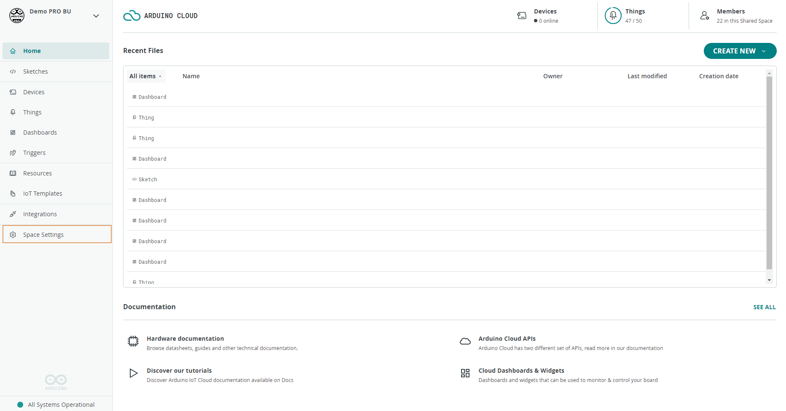
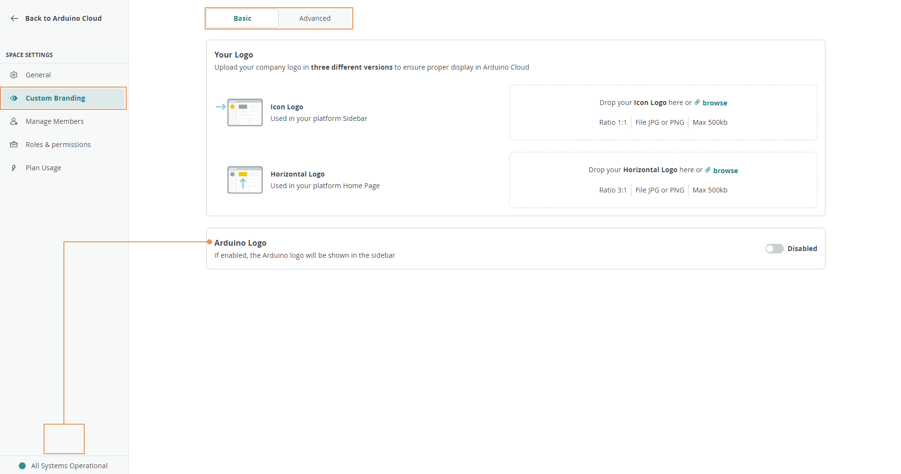

Team plans can **white-label** a shared space, replacing Arduino's branding with
your own. Custom branding personalizes the space's logo, and advanced options
add a custom URL and social sign-in — useful when presenting a cloud environment
to customers or students under your own identity.

Open **Space Settings → Custom Branding** from the shared space sidebar:

## Basic: Logo and Sidebar

The **Basic** tab customizes your logo and the Arduino logo's visibility:

- **Your Logo** — upload a `JPEG` or `PNG` (max 500 KB). The **Icon Logo**
  (recommended ratio 1:1) appears on the sidebar; the **Horizontal Logo**
  (recommended ratio 3:1) appears on the space's Home page.
- **Arduino Logo** — toggle the visibility of the Arduino logo on the sidebar.

## Advanced: Custom URL and Social Sign-In

The **Advanced** tab enables full white labeling:

- **Custom URL** — set a custom subdomain and a site name shown as the page
  title. Avoid special characters or spaces in the subdomain; it's validated and
  previewed on submit.
- **Social Sign-In** — offer Google, GitHub, or Apple authentication. The
  **Custom URL** must be configured first, or this option stays unavailable.

<Alert type="warning">

Disabling a Social Sign-In method later removes the user accounts and data
associated with that authentication method — proceed carefully.

</Alert>

Remember to select **Save** to apply the configuration.

## Next Steps

- [Spaces](/arduino-cloud/spaces-plans-account/spaces)
- [Members & Roles](/arduino-cloud/spaces-plans-account/members-roles)
