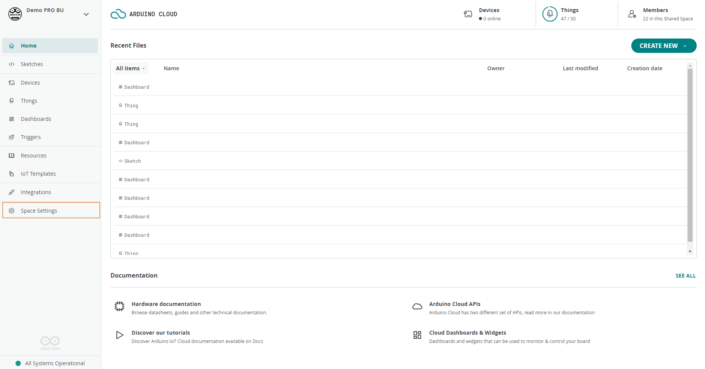
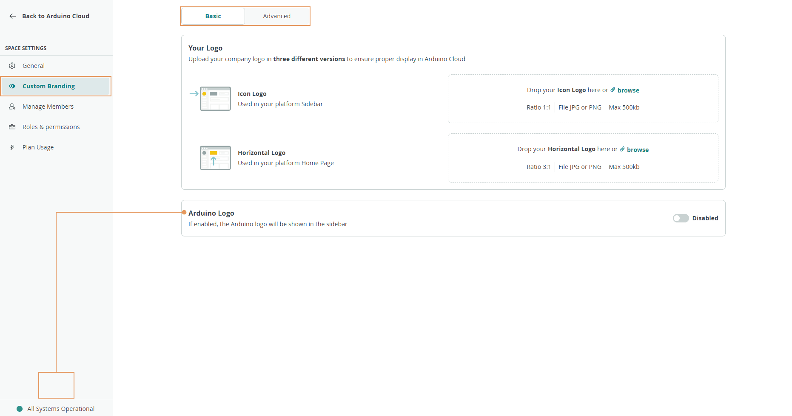
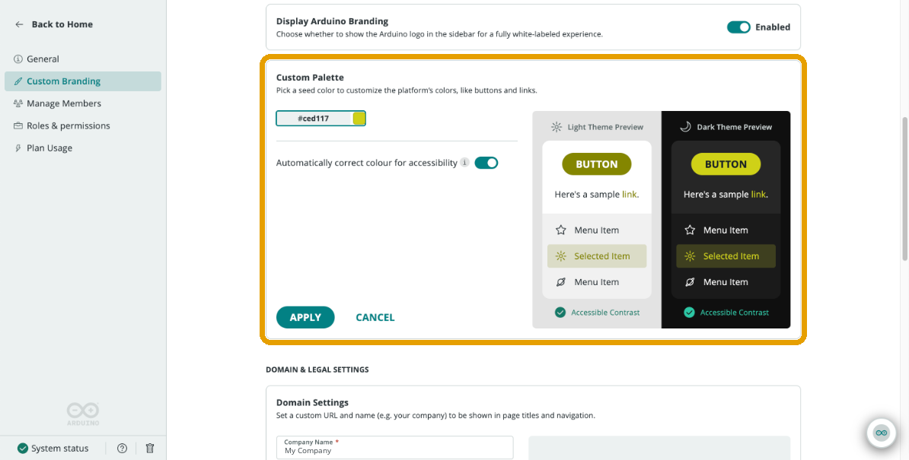

Team plans can **white-label** a shared space, replacing Arduino's branding with your own. Custom branding personalizes the space's logo and interface colors, and advanced options add a custom URL and social sign-in — useful when presenting a cloud environment to customers or students under your own identity.

Open **Space Settings → Custom Branding** from the shared space sidebar:

## Basic: Logo and Sidebar

The **Basic** tab customizes your logo and the Arduino logo's visibility:

- **Your Logo** — upload a `JPEG` or `PNG` (max 500 KB). The **Icon Logo** (recommended ratio 1:1) appears on the sidebar; the **Horizontal Logo** (recommended ratio 3:1) appears on the space's Home page.
- **Arduino Logo** — toggle the visibility of the Arduino logo on the sidebar.

## Custom Palette: Brand Colors for the Interface

**Custom Palette** recolors the interactive elements of the Arduino Cloud web app, such as buttons, links, and selected menu items, to match your brand. It complements your logo: the logo replaces Arduino's imagery, and the palette replaces Arduino's default accent color, so the space looks like part of your own product rather than a re-skinned Arduino tool.

<Alert type="info">

Custom Palette is available only on Arduino Cloud plans that include white-label capabilities, and only Space Admins can configure it. It is not available on plans without white-label entitlements.

</Alert>

You find it under **Space Settings → Custom Branding**, in the **Custom Palette** card:

### How the Seed Color Works

Custom Palette is not a full palette editor. You choose a single **seed color**, and Arduino Cloud derives every shade the interface needs from it: the button fill, link text, and selected-item background in both the light and dark themes. This keeps all interactive elements consistent with each other from a single input.

### Setting a Custom Palette

1. Open **Space Settings → Custom Branding** and scroll to the **Custom Palette** card.
2. Enter a hex color code (for example, `#ced117`) in the color field, or select the color swatch next to it to choose a color with the color picker.
3. Review the **Light Theme Preview** and **Dark Theme Preview** on the right.
4. Leave **Automatically correct colour for accessibility** enabled unless you need the exact seed color (see below).
5. Select **APPLY** to save the palette, or **CANCEL** to discard your changes.

Changes are staged in the preview only. Nothing changes in the space until you select **APPLY**.

### Reading the Theme Previews

The side-by-side previews show how the derived colors render on real interface patterns before you commit them:

| Preview Element | What It Shows |
|---|---|
| **BUTTON** | The fill color of primary action buttons |
| **Sample link** | The color of text links |
| **Menu Item** | Unselected menu entries, which keep their neutral color |
| **Selected Item** | The highlight and text color of the selected or active menu entry |
| **Accessible Contrast** | A status indicator showing whether the generated colors have accessible contrast in that theme |

Check both themes. A color that reads well on the light background can be too dark on the dark background, and the reverse.

### Automatic Accessibility Correction

The **Automatically correct colour for accessibility** toggle is enabled by default. With it enabled, Arduino Cloud adjusts the colors derived from your seed color so that buttons, links, and selected items stay legible in both themes. This is why the derived shades in the preview can differ slightly from the exact seed color you entered.

If your brand guidelines require the exact seed color, you can disable the toggle. Review both previews before applying, since an uncorrected color can make text hard to read for some users.

### Restoring the Arduino Default Colors

To undo a custom palette, select the **DEFAULT** label next to the color swatch. This resets the seed color to Arduino's default palette color. Select **APPLY** to save the change.

### Where the Custom Palette Applies

The custom palette affects the **Arduino Cloud web app interface** only, mainly interactive elements such as buttons and links. It does not apply to:

- The [IoT Remote app](/arduino-cloud/iot-remote-app/use-dashboards-on-phone) for mobile devices.
- Transactional and system emails sent by Arduino Cloud.

## Advanced: Custom URL and Social Sign-In

The **Advanced** tab enables full white labeling:

- **Custom URL** — set a custom subdomain and a site name shown as the page title. Avoid special characters or spaces in the subdomain; it's validated and previewed on submit.
- **Social Sign-In** — offer Google, GitHub, or Apple authentication. The **Custom URL** must be configured first, or this option stays unavailable.

<Alert type="warning">

Disabling a Social Sign-In method later removes the user accounts and data associated with that authentication method — proceed carefully.

</Alert>

Remember to select **Save** to apply the configuration. The Custom Palette card has its own **APPLY** button.

## Next Steps

- [Spaces](/arduino-cloud/spaces-plans-account/spaces)
- [Members, Roles & Permissions](/arduino-cloud/spaces-plans-account/members-roles)
