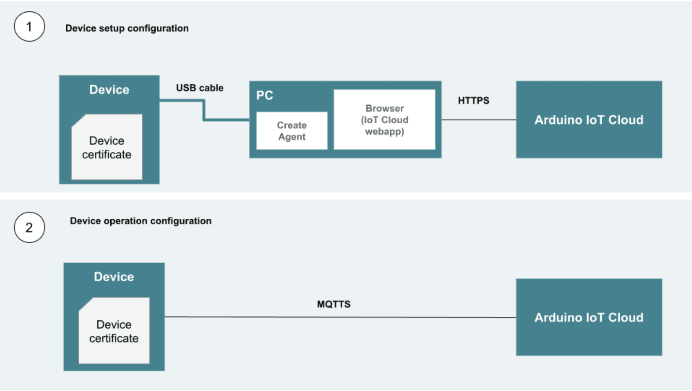

Every device in Arduino Cloud has a cryptographic identity used to authenticate
it and secure the data it exchanges. How that identity is stored depends on the
board: boards with a **secure element** keep keys in tamper-resistant hardware,
while other boards use a Device ID and Secret Key pair.

## Device ID and Secret Key

When a device is registered, Arduino Cloud generates two credentials:

- **Device ID** — the device's unique identifier, safe to reference in code and
  dashboards.
- **Secret Key** — a private key shown only once, at creation. Store it safely;
  it can't be retrieved later, only regenerated.

Boards without a secure element (such as the UNO R4 Wi-Fi®, Nano ESP32, and
ESP32/ESP8266) and manual clients authenticate with this ID + secret key pair.

## Secure Element Boards

Boards with a secure element chip (the MKR family, Nano 33 IoT, Portenta, and
others) establish identity differently. During setup, the board generates a
private/public key pair and a Certificate Signing Request (CSR); the private key
never leaves the secure element. The CSR is signed by Arduino Cloud's
Certification Authority, and the resulting certificate is stored back on the
device:

In operation, the device and the Cloud's MQTT server establish a **mutual-TLS**
connection — each verifies the other's identity — so no secret key is ever
exposed in the sketch. Devices connect to `*.arduino.cc` on ports 8883/8884 for
this.

<Alert type="info">

The secure element provides hardware-level encryption and tamper protection.
Beyond the Cloud certificate, you can also use it to store other sensitive
information your board needs at runtime.

</Alert>

## Keeping Secrets Out of Sketches

Credentials like Wi-Fi® passwords and API keys should never be hard-coded into
sketch source that might be shared. The Cloud Editor provides a dedicated
**Secret** tab where such values are stored encrypted (AES-256) and referenced
by name instead of being written in the code:

- A device's Secret Key and secure-element certificate are handled by the
  platform, not pasted into your sketch.
- Network credentials and other secrets belong in the editor's Secret tab.

For the full workflow, see
[Keep Secrets Out of Your Sketch](/arduino-cloud/sketches-editor/keep-secrets-out).

## Next Steps

- [Keep Secrets Out of Your Sketch](/arduino-cloud/sketches-editor/keep-secrets-out)
- [Security Overview](/arduino-cloud/security-privacy/security-overview)
- [Devices Overview](/arduino-cloud/devices/devices-overview)
