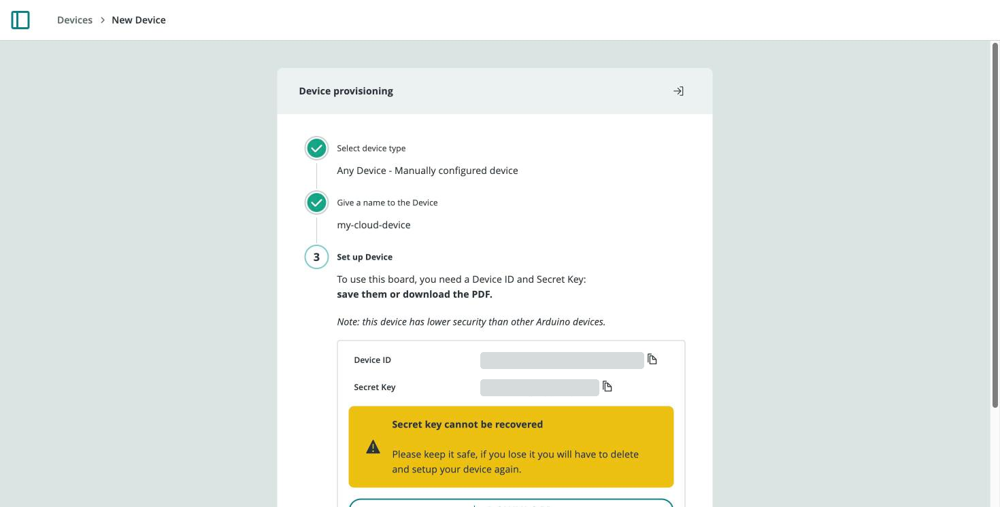
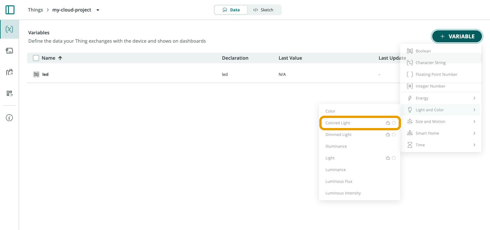

A board running MicroPython (GIGA R1 WiFi, Portenta H7, Nano ESP32, and others
with MicroPython ≥ 1.2) connects to Arduino Cloud as a
[manual (generic) device](/arduino-cloud/devices/add-manual-device) — there's no
generated sketch. You write the connection code yourself using
[arduino-iot-cloud-py](https://github.com/arduino/arduino-iot-cloud-py), the
same library that also covers CPython.

## Setting Up the Cloud Side

Create a [Thing](/arduino-cloud/things-data/things) and associate a **manual
device** with it rather than an Arduino board. This generates a **Device ID**
and **Secret Key** used for authentication instead of a sketch:



Add the [Cloud Variables](/arduino-cloud/things-data/cloud-variables) your
script expects — names are case-sensitive and must match exactly what you
register in code — then build a
[dashboard](/arduino-cloud/dashboards/dashboards) with widgets linked
to them.

## Installing the Library on the Board

Two install paths work, depending on tooling:

- **`mip`, from a running MicroPython REPL/script** (simplest):

  ```python
  import mip
  mip.install("arduino-iot-cloud")
  ```

- **`mpremote`, from your computer**, useful for scripted/CI installs:

  ```bash
  pip install mpremote
  mpremote connect list
  mpremote connect id:<serial-id> mip install github:arduino/arduino-iot-cloud-py
  ```

Keep credentials and Wi-Fi® details out of the main script, in a `secrets.py`
file copied onto the board's filesystem:

```python
WIFI_SSID = "myNetwork"
WIFI_PASSWORD = "passwordForWiFi"
DEVICE_ID = b"ef77wer88-0432-4574-85e1-54e3d5cac861"
CLOUD_PASSWORD = b"TQHFHEKKKLSYMPB1OZLF"
```

## Async vs. Sync Connection Modes

- **Async (default)** — non-blocking; the client's networking runs alongside
  the rest of your code using MicroPython's `async`/`await` primitives, so you
  can keep reading sensors while waiting on the network.
- **Sync** (`sync_mode=True`) — simpler, sequential execution; `client.start()`
  returns immediately after connecting and you call `client.update()` yourself
  on a loop. Easier to reason about, but a slow network call can block
  subsequent code.

```python
# Sync
client = ArduinoCloudClient(device_id=DEVICE_ID, username=DEVICE_ID, password=SECRET_KEY, sync_mode=True)
client.register("sw1", value=None, on_write=on_switch_changed)
client.register("led", value=None)
client.start()
while True:
    client.update()
    time.sleep(0.100)
```

## Full Example: Toggling an LED

```python
from machine import Pin
import time
import network
import logging
from arduino_iot_cloud import ArduinoCloudClient

from secrets import WIFI_SSID, WIFI_PASSWORD, DEVICE_ID, CLOUD_PASSWORD

led = Pin("LED_BUILTIN", Pin.OUT)

def on_switch_changed(client, value):
    led.value(not value)
    client["led"] = value

def wifi_connect():
    wlan = network.WLAN(network.STA_IF)
    wlan.active(True)
    wlan.connect(WIFI_SSID, WIFI_PASSWORD)
    while not wlan.isconnected():
        logging.info("Trying to connect. Note this may take a while...")
        time.sleep_ms(500)
    logging.info(f"WiFi Connected {wlan.ifconfig()}")

if __name__ == "__main__":
    logging.basicConfig(datefmt="%H:%M:%S", format="%(asctime)s.%(msecs)03d %(message)s", level=logging.INFO)
    wifi_connect()

    client = ArduinoCloudClient(device_id=DEVICE_ID, username=DEVICE_ID, password=CLOUD_PASSWORD)
    client.register("ledSwitch", value=None, on_write=on_switch_changed, interval=0.250)
    client.register("led", value=None)
    client.start()
```

`client.start()` enters a loop that keeps running as long as the board is
connected, syncing registered variables in both directions.

## Using Specialized Variable Types

Basic types (Boolean, Integer, Float, String) register with a plain
`client.register("name", ...)`. Specialized types — like a colored light for an
RGB LED — need their matching Python class imported and passed to `register()`
instead of a bare name:



```python
from arduino_iot_cloud import ColoredLight

client.register(ColoredLight("light", swi=True, on_write=on_colored_light_changed))
```

The callback receives an object with the type's specific properties — for a
colored light, `swi` (on/off), `hue`, `sat`, and `bri` — which you convert to
RGB before driving physical LED pins.

<Alert type="info">

If the board doesn't connect or variables don't sync: confirm MicroPython ≥ 1.2
is installed, double-check `secrets.py`'s Wi-Fi® and Device ID/Secret Key values
against what's shown in the Cloud, and make sure the Thing's variables are named
exactly as registered — names are case-sensitive.

</Alert>

## Next Steps

- [Python](/arduino-cloud/device-libraries/python) — the full
  `arduino-iot-cloud-py` reference, shared between MicroPython and CPython.
- [Cloud Variables](/arduino-cloud/things-data/cloud-variables)
- [Add a Manual Device](/arduino-cloud/devices/add-manual-device)
