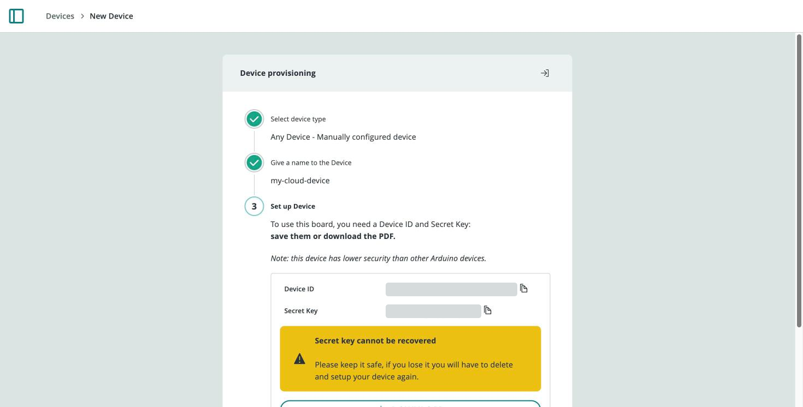
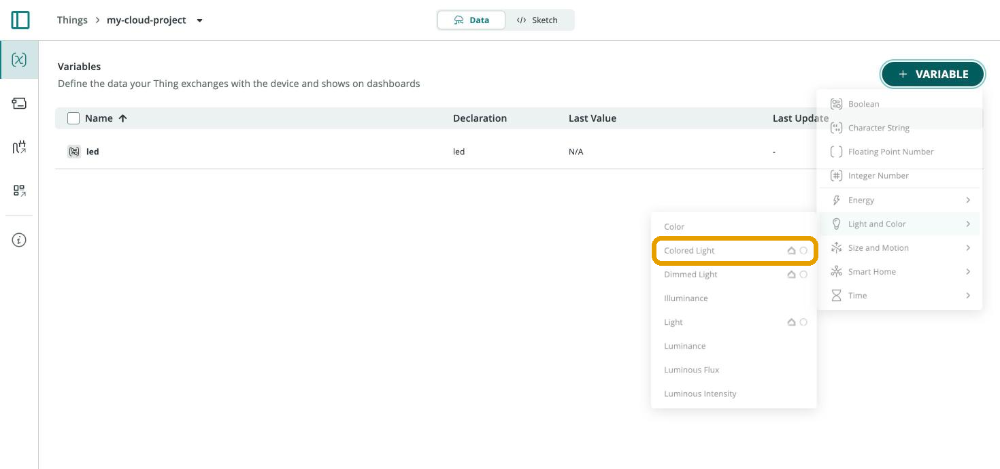

A board running MicroPython (GIGA R1 WiFi, Portenta H7, Nano ESP32, and others with MicroPython ≥ 1.2) connects to Arduino Cloud as a [manual (generic) device](/arduino-cloud/devices/add-manual-device) — there's no generated sketch. You write the connection code yourself using [arduino-iot-cloud-py](https://github.com/arduino/arduino-iot-cloud-py), the same library that also covers CPython.

As a minimal example, this page toggles the on-board LED of the board using an Arduino Cloud dashboard widget.

## Requirements

- [Arduino Lab for MicroPython](https://labs.arduino.cc/en/labs/micropython)
- [Arduino GIGA R1 WiFi](/hardware/giga-r1-wifi), [Portenta H7](/hardware/portenta-h7) or [Nano ESP32](https://store.arduino.cc/products/nano-esp32)
- MicroPython >= 1.2 installed on your Arduino board. See the [MicroPython Installation Guide](/micropython/basics/board-installation), written for all Arduino boards.

## Setting Up the Cloud Side

The board connects as a **manual device**, which uses a **Device ID** and **Secret Key** for authentication instead of a generated sketch. Variable names are case-sensitive and must match exactly what you register in code.

1. Create a [Thing](/arduino-cloud/things-data/things), click **Select Device** under **Associated Devices**, then **Set Up New Device** > **Manual Device**, and name the device.
2. Save the generated **Device ID** and **Secret Key** (you can download them as a PDF). The Secret Key cannot be retrieved again.

    

3. In the Thing, add two Boolean [Cloud Variables](/arduino-cloud/things-data/cloud-variables) named `led` and `ledSwitch`.
4. Create a [dashboard](/arduino-cloud/dashboards/dashboards) with an **LED** widget linked to `led` and a **Switch** widget linked to `ledSwitch`.

See [Add a Manual Device](/arduino-cloud/devices/add-manual-device) for more details.

## Installing the Library on the Board

Two install paths work, depending on tooling:

- **`mip`, from a running MicroPython REPL/script** (simplest):

  ```python
  import mip
  mip.install("github:arduino/arduino-iot-cloud-py")
  ```

- **`mpremote`, from your computer**, useful for scripted/CI installs:

  ```bash
  pip install mpremote
  mpremote connect list
  mpremote connect id:<serial-id> mip install github:arduino/arduino-iot-cloud-py
  ```

Keep credentials and Wi-Fi® details out of the main script, in a `secrets.py` file copied onto the board's filesystem with the file manager in [Arduino Lab for MicroPython](https://labs.arduino.cc/en/labs/micropython):

```python
WIFI_SSID = "myNetwork"
WIFI_PASSWORD = "passwordForWiFi"
DEVICE_ID = b"ef77wer88-0432-4574-85e1-54e3d5cac861"
CLOUD_PASSWORD = b"TQHFHEKKKLSYMPB1OZLF"
```

<Alert type="info">

Do not copy files manually to the flash drive that mounts when MicroPython boots, as this can corrupt the file system.

</Alert>

## Async vs. Sync Connection Modes

- **Async (default)** — non-blocking; the client's networking runs alongside the rest of your code using MicroPython's `async`/`await` primitives, so you can keep reading sensors while waiting on the network.
- **Sync** (`sync_mode=True`) — simpler, sequential execution; `client.start()` returns immediately after connecting and you call `client.update()` yourself on a loop. Easier to reason about, but a slow network call can block subsequent code.

```python
# Sync
client = ArduinoCloudClient(device_id=DEVICE_ID, username=DEVICE_ID, password=SECRET_KEY, sync_mode=True)
client.register("sw1", value=None, on_write=on_switch_changed)
client.register("led", value=None)
client.start()
while True:
    client.update()
    time.sleep(0.100)
```

## Full Example: Toggling an LED

```python
from machine import Pin
import time
import network
import logging
from arduino_iot_cloud import ArduinoCloudClient

from secrets import WIFI_SSID, WIFI_PASSWORD, DEVICE_ID, CLOUD_PASSWORD

led = Pin("LED_BUILTIN", Pin.OUT)

def on_switch_changed(client, value):
    led.value(not value)
    client["led"] = value

def wifi_connect():
    wlan = network.WLAN(network.STA_IF)
    wlan.active(True)
    wlan.connect(WIFI_SSID, WIFI_PASSWORD)
    while not wlan.isconnected():
        logging.info("Trying to connect. Note this may take a while...")
        time.sleep_ms(500)
    logging.info(f"WiFi Connected {wlan.ifconfig()}")

if __name__ == "__main__":
    logging.basicConfig(datefmt="%H:%M:%S", format="%(asctime)s.%(msecs)03d %(message)s", level=logging.INFO)
    wifi_connect()

    client = ArduinoCloudClient(device_id=DEVICE_ID, username=DEVICE_ID, password=CLOUD_PASSWORD)
    client.register("ledSwitch", value=None, on_write=on_switch_changed, interval=0.250)
    client.register("led", value=None)
    client.start()
```

`client.start()` enters a loop that keeps running as long as the board is connected, syncing registered variables in both directions.

To test it, run the script from Arduino Lab for MicroPython and toggle the `ledSwitch` widget on your dashboard. The board's LED follows the switch, and the `led` widget mirrors its state.

## Using Specialized Variable Types

Basic types (Boolean, Integer, Float, String) register with a plain `client.register("name", ...)`. Specialized types — like a colored light for an RGB LED — need their matching Python class imported and passed to `register()` instead of a bare name. This example uses a **Colored Light** variable named `light`:



The callback receives an object of the same type with populated properties. For `ColoredLight`, these are `swi` (on/off), `hue` (0-360), `sat` and `bri` (0-100). To drive the board's RGB LED, convert them to RGB and set each channel with [PWM](/learn/microcontrollers/analog-output/). Combine this with the Wi-Fi® and client setup from the LED example, replacing its `register()` calls:

```python
from machine import Pin, PWM
from arduino_iot_cloud import ColoredLight

leds = [PWM(Pin(name, Pin.OUT)) for name in ("LEDR", "LEDG", "LEDB")]

def convert_hs_to_rgb(hue, sat, bri):
    h, s, v = hue / 360, sat / 100, bri / 100
    i = int(h * 6)
    f = h * 6 - i
    p, q, t = v * (1 - s), v * (1 - s * f), v * (1 - s * (1 - f))
    r, g, b = [(v, t, p), (q, v, p), (p, v, t), (p, q, v), (t, p, v), (v, p, q)][i % 6]
    return (int(r * 255), int(g * 255), int(b * 255))

def set_leds_from_rgb(rgb, common_cathode=True):
    for pwm, value in zip(leds, rgb):
        # The on-board RGB LED is on when the pin is low, so invert the value.
        if common_cathode:
            value = 255 - value
        value = max(0, min(255, value))
        pwm.duty_u16(int(value * 65535 / 255))

def on_colored_light_changed(client, light):
    if light.hue is None or light.sat is None or light.bri is None:
        return
    if light.swi:
        set_leds_from_rgb(convert_hs_to_rgb(light.hue, light.sat, light.bri))
    else:
        set_leds_from_rgb((0, 0, 0))

client.register(ColoredLight("light", swi=True, on_write=on_colored_light_changed))
```

<Alert type="info">

If the board doesn't connect or variables don't sync: confirm MicroPython ≥ 1.2 is installed, double-check `secrets.py`'s Wi-Fi® and Device ID/Secret Key values against what's shown in the Cloud, and make sure the Thing's variables are named exactly as registered — names are case-sensitive.

</Alert>

## Next Steps

- [Python](/arduino-cloud/device-libraries/python) — the full `arduino-iot-cloud-py` reference, shared between MicroPython and CPython.
- [Cloud Variables](/arduino-cloud/things-data/cloud-variables)
- [Add a Manual Device](/arduino-cloud/devices/add-manual-device)
