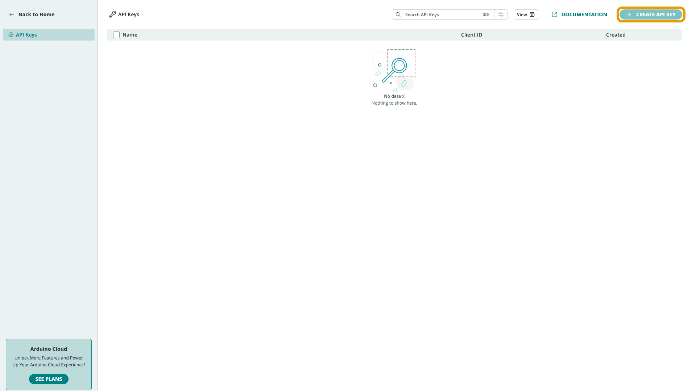

The Arduino Cloud REST API (`https://api2.arduino.cc/iot`) provides CRUD and
history access to every resource — Devices, Things, Properties, Dashboards,
Templates, Triggers, Series, LoRa® devices, and network credentials. It's used
from servers, scripts, CI, and backends over HTTPS. The full interactive
reference lives at
[docs.arduino.cc/cloud-api](https://docs.arduino.cc/cloud-api/).

## Getting API Credentials

Every call needs a bearer token, obtained via an OAuth2 client-credentials flow
using a **Client ID** and **Client Secret**. Create a pair from **API Keys**
(`/api-keys`) in the Arduino Cloud web UI — the secret is shown only once, so
download it as a PDF if offered:



## Token Exchange

```bash
curl --request POST \
  --url 'https://api2.arduino.cc/iot/v1/clients/token' \
  --header 'content-type: application/x-www-form-urlencoded' \
  --data 'grant_type=client_credentials' \
  --data 'client_id=YOUR_CLIENT_ID' \
  --data 'client_secret=YOUR_CLIENT_SECRET' \
  --data 'audience=https://api2.arduino.cc/iot'
```

Then call any endpoint with `Authorization: Bearer <token>`.

<Alert type="note">

Access tokens expire after 300 seconds — re-fetch rather than caching
long-term. The rate limit is 10 requests/second per authenticated client
(HTTP 429 beyond that).

</Alert>

## Resource Groups

| Group | Version(s) | Covers |
|---|---|---|
| Devices | v2 | CRUD, certs, OTA binaries, passthrough, tags |
| Things | v2 | CRUD, variable bindings, tags |
| Properties | v2 | Variable CRUD on a Thing |
| Property types | v1 | Enumerates allowed property types |
| Dashboards | v2 and v3 (current) | List/Create/Delete/Show/Patch/Clone/Share/Template |
| Templates | — | Thing + Dashboard bundles |
| Triggers | v1 | Condition → action (email/push/webhook) |
| Series | v2 | Raw + sampled + batch history queries, last-value |
| Lora devices | v1 | LoRaWAN® device management |
| Lora frequency plans | v1 | Supported frequency plans |
| Network credentials | v1 | Stored Wi-Fi®/cellular credentials |

## Official SDKs

CRUD-oriented client libraries, generated from the same OpenAPI spec:

| Language | Package | Repository |
|---|---|---|
| Go | `iot-client-go` | [github.com/arduino/iot-client-go](https://github.com/arduino/iot-client-go) |
| JavaScript | `@arduino/arduino-iot-client` | [github.com/arduino/iot-client-js](https://github.com/arduino/iot-client-js) |
| Python | `arduino-iot-client` | [github.com/arduino/iot-client-py](https://github.com/arduino/iot-client-py) |

The JavaScript and Python repos each ship a `docs/` folder with one rendered
markdown file per API group and per model — usually the fastest way to answer
"what does this endpoint accept/return". The Go repo documents methods and
params in `api_*.go` and schemas in `model_*.go`.

## Authenticating From an SDK

```python
# Python (arduino-iot-client)
from oauthlib.oauth2 import BackendApplicationClient
from requests_oauthlib import OAuth2Session
import iot_api_client as iot
from iot_api_client.configuration import Configuration
from iot_api_client.api import DevicesV2Api

oauth_client = BackendApplicationClient(client_id="YOUR_CLIENT_ID")
oauth = OAuth2Session(client=oauth_client)
token = oauth.fetch_token(
    token_url="https://api2.arduino.cc/iot/v1/clients/token",
    client_id="YOUR_CLIENT_ID",
    client_secret="YOUR_CLIENT_SECRET",
    include_client_id=True,
    audience="https://api2.arduino.cc/iot",
)

client_config = Configuration(host="https://api2.arduino.cc")
client_config.access_token = token.get("access_token")
client = iot.ApiClient(client_config)

devices_api = DevicesV2Api(client)
for device in devices_api.devices_v2_list():
    print(device.name, device.type)
```

```javascript
// JavaScript (@arduino/arduino-iot-client)
var IotApi = require('@arduino/arduino-iot-client');
var rp = require('request-promise');

async function getToken() {
  const response = await rp({
    method: 'POST',
    url: 'https://api2.arduino.cc/iot/v1/clients/token',
    headers: { 'content-type': 'application/x-www-form-urlencoded' },
    json: true,
    form: {
      grant_type: 'client_credentials',
      client_id: 'YOUR_CLIENT_ID',
      client_secret: 'YOUR_CLIENT_SECRET',
      audience: 'https://api2.arduino.cc/iot',
    },
  });
  return response['access_token'];
}

(async () => {
  const client = IotApi.ApiClient.instance;
  client.authentications['oauth2'].accessToken = await getToken();
  const api = new IotApi.DevicesV2Api(client);
  console.log(await api.devicesV2List());
})();
```

## Finding Resource IDs

Every Device, Thing, and Variable has an `id` used to target it in API calls.
Listing endpoints return every resource's ID and full details:

```
GET https://api2.arduino.cc/iot/v2/things
GET https://api2.arduino.cc/iot/v2/devices
GET https://api2.arduino.cc/iot/v2/dashboards
```

For organization-scoped calls, pass `X-Organization: <org_id>` as a header — all
three SDKs support this per-call or at client-config level.

## Next Steps

- [Developer Overview](/arduino-cloud/apis-cli/developer-overview)
- [CLI: Install & Credentials](/arduino-cloud/apis-cli/cli-install-credentials)
- [Device Libraries](/arduino-cloud/device-libraries)

## Trademark Acknowledgments

- **LoRa®** and **LoRaWAN®** are registered trademarks of Semtech Corporation.
