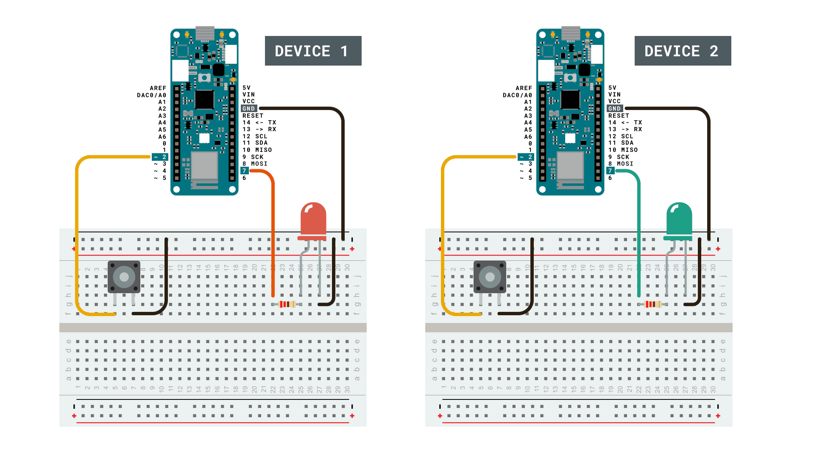
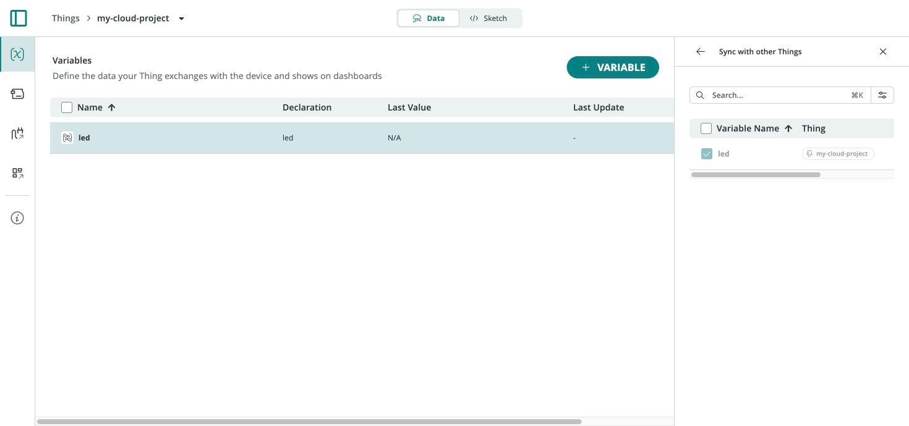
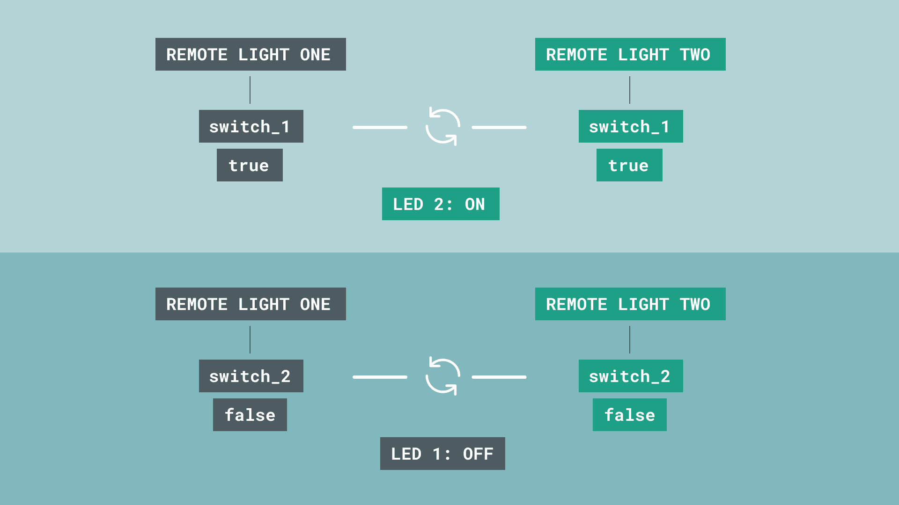
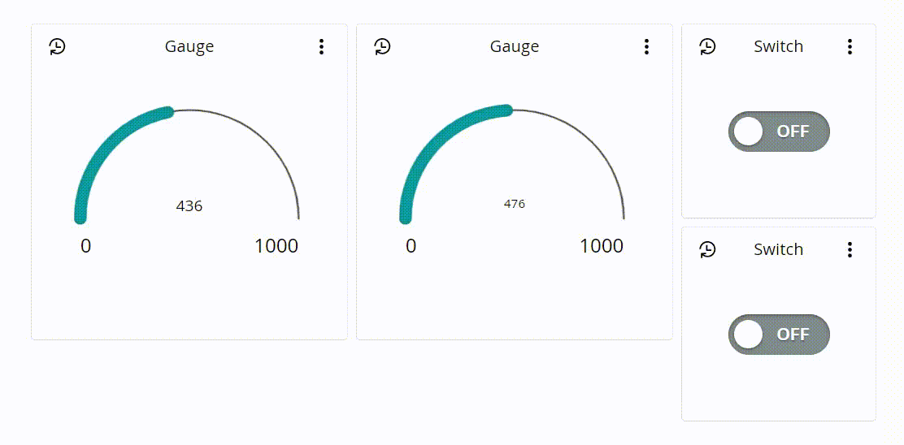

In this project you'll wire two separate boards together through Arduino
Cloud so that pressing a button on one board toggles an LED on the other,
and vice versa. There's no direct radio link between the boards — Arduino
Cloud itself is the communication layer, keeping a shared
[Cloud Variable](/arduino-cloud/things-data/cloud-variables) in sync across
both. You'll finish with a single dashboard that mirrors both boards' state.

**What you need:**

- Two Wi-Fi®-capable boards (e.g. two MKR WiFi 1010 or two UNO R4 Wi-Fi®).
- A push button and an LED wired to each board.
- The [Cloud Agent](/arduino-cloud/devices/cloud-agent) installed for USB
  uploads.



## Step 1 — Provision Both Boards

Add each board as its own [Device](/arduino-cloud/devices/devices-overview)
from the **Devices** page. You'll end up with two devices, each with its own
**Device ID** and **Secret Key**.

## Step 2 — Create Two Things

Create two [Things](/arduino-cloud/things-data/things) — for example
**Remote Light One** and **Remote Light Two** — and associate one device
with each.

## Step 3 — Add and Link the Variables

On the first Thing, add a Boolean [Cloud Variable](/arduino-cloud/things-data/cloud-variables)
named `switch_1` (Read & Write). On the second Thing, add `switch_2` the same
way. Then, for the mirrored values, use **Sync with other Things** when adding
a variable, and pick the variable on the other Thing to link to:



<Alert type="note">

Synchronization works between any variables of a **compatible type** — not
just Booleans. An integer or float sensor reading can mirror across two
Things exactly the same way.

</Alert>

Each Thing ends up with two Booleans: one it owns (driven by its own button)
and one that mirrors the other Thing's variable (driving its LED).

## Step 4 — Upload the Sketch

The sync needs zero networking glue code. Each board writes to its own
variable on a button press and reacts to the other board's variable through
the auto-generated `on...Change()` callback:

```arduino
#include "thingProperties.h"

int buttonPin = 2;
int ledPin = 7;

void setup() {
  pinMode(buttonPin, INPUT_PULLUP);
  pinMode(ledPin, OUTPUT);
  Serial.begin(9600);
  delay(1500);
  initProperties();
  ArduinoCloud.begin(ArduinoIoTPreferredConnection);
}

void loop() {
  ArduinoCloud.update();
  if (digitalRead(buttonPin) == LOW) {
    switch_1 = !switch_1;  // this board's own variable
    delay(500);
  }
}

// Fires when the OTHER board's synced variable changes
void onSwitch2Change() {
  digitalWrite(ledPin, switch_2 ? HIGH : LOW);
}

void onSwitch1Change() {
}
```

Upload the mirror image of this sketch to the second board — its button
writes `switch_2`, and `onSwitch1Change()` drives its LED:

```arduino
#include "thingProperties.h"

int buttonPin = 2;
int ledPin = 7;

void setup() {
  pinMode(buttonPin, INPUT_PULLUP);
  pinMode(ledPin, OUTPUT);
  Serial.begin(9600);
  delay(1500);
  initProperties();
  ArduinoCloud.begin(ArduinoIoTPreferredConnection);
}

void loop() {
  ArduinoCloud.update();
  if (digitalRead(buttonPin) == LOW) {
    switch_2 = !switch_2;  // this board's own variable
    delay(500);
  }
}

// Fires when the OTHER board's synced variable changes
void onSwitch1Change() {
  digitalWrite(ledPin, switch_1 ? HIGH : LOW);
}

void onSwitch2Change() {
}
```



## Step 5 — Visualize Both Boards on One Dashboard

Build a single [Dashboard](/arduino-cloud/dashboards/dashboards) with a
**Switch** widget per board, each linked to that Thing's Boolean. Because the
variables are synced, toggling either side flips the other a moment later:



<Alert type="warning">

If the boards don't react to each other, confirm both are online, each sketch
was uploaded to the correct board, and the variables are genuinely linked via
**Sync with other Things** — a variable created independently on each Thing
will not sync.

</Alert>

## Next Steps

- [Sync Variables Across Devices](/arduino-cloud/things-data/sync-variables)
- [Cloud Variables](/arduino-cloud/things-data/cloud-variables)
- [Dashboards](/arduino-cloud/dashboards/dashboards)
