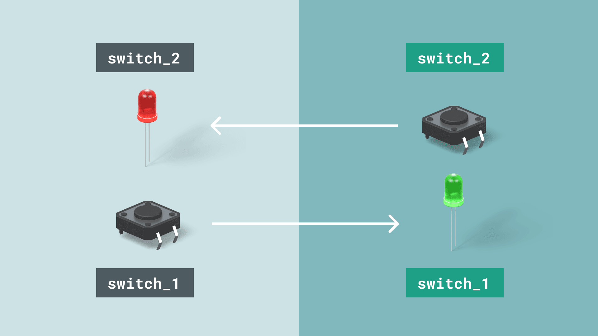
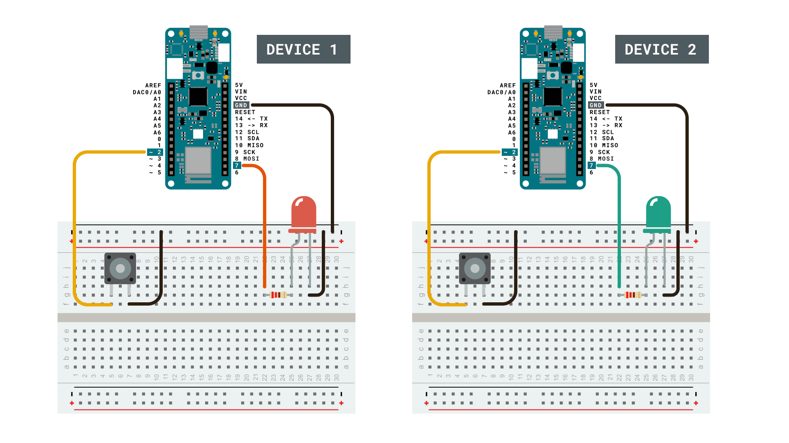
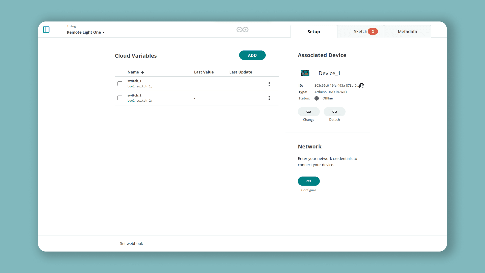
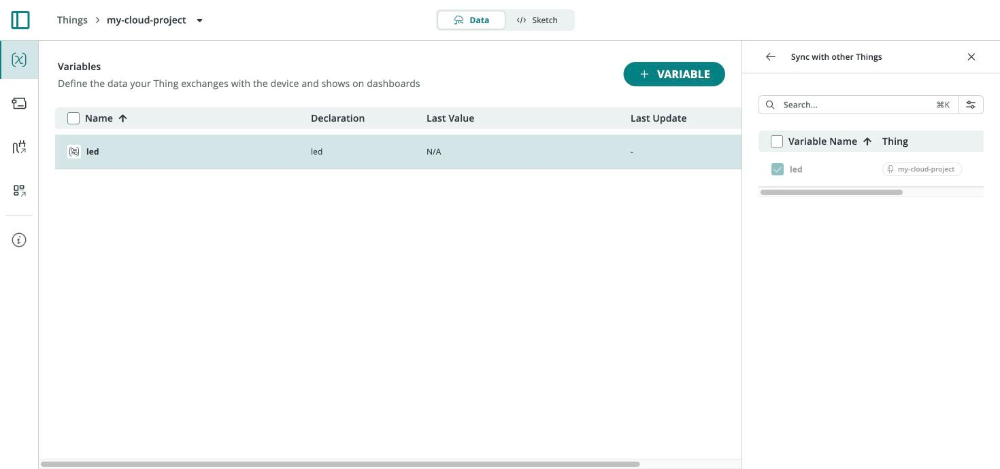
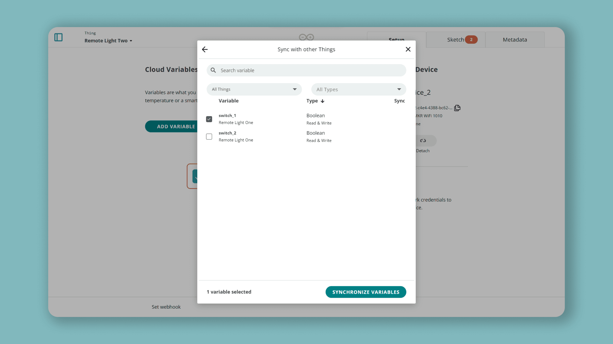
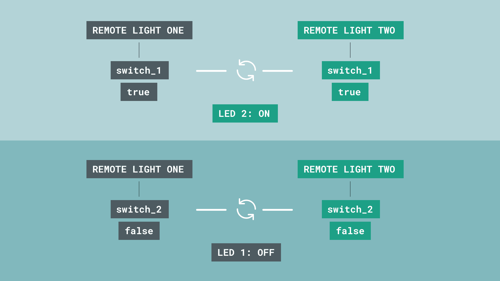
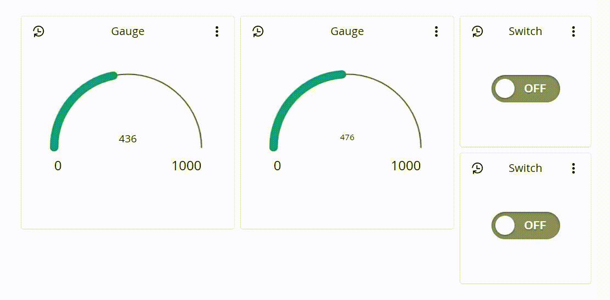

In this project you'll connect two separate boards through Arduino Cloud so that pressing a button on one board toggles an LED on the other, and vice versa. There's no direct radio link between the boards: Arduino Cloud is the communication layer, keeping shared [Cloud Variables](/arduino-cloud/things-data/cloud-variables) in sync across both.

## Goal

By the end of this tutorial:

- The button on **Device_1** turns the LED on **Device_2** on and off.
- The button on **Device_2** turns the LED on **Device_1** on and off.
- A single dashboard shows the state of both boards.



## What You Need

- Two Arduino Cloud-compatible Wi-Fi® boards, for example MKR WiFi 1010, MKR 1000 WiFi, Nano 33 IoT or Nano RP2040 Connect. The two boards don't need to be the same model; any [supported Wi-Fi® board](/arduino-cloud/devices/add-wifi-board#supported-boards) works.
- Two USB cables that support data transfer.
- Two LEDs, two push buttons and two 220 Ω resistors.
- Jumper wires and two breadboards.
- An [Arduino account](https://login.arduino.cc/login) and the [Cloud Agent](/arduino-cloud/devices/cloud-agent) installed for USB uploads.

## Circuit

Build the same circuit for both boards: a push button on pin 2 and an LED, with its resistor, on pin 7.



<Alert type="note">

The circuit shows an MKR WiFi 1000/1010. The pinout differs on Nano boards; if you use other pins, change `buttonPin` and `ledPin` in the sketches.

</Alert>

## Step 1 — Add Both Boards

Add each board as its own [device](/arduino-cloud/devices/devices-overview) from the **Devices** page, see [Add a Wi-Fi Board](/arduino-cloud/devices/add-wifi-board). Name them **Device_1** and **Device_2**, so you can tell them apart when you associate them with Things and upload sketches.

<Alert type="info">

Put a label on each physical board with its device name. It is easy to mix up the boards later.

</Alert>

**Checkpoint:** both devices are listed in **Devices**.

## Step 2 — Create the First Thing

1. Create a [Thing](/arduino-cloud/things-data/things) named **Remote Light One**.
2. Associate **Device_1** with it, and enter the network credentials if prompted.
3. Add two Boolean [Cloud Variables](/arduino-cloud/things-data/cloud-variables), both with **Read & Write** permission:

| Variable name | Type | Permission | Role on Device_1 |
|---|---|---|---|
| `switch_1` | Boolean | Read & Write | Changed by Device_1's button |
| `switch_2` | Boolean | Read & Write | Drives Device_1's LED |

**Checkpoint:** the Thing shows **Device_1** and the two variables.



## Step 3 — Create the Second Thing and Sync the Variables

1. Create a second Thing named **Remote Light Two**, and associate **Device_2** with it.
2. Select **+ Variable**, name it `switch_1`, and select **Sync with other Things**.

   

3. Select the `switch_1` variable of **Remote Light One**, select **Synchronize variables**, and then add the variable.

   

4. Repeat steps 2 and 3 for `switch_2`: name it `switch_2` and sync it with the `switch_2` variable of **Remote Light One**.

On **Remote Light Two**, the roles are reversed:

| Variable name | Synced with | Role on Device_2 |
|---|---|---|
| `switch_1` | `switch_1` on Remote Light One | Drives Device_2's LED |
| `switch_2` | `switch_2` on Remote Light One | Changed by Device_2's button |

Synced variables must be of the same type. See [Sync Variables Between Things](/arduino-cloud/things-data/sync-variables).

**Checkpoint:** both variables on **Remote Light Two** show that they are synced with **Remote Light One**.

## Step 4 — Upload the Sketch to Device_1

Open the **Sketch** tab of **Remote Light One** and replace the generated code with the sketch below. Each board writes to its own variable when its button is pressed, and reacts to the other board's variable in the auto-generated `on...Change()` callback. The sync itself needs no networking code.

```arduino
#include "thingProperties.h"

int buttonPin = 2;
int ledPin = 7;

void setup() {
  pinMode(buttonPin, INPUT_PULLUP);
  pinMode(ledPin, OUTPUT);
  Serial.begin(9600);
  delay(1500);
  initProperties();
  ArduinoCloud.begin(ArduinoIoTPreferredConnection);
  setDebugMessageLevel(2);
  ArduinoCloud.printDebugInfo();
}

void loop() {
  ArduinoCloud.update();
  if (digitalRead(buttonPin) == LOW) {
    switch_1 = !switch_1;  // this board's own variable
    delay(500);            // simple debounce
  }
}

// Runs when Device_2 changes switch_2
void onSwitch2Change() {
  digitalWrite(ledPin, switch_2 ? HIGH : LOW);
}

// Required by the generated code; Device_1 only writes switch_1
void onSwitch1Change() {
}
```

Upload the sketch to **Device_1**.

**Checkpoint:** in the Serial Monitor, Device_1 connects to Arduino Cloud, and the Thing shows the device as online.

## Step 5 — Upload the Sketch to Device_2

Open the **Sketch** tab of **Remote Light Two** and replace the generated code with the mirror sketch below: the button writes `switch_2`, and `onSwitch1Change()` drives the LED.

```arduino
#include "thingProperties.h"

int buttonPin = 2;
int ledPin = 7;

void setup() {
  pinMode(buttonPin, INPUT_PULLUP);
  pinMode(ledPin, OUTPUT);
  Serial.begin(9600);
  delay(1500);
  initProperties();
  ArduinoCloud.begin(ArduinoIoTPreferredConnection);
  setDebugMessageLevel(2);
  ArduinoCloud.printDebugInfo();
}

void loop() {
  ArduinoCloud.update();
  if (digitalRead(buttonPin) == LOW) {
    switch_2 = !switch_2;  // this board's own variable
    delay(500);            // simple debounce
  }
}

// Runs when Device_1 changes switch_1
void onSwitch1Change() {
  digitalWrite(ledPin, switch_1 ? HIGH : LOW);
}

// Required by the generated code; Device_2 only writes switch_2
void onSwitch2Change() {
}
```

Make sure that you upload this sketch to **Device_2**.

**Checkpoint:** both devices are online. Press the button on Device_1: the LED on Device_2 turns on. Press it again: the LED turns off. The button on Device_2 controls the LED on Device_1 in the same way.



## Step 6 — Visualize Both Boards on One Dashboard

Build a [Dashboard](/arduino-cloud/dashboards/dashboards) with a **Switch** widget per board, each linked to that Thing's variable. Because the variables are synced, toggling either side updates the other a moment later:



## Troubleshooting

- **Sketches on the wrong board**: the sketch for **Remote Light One** must be uploaded to **Device_1**, and the sketch for **Remote Light Two** to **Device_2**. Check the device associated with each Thing.
- **A board doesn't connect**: check the network credentials, then open the Serial Monitor after the upload to see any connection errors. See [Troubleshoot Device Connections](/arduino-cloud/devices/troubleshoot-device-connections).
- **The boards don't react to each other**: check that the variables on **Remote Light Two** were added with **Sync with other Things**. A variable created independently with the same name on each Thing will not sync.
- **Still not working**: it can be hard to keep track of which board is which. Associate the devices again and upload the sketches again.

## Next Steps

- [Sync Variables Between Things](/arduino-cloud/things-data/sync-variables)
- [Cloud Variables](/arduino-cloud/things-data/cloud-variables)
- [Dashboards](/arduino-cloud/dashboards/dashboards)
