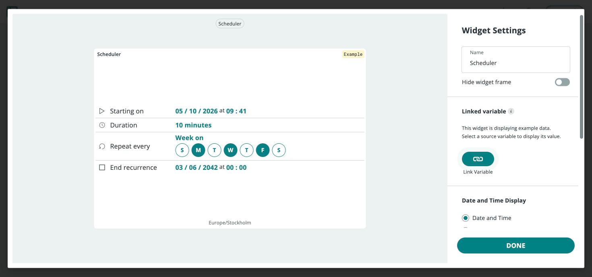
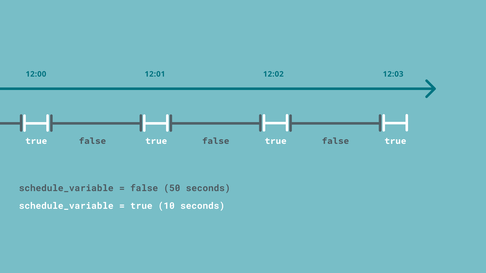
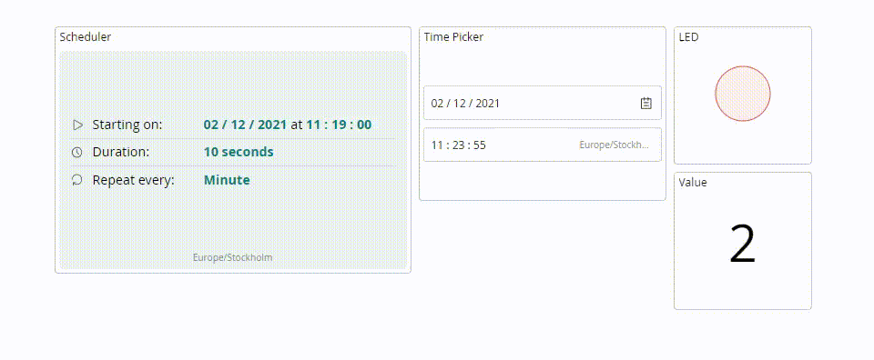

In this project you'll automate an LED (or any relay-driven light) so it turns on and off on a recurring schedule — defined entirely from a dashboard, with no timing logic in your sketch. It's built around the `CloudSchedule` variable type and the **Scheduler** widget, which together let you say "on for 10 seconds every minute" or "on for 8 hours every day" without writing a single timer.

**What you need:**

- A Wi-Fi®-capable board with an LED on a digital pin.
- An Arduino Cloud [Thing](/arduino-cloud/things-data/things) with an associated device.

## Step 1 — Add the Schedule Variable

In your Thing, create these [Cloud Variables](/arduino-cloud/things-data/cloud-variables). **CloudSchedule** and **CloudTime** are under the **Time** category:

| Variable Name | Variable Type | Permission   | Purpose |
| ------------- | ------------- | ------------ | ------- |
| schedule_test | CloudSchedule | Read & Write | The schedule set from the dashboard |
| time_read     | CloudTime     | Read Only    | The device's local time |
| light         | bool          | Read Only    | Dashboard feedback while the job is active |
| counter       | int           | Read Only    | How many times the job has fired |

<Alert type="note">

The schedule is interpreted in the Thing's timezone. Set the Thing's timezone correctly before relying on it, or the job fires at the wrong local time.

</Alert>

## Step 2 — Write the Sketch

Your sketch only checks whether the schedule is active; the cloud decides when that happens. While `schedule_test.isActive()` is true, the LED on pin 6 and `light` are on; the `toggle` flag makes `counter` increase only once per activation:

```arduino
#include "thingProperties.h"

bool toggle;
int LED = 6;

void setup() {
  Serial.begin(9600);
  delay(1500);

  initProperties();

  ArduinoCloud.begin(ArduinoIoTPreferredConnection);
  setDebugMessageLevel(2);
  ArduinoCloud.printDebugInfo();
  pinMode(LED, OUTPUT);
  counter = 0;
  light = false;
}

void loop() {
  ArduinoCloud.update();

  if (schedule_test.isActive()) {
    light = true;
    digitalWrite(LED, HIGH);

    if (toggle) {
      counter++;
      toggle = false;
    }
  } else {
    light = false;
    digitalWrite(LED, LOW);
    toggle = true;
  }

  if (ArduinoCloud.connected()) {
    time_read = ArduinoCloud.getLocalTime();
  }
}

void onScheduleTestChange() {
  // Can be left empty — loop() polls the schedule.
}
```

Open the Serial Monitor after uploading to confirm the board connects; connection errors are printed there.

## Step 3 — Add the Scheduler Widget

On a [Dashboard](/arduino-cloud/dashboards/dashboards), add a **Scheduler** widget and link it to `schedule_test`, then open its configuration:



| Parameter | Description |
|---|---|
| **Start** | Date and time of the first occurrence. |
| **End** | When the schedule stops firing, or "never." |
| **Duration** | How long the active state lasts once triggered. |
| **Repeat every** | How often it recurs: minute, hour, day, week, month, or year. |

Configure, for example, **start: today, end: never, duration: 10 seconds, repeat every: minute** to activate the light for 10 seconds each minute:



## Step 4 — Watch It Run

Add the remaining widgets so the dashboard has four in total:

| Widget      | Variable      |
| ----------- | ------------- |
| Scheduler   | schedule_test |
| Time Picker | time_read     |
| Value       | counter       |
| LED         | light         |

With the Step 3 schedule, the **LED** widget turns on for 10 seconds each minute and `counter` increases by 1 every time:



<Alert type="info">

The Scheduler widget only accepts `CloudSchedule` variables, and variable names are case-sensitive — a mismatch between the sketch and the Thing's variable name is the most common reason a schedule appears to do nothing.

</Alert>

## Next Steps

- [Scheduler Automation](/arduino-cloud/automations/scheduler)
- [Dashboards](/arduino-cloud/dashboards/dashboards)
- [Cloud Variables](/arduino-cloud/things-data/cloud-variables)
