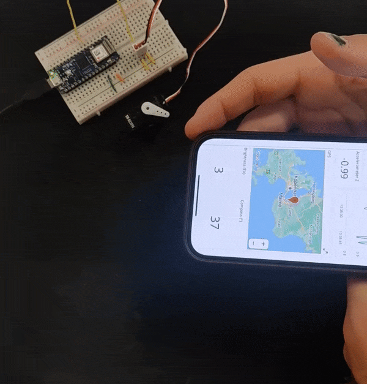
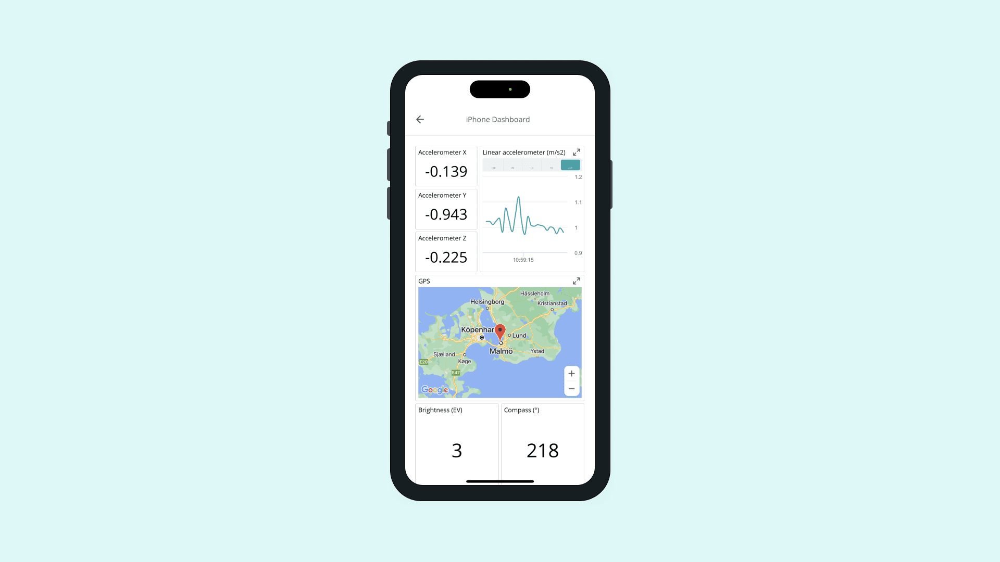
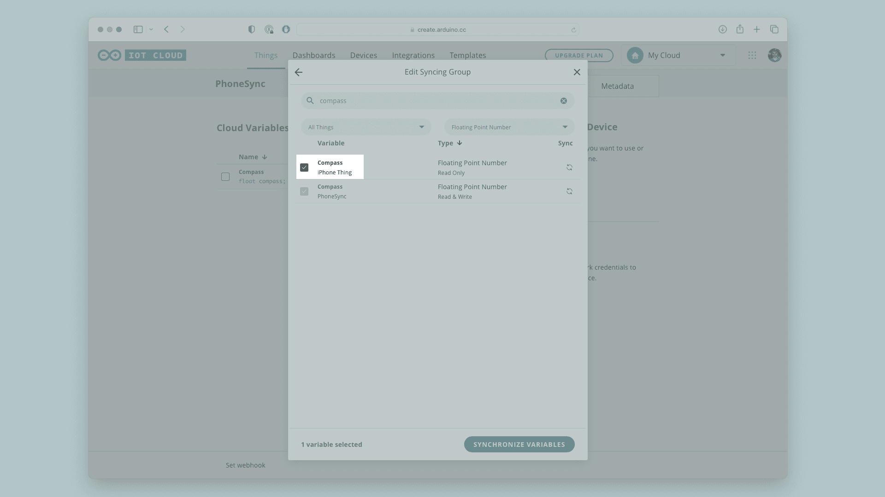

In this project you'll turn your phone into an Arduino Cloud device — no extra hardware required. The IoT Remote app exposes your phone's built-in sensors (GPS, accelerometer/gyroscope, light sensor, compass, and more depending on the device) as [Cloud Variables](/arduino-cloud/things-data/cloud-variables), which you can visualize on a dashboard or use to drive another device.

**What you need:**

- The IoT Remote app installed and signed in (see [IoT Remote App](/arduino-cloud/iot-remote-app)).
- An Arduino Cloud account.



## Step 1 — Enable "Use Data From Your Phone"

Open the IoT Remote app (v1.1 or later) and sign in. Tap the **hamburger menu** in the top-left, choose **"Use data from your phone"**, then expand the section to see every sensor that can be streamed. Check the box to **consent** to sending sensor data to the Cloud, then tap **"SET YOUR PHONE"** — the app builds a phone Thing and dashboard for you automatically.

The exposed sensors include GPS position, accelerometer, gyroscope, magnetic field, **compass** orientation, microphone/sound level, and ambient light (the exact set depends on your device):



## Step 2 — Build the Dashboard

The app generates a dashboard with a widget per sensor. Pick up your phone and move it — bring a magnet close, make sounds, rotate it — and watch the widgets update live.

## Step 3 — Use the Data on Another Device

The phone Thing can't be programmed, but its variables can be **synced** to another Thing. Create a [Thing](/arduino-cloud/things-data/things), attach a Cloud-compatible board (e.g. a Nano 33 IoT), and add a variable named `compass`. When adding it, click **"Sync with other Things"**, search for **compass**, and tick the compass variable from your phone's Thing:



Now the board's `compass` variable mirrors the phone's compass in real time.

## Step 4 — Drive a Servo From the Compass

The phone's compass reports 0–360°, but most small servos only sweep 0–180° (or 90°), so `map()` the value before writing it. Let Arduino Cloud generate the sketch, then add the servo logic:

```arduino
#include "thingProperties.h"
#include <Servo.h>

Servo myServo;
int mappedCompass;

void setup() {
  Serial.begin(9600);
  delay(1500);

  myServo.attach(2);
  myServo.write(80);

  initProperties();
  ArduinoCloud.begin(ArduinoIoTPreferredConnection);
  setDebugMessageLevel(2);
  ArduinoCloud.printDebugInfo();
}

void loop() {
  ArduinoCloud.update();
  mappedCompass = map(compass, 0, 360, 0, 90);
  myServo.write(mappedCompass);
}

void onCompassChange() {
  // Act on compass changes here, if needed.
}
```

Upload the sketch, wait for the board to connect, then rotate your phone and watch the servo follow.

## Next Steps

- [IoT Remote App](/arduino-cloud/iot-remote-app)
- [Sync Variables Across Devices](/arduino-cloud/things-data/sync-variables)
- [Dashboards](/arduino-cloud/dashboards/dashboards)
