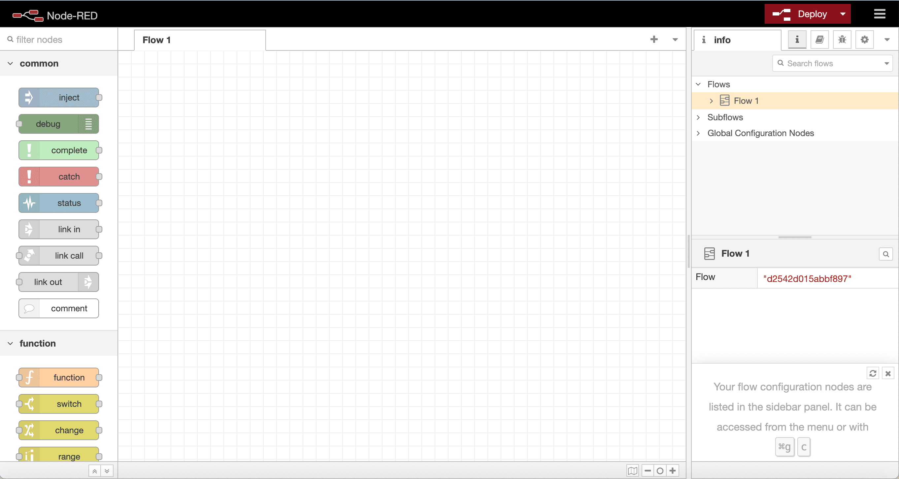
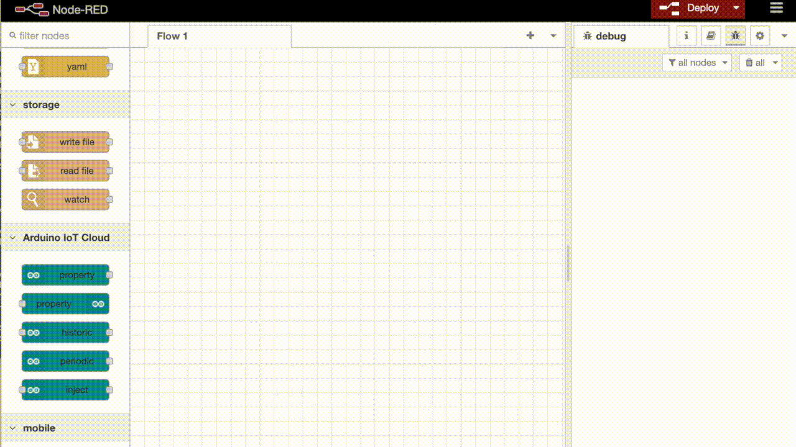

In this project you'll connect Arduino Cloud to [Node-RED](https://nodered.org/) and build a flow that watches a sensor variable and emails you only when it crosses a threshold — instead of spamming you with every reading. You'll pull a Cloud Variable into a flow, filter it with a function node, and wire the result to an email node.

## Hardware & Software Requirements

- A paid Arduino Cloud plan (Node-RED integration isn't available on Free).
- A [Cloud-compatible board](/arduino-cloud/reference/supported-boards-capabilities). This example uses the Arduino MKR WiFi 1010.
- A DHT11 humidity sensor.
- [Arduino Create Agent](https://github.com/arduino/arduino-create-agent).
- [Node.js](https://nodejs.org/en/) and Node-RED installed locally (`npm install -g --unsafe-perm node-red`, then `node-red`, opening at `http://localhost:1880`).
- An API key (Client ID/Secret) from [API Keys](/arduino-cloud/apis-cli/cli-install-credentials).

## Step 1 — Set Up the Thing

The Thing reads humidity from a **DHT11** sensor. You can use another reading, such as temperature or soil moisture, but the code and circuit below are specific to the DHT11.

1. In Arduino Cloud, create a Thing, attach your device, and enter your network credentials.
2. Add an integer variable named `humidity` with **Read Only** permission.
3. Connect the DHT11 data pin to pin 7, VCC to VCC, and GND to GND on the board.
4. In the **Sketch** tab, add the DHT read to the generated sketch and upload it. The `dht.h` header comes from the library named "dht library":

    ```arduino
    #include "thingProperties.h"
    #include <dht.h>

    dht DHT;
    #define DHT11_PIN 7

    void loop() {
      ArduinoCloud.update();
      DHT.read11(DHT11_PIN);
      humidity = DHT.humidity;
    }
    ```

## Step 2 — Install the Arduino Cloud Nodes

In the Node-RED editor, open **menu > Manage palette > Install**, search for **Arduino**, and install `@arduino/node-red-contrib-arduino-iot-cloud`. This adds five Arduino Cloud nodes, including **property out**.



<Alert type="info">

Node-RED community packages are maintained outside Arduino Cloud's release cycle — confirm the current package name/version in the palette manager (or on npm) before installing.

</Alert>

## Step 3 — Read a Cloud Variable

Drag a **property out** node onto the canvas and configure it: add an Arduino connection authenticated with your Client ID/Secret, then pick your Thing and the `humidity` variable:



Wire an `inject` node into it and a `debug` node on its output, then **Deploy**. The variable's live value appears in the sidebar console.

## Step 4 — Filter to Threshold Crossings

Add a **function** node between **property out** and the debug node. This JavaScript forwards a message only the first time the value rises above 60 (and again when it drops back below), instead of on every reading:

```js
let data = msg.payload;
let trigger = context.get("status");

if (typeof trigger == "undefined") trigger = false;

if (data > 60 && !trigger) {
  trigger = true;
  context.set("status", trigger);
  return msg;
}

if (data < 60 && trigger) {
  trigger = false;
  context.set("status", trigger);
  return msg;
}
```

Test it by blowing on the sensor to raise the humidity.

## Step 5 — Send the Email

1. In **Manage palette > Install**, search for **Email** and install `node-red-node-email`.
2. Drag an **email** node into the workspace and wire it to the function node's output, replacing the debug node.
3. Double-click the node and enter the recipient address and your sender account details. You can customize the message in the function node.

<Alert type="info">

The SMTP settings, such as the server, the port, and whether you need an app password, depend on your email provider. Check your provider's documentation for the current values.

</Alert>

Deploy the flow. Now, whenever `humidity` crosses 60, you get a single email alert rather than a constant stream.

<Alert type="info">

The SMTP settings, such as the server, the port, and whether you need an app password, depend on your email provider. Check your provider's documentation for the current values.

</Alert>

Deploy the flow. Now, whenever `humidity` crosses 60, you get a single email alert rather than a constant stream.

## Next Steps

- [Node-RED Integration](/arduino-cloud/integrations/node-red)
- [REST API & SDKs](/arduino-cloud/apis-cli/rest-api-sdks)
- [Cloud Variables](/arduino-cloud/things-data/cloud-variables)
