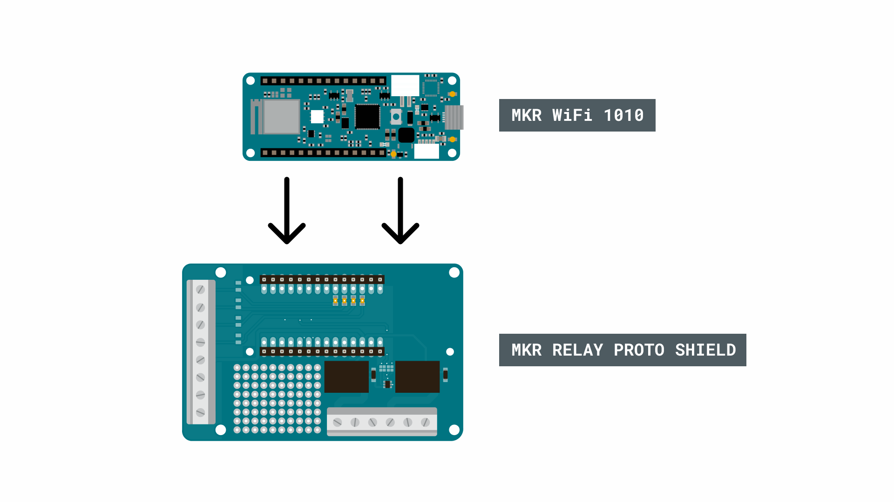
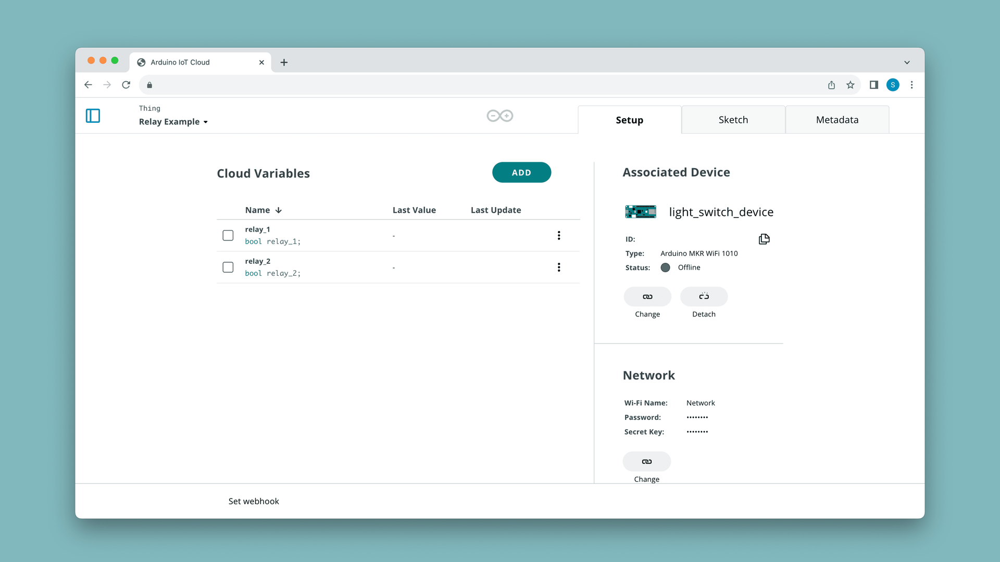
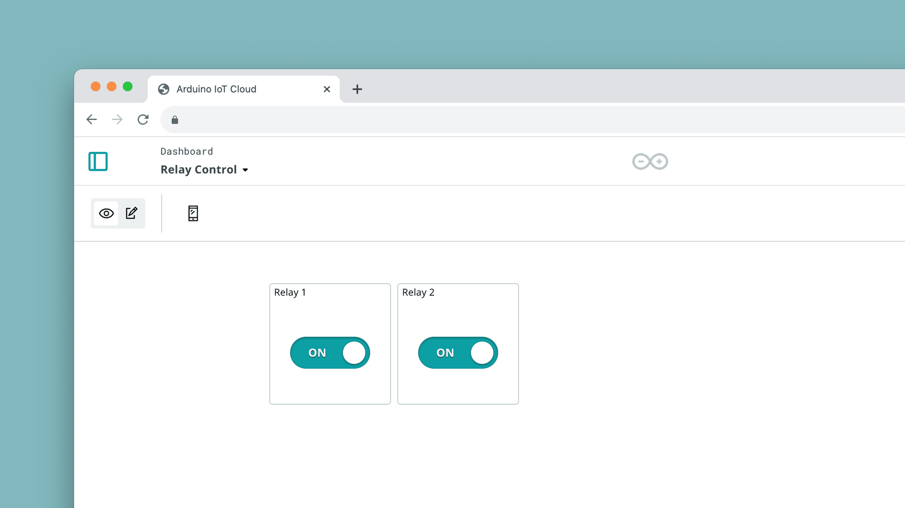
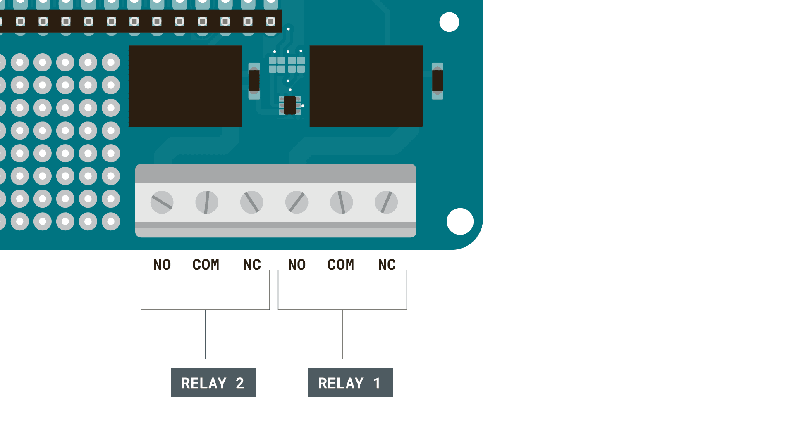
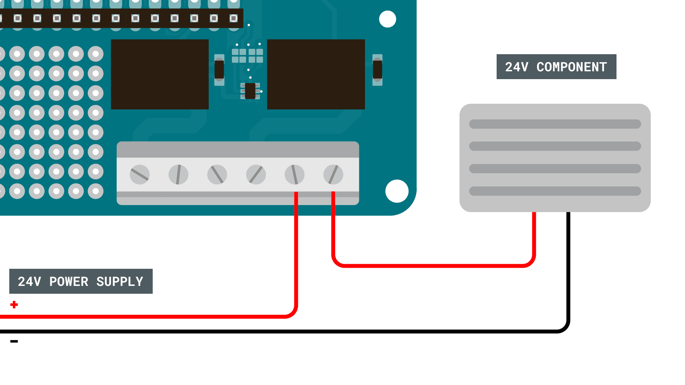

In this project you'll control the relays on an
[MKR Relay Shield](https://store.arduino.cc/arduino-mkr-relay-proto-shield)
(mounted on an [MKR WiFi 1010](https://store.arduino.cc/mkr-wifi-1010)) from
an Arduino Cloud dashboard — and optionally from the
[IoT Remote app](/arduino-cloud/iot-remote-app) on your phone.
Each relay is driven by a single Boolean Cloud Variable, so switching a
real-world load becomes as simple as toggling a widget.

**What you need:**

- [MKR WiFi 1010](https://store.arduino.cc/mkr-wifi-1010) (any Wi-Fi®-capable
  board works).
- [MKR Relay Shield](https://store.arduino.cc/arduino-mkr-relay-proto-shield).



## Step 1 — Provision the Board and Thing

Add the board as a Wi-Fi® [Device](/arduino-cloud/devices/add-wifi-board),
create a [Thing](/arduino-cloud/things-data/things), and associate the device.



## Step 2 — Add a Variable Per Relay

Add one **Boolean**, **Read & Write** [Cloud Variable](/arduino-cloud/things-data/cloud-variables) per relay:

| Variable Name | Data Type | Permission   |
| ------------- | --------- | ------------ |
| `relay_1`     | Boolean   | Read & Write |
| `relay_2`     | Boolean   | Read & Write |


## Step 3 — Write the Sketch

The two relays on the MKR Relay Shield are driven by **digital pins 1 and 2**. Set them as outputs in `setup()`, then drive each pin from the auto-generated callback that fires when the dashboard toggles the variable. Writing `LOW` activates a relay (connecting NC to COM), `HIGH` de-activates it:

```arduino
#include "thingProperties.h"

void setup() {
  Serial.begin(9600);
  delay(1500);

  pinMode(1, OUTPUT);
  pinMode(2, OUTPUT);

  initProperties();
  ArduinoCloud.begin(ArduinoIoTPreferredConnection);
  setDebugMessageLevel(2);
  ArduinoCloud.printDebugInfo();
}

void loop() {
  ArduinoCloud.update();
}

void onRelay1Change() {
  if (relay_1) {
    digitalWrite(1, LOW);
  } else {
    digitalWrite(1, HIGH);
  }
}

void onRelay2Change() {
  if (relay_2) {
    digitalWrite(2, LOW);
  } else {
    digitalWrite(2, HIGH);
  }
}
```

Upload the sketch; the board connects to the Cloud and syncs. Open the Serial Monitor right after connecting to check for any error codes.

## Step 4 — Add a Switch Widget

On a [Dashboard](/arduino-cloud/dashboards/dashboards), add a **Switch**
widget per relay and link it to the matching `relay_x` variable. Flip the
switch to actuate the relay:



You can control the same dashboard from the
[IoT Remote app](/arduino-cloud/iot-remote-app).

## Connecting a Load to the High-Power Pins

> **Note:** Working with higher-voltage components demands extreme caution. Don't alter the circuit while it's powered, and never connect high-voltage components directly to the Arduino.

Each relay exposes three **high-power** terminals — **NO**, **COM**, and **NC** — rated for roughly **5–24 V**:



Using the **NC** configuration, writing a **LOW** signal connects NC to COM and powers the load. For example, driving a 24 V heater from a 24 V supply:



Control it with:

```arduino
digitalWrite(relay_1, LOW);   // activate
digitalWrite(relay_1, HIGH);  // de-activate
```

> **Note:** Keep both the supply and the load at or below **24 V** — the relays are not rated for higher voltages. Relays like these are ideal for switching LED strips, fans, pumps, and low-power heating elements, including 12/24 V systems in cars, boats, and off-grid setups.

## Next Steps

- [Add a Wi-Fi Board](/arduino-cloud/devices/add-wifi-board)
- [IoT Remote App](/arduino-cloud/iot-remote-app)
- [Dashboards](/arduino-cloud/dashboards/dashboards)
