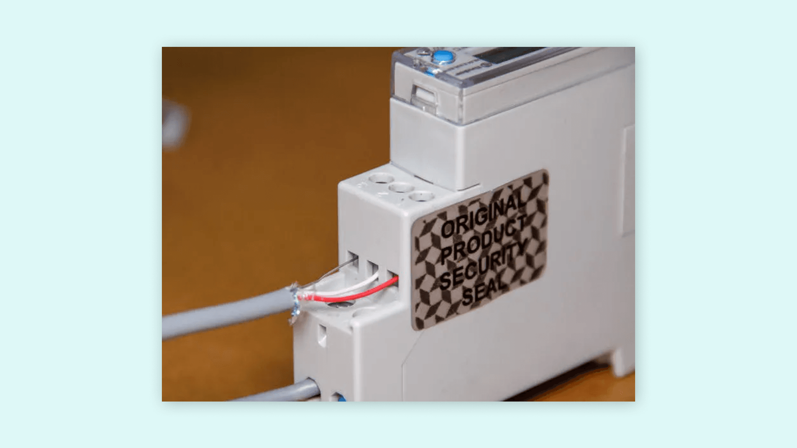
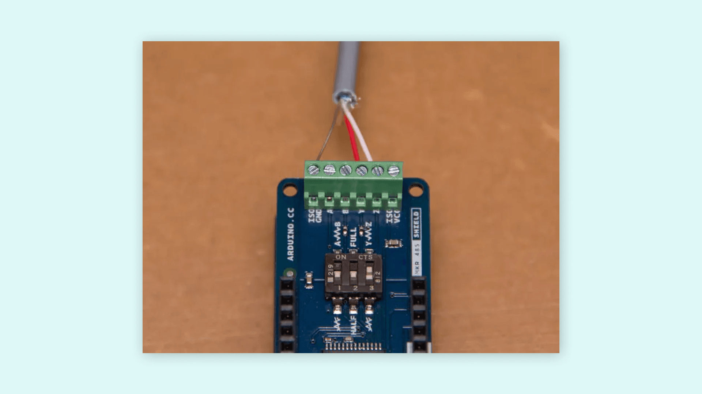
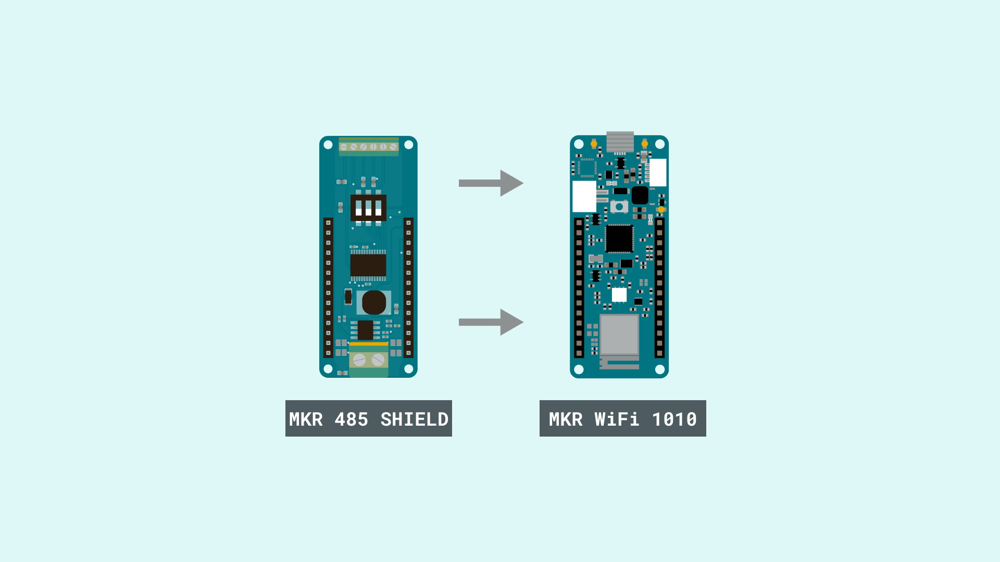
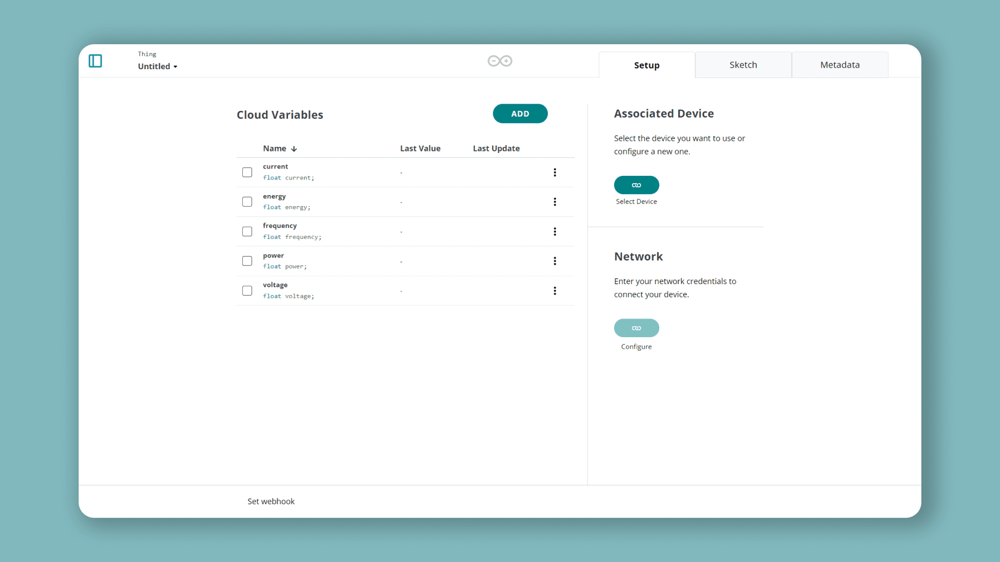
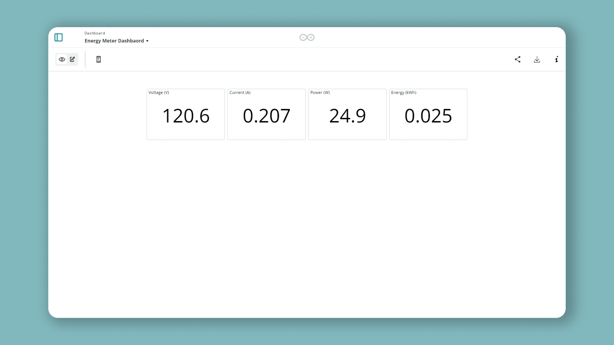

In this project you'll connect a Modbus RS-485 energy meter to Arduino Cloud using an [MKR WiFi 1010](https://store.arduino.cc/arduino-mkr-wifi-1010) and an [MKR 485 Shield](https://store.arduino.cc/arduino-mkr-485-shield), and chart live power consumption on a dashboard. Modbus over RS-485 is a common industrial protocol — robust over long cable runs — making this a practical pattern for real energy monitoring.

**What you need:**

- [MKR WiFi 1010](https://store.arduino.cc/arduino-mkr-wifi-1010) and [MKR 485 Shield](https://store.arduino.cc/arduino-mkr-485-shield).
- A Modbus-RTU energy meter with a documented register map (originally tested with a Finder Type 7E.64).
- The [Arduino Modbus library](https://www.arduino.cc/en/ArduinoModbus/ArduinoModbus) and twisted-pair shielded cable for the RS-485 bus.

## Step 1 — Wire the Meter to the RS-485 Bus

> **Warning:** Mains wiring can be lethal. Switch off the supply at the breaker and verify zero voltage with a multimeter before touching the meter. If you're unsure, call an electrician.

Install the meter on the DIN rail and connect live/neutral through it (input on top, load on the bottom). Then run a twisted single-pair shielded cable from the meter's RS-485 terminals to the MKR 485 Shield.

The RS-485 terminals are **A**, **B** and **COM**. The common convention maps **B = D+** and **A = D-**. On the meter, connect the **red cable to D+**, the **white cable to D-**, and the **brown cable to COM**.



The Finder meter is **half-duplex**, so configure the shield for half-duplex too. On the MKR 485 Shield, half-duplex uses the **Y** and **Z** terminals, where **Y = B/D+** and **Z = A/D-**:

- Red cable (D+) → **Y**
- White cable (D-) → **Z**
- Brown cable (COM) → **ISOGND**
- Switch 2 → **OFF** (HALF)
- Switch 3 → **ON** (Y-Z, enables termination resistor)
- Switch 1 is unused in half-duplex.



Finally, mount the shield on the MKR WiFi 1010:



## Step 2 — Provision the Board and Thing

Add the MKR WiFi 1010 as a Wi-Fi® [Device](/arduino-cloud/devices/add-wifi-board), then create a [Thing](/arduino-cloud/things-data/things) and associate it:



## Step 3 — Add the Meter Variables

Add these Read-Only [Cloud Variables](/arduino-cloud/things-data/cloud-variables), all **Floating Point Number**, update **On change**:

| Variable  | Type  | Permission | Update Policy |
|-----------|-------|------------|---------------|
| voltage   | float | Read Only  | On change     |
| current   | float | Read Only  | On change     |
| power     | float | Read Only  | On change     |
| frequency | float | Read Only  | On change     |
| energy    | float | Read Only  | On change     |

## Step 4 — Read the Modbus Registers

Modbus is a serial protocol for industrial sensors. The MKR WiFi 1010 talks Modbus through the [Arduino Modbus library](https://www.arduino.cc/en/ArduinoModbus/ArduinoModbus), which handles the message framing for you. A read request is a frame like `01 03 04 00 16 00 02 25 C7`, where `01` is the device address, `03` the function code (read holding registers), `00 16` the register address, `00 02` the register size in 16-bit words, and `25 C7` the CRC.

Each value for the Finder Type 7E.64 lives at a specific holding register. Read it with `ModbusRTUClient.requestFrom(deviceAddress, HOLDING_REGISTERS, address, words)`, pull the words out of the buffer, join them, and scale:

| Reading   | Register | Words | Scaling        |
|-----------|----------|-------|----------------|
| voltage   | `0x000C` | 2     | ÷ 1000 → V     |
| current   | `0x0016` | 2     | ÷ 1000 → A     |
| power     | `0x0025` | 3     | ÷ 1000 → W     |
| frequency | `0x0040` | 1     | ÷ 1000 → Hz    |
| energy    | `0x0109` | 3     | ÷ 10000 → kWh  |

For a two-word register, read both words and join them by bit-shifting the first word left by 16 and OR-ing the second — e.g. current:

```arduino
float readCurrent() {
  float ampere = 0.;
  if (!ModbusRTUClient.requestFrom(0x01, HOLDING_REGISTERS, 0x0016, 2)) {
    Serial.print("- Failed to read the current! ");
    Serial.println(ModbusRTUClient.lastError());
  } else {
    uint16_t word1 = ModbusRTUClient.read();
    uint16_t word2 = ModbusRTUClient.read();
    int32_t milliamp = word1 << 16 | word2;  // join the two words
    ampere = milliamp / 1000.0;              // milliampere → ampere
  }
  return ampere;
}
```

Let Arduino Cloud generate the sketch, then paste in the complete program below. The connectivity glue (`thingProperties.h`, `ArduinoCloud.begin`) is generated for you; the register-reading functions are the meter-specific part:

```arduino
/* Finder Energy Meter to Arduino Cloud
 * Created by Alberto Perro (Officine Innesto), modified by José Bagur
 */

#include <ArduinoRS485.h>
#include <ArduinoModbus.h>

#undef ON
#undef OFF

#include "thingProperties.h"

unsigned long rate = 60000; // refresh rate in ms
unsigned long lastMillis = 0;

void setup() {
  Serial.begin(9600);
  delay(1500);

  initProperties();
  ArduinoCloud.begin(ArduinoIoTPreferredConnection);
  setDebugMessageLevel(2);
  ArduinoCloud.printDebugInfo();

  // Start Modbus RTU client at 9600 baud
  if (!ModbusRTUClient.begin(9600)) {
    Serial.println("- Failed to start Modbus RTU Client!");
    while (1);
  }
}

void loop() {
  ArduinoCloud.update();

  if (millis() - lastMillis > rate) {
    lastMillis = millis();

    voltage = readVoltage();
    delay(100);
    current = readCurrent();
    delay(100);
    power = readPower();
    delay(100);
    frequency = readFreq();
    delay(100);
    energy = readEnergy();

    Serial.print("- " + String(voltage, 3) + "V " + String(current, 3) + "A " + String(power, 3) + "W ");
    Serial.println(String(frequency, 3) + "Hz " + String(energy, 3) + "kWh");
    delay(100);
  }
}

float readVoltage() {
  float volt = 0.;
  if (!ModbusRTUClient.requestFrom(0x01, HOLDING_REGISTERS, 0x000C, 2)) {
    Serial.print("- Failed to read the voltage! ");
    Serial.println(ModbusRTUClient.lastError());
  } else {
    uint16_t word1 = ModbusRTUClient.read();
    uint16_t word2 = ModbusRTUClient.read();
    uint32_t millivolt = word1 << 16 | word2;
    volt = millivolt / 1000.0;
  }
  return volt;
}

float readCurrent() {
  float ampere = 0.;
  if (!ModbusRTUClient.requestFrom(0x01, HOLDING_REGISTERS, 0x0016, 2)) {
    Serial.print("- Failed to read the current! ");
    Serial.println(ModbusRTUClient.lastError());
  } else {
    uint16_t word1 = ModbusRTUClient.read();
    uint16_t word2 = ModbusRTUClient.read();
    int32_t milliamp = word1 << 16 | word2;
    ampere = milliamp / 1000.0;
  }
  return ampere;
}

double readPower() {
  double watt = 0.;
  if (!ModbusRTUClient.requestFrom(0x01, HOLDING_REGISTERS, 0x0025, 3)) {
    Serial.print("- Failed to read power! ");
    Serial.println(ModbusRTUClient.lastError());
  } else {
    uint16_t word1 = ModbusRTUClient.read();
    uint16_t word2 = ModbusRTUClient.read();
    uint16_t word3 = ModbusRTUClient.read();

    uint64_t milliwatt;
    if (word1 >> 7 == 0) {
      milliwatt = word1 << 32 | word2 << 16 | word3;
    } else {
      word1 &= 0b01111111;
      milliwatt = 0b1 << 48 | word1 << 32 | word2 << 16 | word3;
    }
    watt = milliwatt / 1000.;
  }
  return watt;
}

float readFreq() {
  float freq = 0.;
  if (!ModbusRTUClient.requestFrom(0x01, HOLDING_REGISTERS, 0x0040, 2)) {
    Serial.print("- Failed to read frequency! ");
    Serial.println(ModbusRTUClient.lastError());
  } else {
    uint16_t word1 = ModbusRTUClient.read();
    freq = word1 / 1000.0;
  }
  return freq;
}

double readEnergy() {
  double kwh = 0.;
  if (!ModbusRTUClient.requestFrom(0x01, HOLDING_REGISTERS, 0x0109, 3)) {
    Serial.print("- Failed to read energy! ");
    Serial.println(ModbusRTUClient.lastError());
  } else {
    uint16_t word1 = ModbusRTUClient.read();
    uint16_t word2 = ModbusRTUClient.read();
    uint16_t word3 = ModbusRTUClient.read();
    uint64_t dwh = word1 << 32 | word2 << 16 | word3;
    kwh = dwh / 10000.0;
  }
  return kwh;
}
```

> The register addresses and scaling above are for the Finder Type 7E.64. A different meter model will use a different register map — consult its datasheet and adjust the addresses, word counts, and divisors accordingly.

## Step 5 — Chart the Consumption

On a [Dashboard](/arduino-cloud/dashboards/dashboards), add a **Value**, **Chart** or **Gauge** widget linked to each variable to visualize consumption over time:



## Next Steps

- [Add a Wi-Fi Board](/arduino-cloud/devices/add-wifi-board)
- [Dashboards](/arduino-cloud/dashboards/dashboards)
- [Historical Data Export](/arduino-cloud/things-data/historical-data-export)
