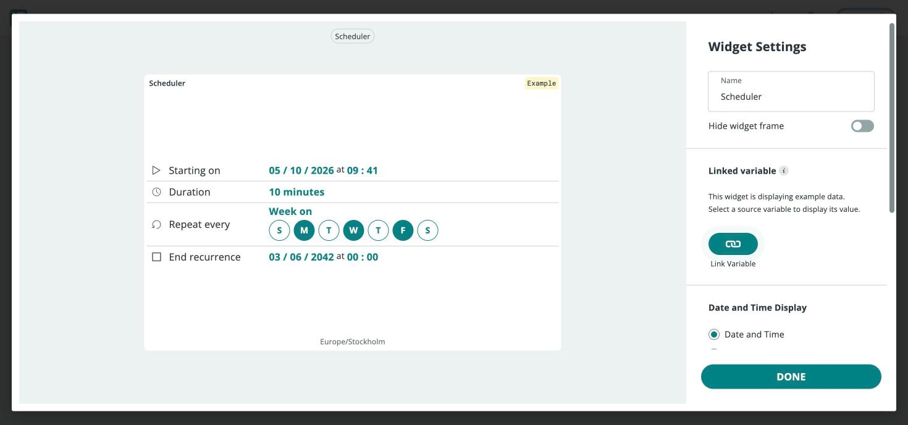

In this project you'll automate an LED (or any relay-driven light) so it
turns on and off on a recurring schedule — defined entirely from a dashboard,
with no timing logic in your sketch. It's built around the `CloudSchedule`
variable type and the **Scheduler** widget, which together let you say
"on for 10 seconds every minute" or "on for 8 hours every day" without
writing a single timer.

**What you need:**

- A Wi-Fi®-capable board with an LED on a digital pin.
- An Arduino Cloud [Thing](/arduino-cloud/things-data/things) with an
  associated device.

## Step 1 — Add the Schedule Variable

In your Thing's [Cloud Variables](/arduino-cloud/things-data/cloud-variables),
add a variable of type **CloudSchedule** (found under the **Time** category) —
for example `schedule_test`. Optionally add a `CloudTime` variable
(`time_read`) to display the device's local time, and a Boolean `light` for
dashboard feedback.

<Alert type="note">

The schedule is interpreted in the Thing's timezone. Set the Thing's timezone
correctly before relying on it, or the job fires at the wrong local time.

</Alert>

## Step 2 — Write the Sketch

Your sketch only checks whether the schedule is active; the cloud decides
when that happens:

```arduino
#include "thingProperties.h"

int LED = 6;

void setup() {
  Serial.begin(9600);
  delay(1500);
  initProperties();
  ArduinoCloud.begin(ArduinoIoTPreferredConnection);
  pinMode(LED, OUTPUT);
  light = false;
}

void loop() {
  ArduinoCloud.update();

  if (schedule_test.isActive()) {
    light = true;
    digitalWrite(LED, HIGH);
  } else {
    light = false;
    digitalWrite(LED, LOW);
  }

  if (ArduinoCloud.connected()) {
    time_read = ArduinoCloud.getLocalTime();
  }
}

void onScheduleTestChange() {
  // Reacts to a schedule state change, if needed — can be left empty.
}
```

## Step 3 — Add the Scheduler Widget

On a [Dashboard](/arduino-cloud/dashboards/dashboards), add a **Scheduler**
widget and link it to `schedule_test`, then open its configuration:



| Parameter | Description |
|---|---|
| **Start** | Date and time of the first occurrence. |
| **End** | When the schedule stops firing, or "never." |
| **Duration** | How long the active state lasts once triggered. |
| **Repeat every** | How often it recurs: minute, hour, day, week, month, or year. |

Configure, for example, **start: today, end: never, duration: 10 seconds,
repeat every: minute** to activate the light for 10 seconds each minute:


## Step 4 — Watch It Run

Add an **LED** widget linked to `light` and a **Value** widget linked to
`time_read` to see the automation drive your board live:


<Alert type="info">

The Scheduler widget only accepts `CloudSchedule` variables, and variable
names are case-sensitive — a mismatch between the sketch and the Thing's
variable name is the most common reason a schedule appears to do nothing.

</Alert>

## Next Steps

- [Scheduler Automation](/arduino-cloud/automations/scheduler)
- [Dashboards](/arduino-cloud/dashboards/dashboards)
- [Cloud Variables](/arduino-cloud/things-data/cloud-variables)
