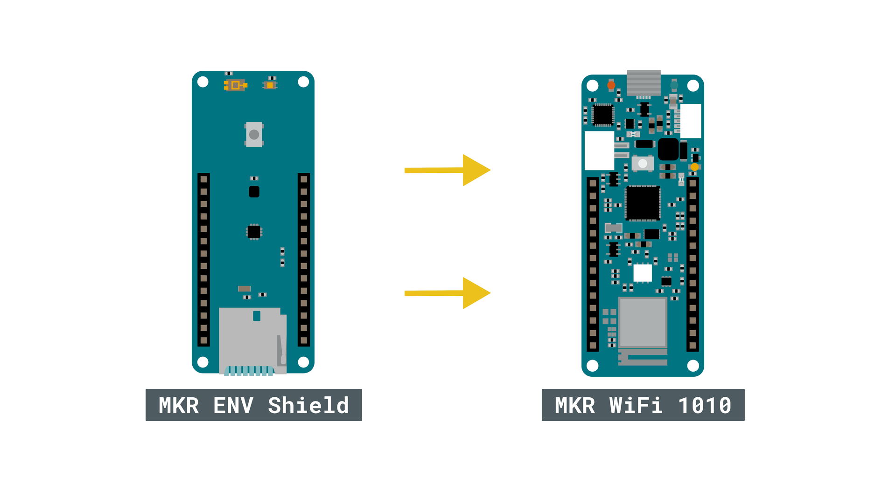
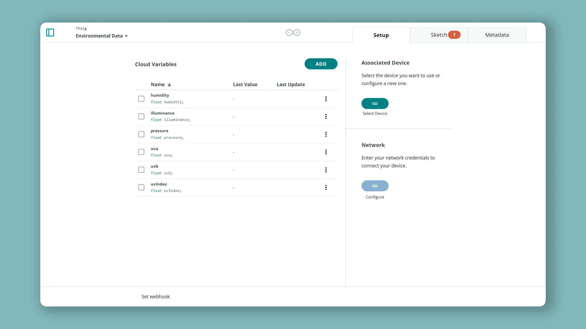
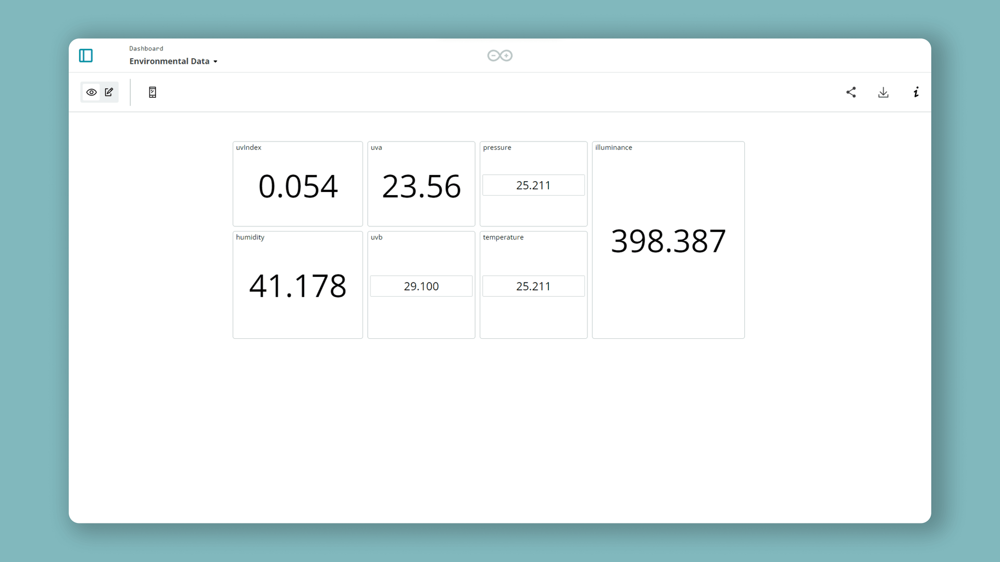

In this project you'll combine an
[MKR WiFi 1010](https://store.arduino.cc/mkr-wifi-1010) with an
[MKR ENV Shield](https://store.arduino.cc/arduino-mkr-env-shield) to record
temperature, humidity, pressure, and illuminance, then stream it live to an
Arduino Cloud dashboard. It's a compact, self-contained environmental logger
you can read from anywhere.

**What you need:**

- [MKR WiFi 1010](https://store.arduino.cc/mkr-wifi-1010).
- [MKR ENV Shield](https://store.arduino.cc/arduino-mkr-env-shield), mounted
  on the board.
- The [Arduino_MKRENV](https://www.arduino.cc/en/Reference/ArduinoMKRENV)
  library.



<Alert type="note">

Newer MKR ENV Shield revisions no longer include the UV sensor — see
[this Help Center article](https://support.arduino.cc/hc/en-us/articles/360019197540-Different-MKR-ENV-Shield-versions)
for the version differences.

</Alert>

## Step 1 — Provision the Board and Thing

Add the MKR WiFi 1010 as a Wi-Fi®
[Device](/arduino-cloud/devices/add-wifi-board), then create a
[Thing](/arduino-cloud/things-data/things) and associate the device.



## Step 2 — Add the Sensor Variables

Add these Read-Only [Cloud Variables](/arduino-cloud/things-data/cloud-variables), all floats:

| Name        | Type  | Permission |
|-------------|-------|------------|
| temperature | float | Read Only  |
| humidity    | float | Read Only  |
| illuminance | float | Read Only  |
| pressure    | float | Read Only  |
| uva\*       | float | Read Only  |
| uvb\*       | float | Read Only  |
| uvIndex\*   | float | Read Only  |

\* The `uva`, `uvb`, and `uvIndex` variables only exist on the **MKR ENV Shield v1**. Skip them on newer revisions, which have no UV sensor.

## Step 3 — Write the Sketch

Let Arduino Cloud generate the sketch, then include `Arduino_MKRENV`, initialize the shield in `setup()`, and read each sensor into its Cloud Variable in `loop()`:

```arduino
#include "thingProperties.h"
#include <Arduino_MKRENV.h>

void setup() {
  Serial.begin(9600);
  while (!Serial);
  delay(1500);

  initProperties();
  ArduinoCloud.begin(ArduinoIoTPreferredConnection);
  setDebugMessageLevel(2);
  ArduinoCloud.printDebugInfo();

  if (!ENV.begin()) {
    Serial.println("Failed to initialize MKR ENV shield!");
    while (1);
  }
}

void loop() {
  ArduinoCloud.update();
  temperature = ENV.readTemperature();
  humidity    = ENV.readHumidity();
  pressure    = ENV.readPressure();
  illuminance = ENV.readIlluminance();
  uva         = ENV.readUVA();      // remove on newer ENV shields (no UV sensor)
  uvb         = ENV.readUVB();      // remove on newer ENV shields (no UV sensor)
  uvIndex     = ENV.readUVIndex();  // remove on newer ENV shields (no UV sensor)
}
```

After uploading, open the Serial Monitor to confirm the board prints `Connected to "Network"` and `Connect to the Arduino Cloud`.

## Step 4 — Build the Dashboard

On a [Dashboard](/arduino-cloud/dashboards/dashboards), add a Value, Gauge, or
Chart widget per variable to view the readings live and over time:



## Next Steps

- [Add a Wi-Fi Board](/arduino-cloud/devices/add-wifi-board)
- [Dashboards](/arduino-cloud/dashboards/dashboards)
- [Historical Data Export](/arduino-cloud/things-data/historical-data-export)
