The full catalog of [Dashboard](/arduino-cloud/dashboards/dashboards) widgets, organized into the three picker categories — **Interaction**, **Visualisation**, and **Annotation**. Every widget can be added without linking a variable first; it renders with placeholder data until you bind it to a [Cloud Variable](/arduino-cloud/things-data/cloud-variables).

## Interaction

Widgets that let a dashboard write back to a device.

| Widget | Preview | What It Does | Variable Types |
|---|---|---|---|
| Switch | 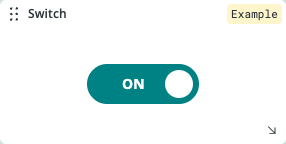 | Binary ON/OFF toggle. | `bool` |
| Push Button | 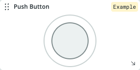 | Momentary press — sends a value only while held. | `bool` |
| Slider | 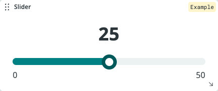 | Drag to set a numeric value within a min/max range. | `int`, `float` |
| Stepper | 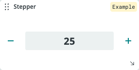 | Increment/decrement a numeric value by 1. | `int`, `float` |
| Messenger | 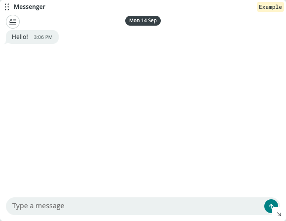 | Two-way text messages between dashboard and device. | `String` |
| Color | 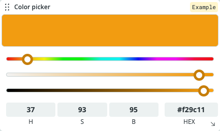 | HSB/hex color picker. | `CloudColor` |
| Dimmed Light | 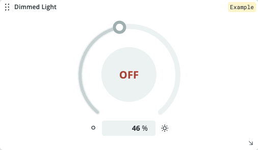 | ON/OFF plus a brightness percentage. | `CloudDimmedLight` |
| Colored Light | 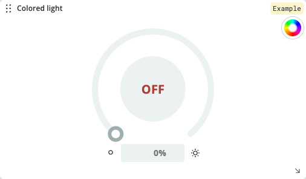 | ON/OFF plus a full color picker. | `CloudColoredLight` |
| Time Picker | 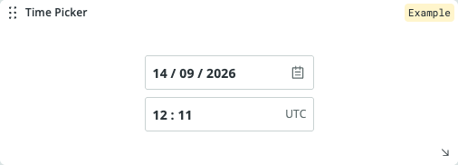 | Set a specific date/time value. | `CloudTime` |
| Scheduler | 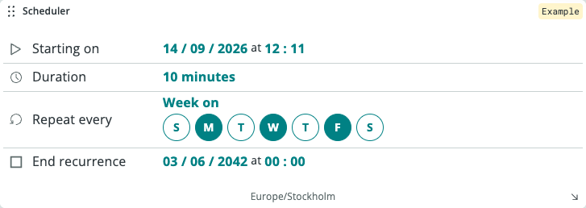 | Define a recurring schedule — see [Scheduler](/arduino-cloud/automations/scheduler). | `CloudSchedule` |

## Visualisation

Widgets for displaying data coming from a device.

| Widget | Preview | What It Does | Variable Types |
|---|---|---|---|
| Value | 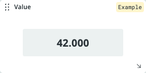 | Plain numeric/text readout. | Most types |
| Value Selector | 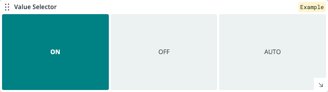 | Current value as mutually-exclusive buttons. | `int`, `String` |
| Value Dropdown | 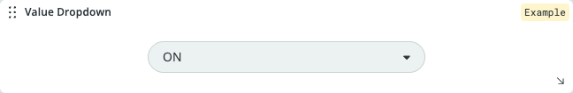 | Same as Value Selector, as a dropdown. | `int`, `String` |
| Status | 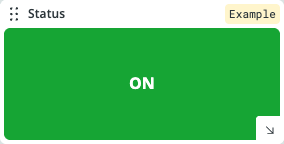 | A short text/state label. | `bool` |
| Gauge | 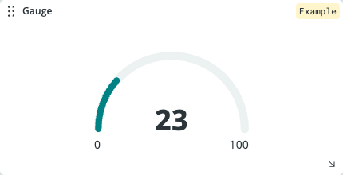 | Circular gauge with configurable min/max. | `int`, `float` |
| Percentage | 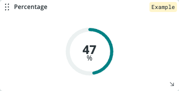 | A 0–100% readout with icon/color thresholds. | `int`, `float` |
| LED | 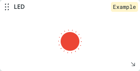 | Simple on/off indicator light. | `bool` |
| Map | 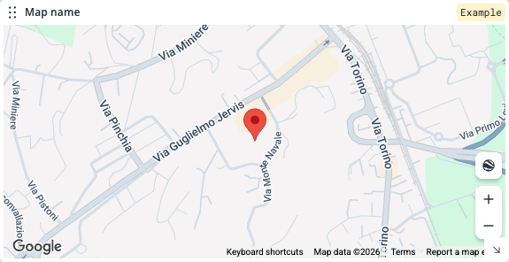 | Plots a `Location` variable on a live map. | `CloudLocation` |
| Chart | 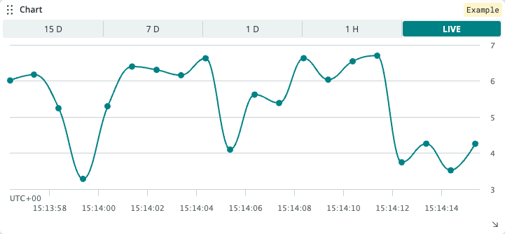 | Time-series line chart, one variable, with selectable range. | `int`, `float` |
| Advanced Map 🔒 | 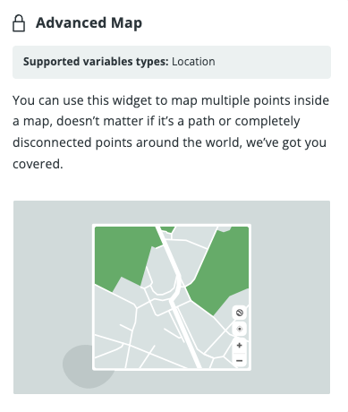 | Location history/path for a device. **Plan-gated.** | `CloudLocation` |
| Advanced Chart 🔒 | 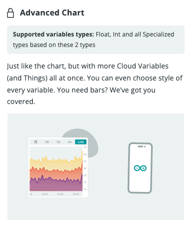 | Up to 5 variables on one chart. **Plan-gated.** | `int`, `float` |

## Annotation

Non-data widgets for organizing a dashboard.

| Widget | Preview | What It Does | Variable Types |
|---|---|---|---|
| Sticky Note | 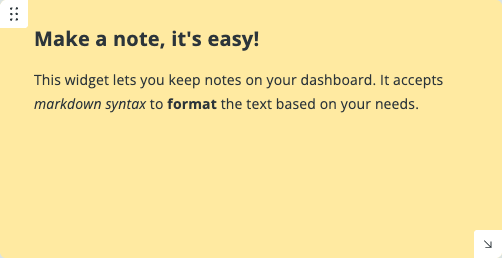 | A markdown-formatted note. | None (not linkable) |
| Image | 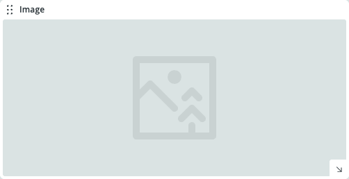 | An uploaded or URL image (JPG/PNG/WEBP); URL images can auto-refresh. | None (not linkable) |
| Image Map 🔒 | 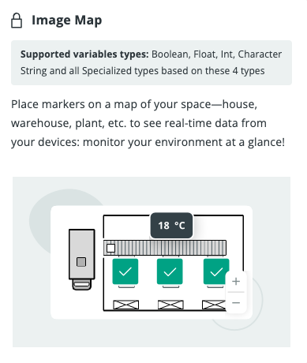 | Live variable markers, controls, and labels on a custom image (e.g. a floor plan). **Plan-gated.** See [Image Map Widget](/arduino-cloud/dashboards/image-map-widget). | `int`, `float`, `String`, `bool` |
| Link |  | A clickable link/button to an external URL. | None (not linkable) |

<Alert type="note">

**Three widgets are plan-gated:** Advanced Map, Advanced Chart, and Image Map show an "Upgrade to unlock widget" state on the Free tier (the previews above show that locked state, not a working instance). See the [Plans Feature Matrix](/arduino-cloud/reference/plans-feature-matrix) for details.

</Alert>

## Next Steps

- [Dashboards](/arduino-cloud/dashboards/dashboards)
- [Cloud Variable Types](/arduino-cloud/reference/cloud-variable-types)
- [Plans Feature Matrix](/arduino-cloud/reference/plans-feature-matrix)

## Trademark Acknowledgments

- **LoRa®** is a registered trademark of Semtech Corporation.
