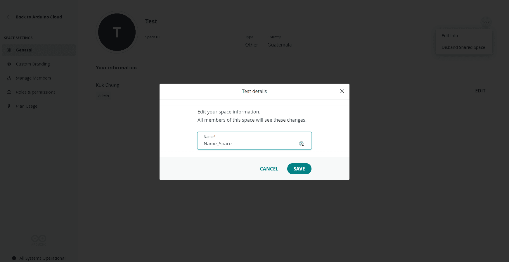
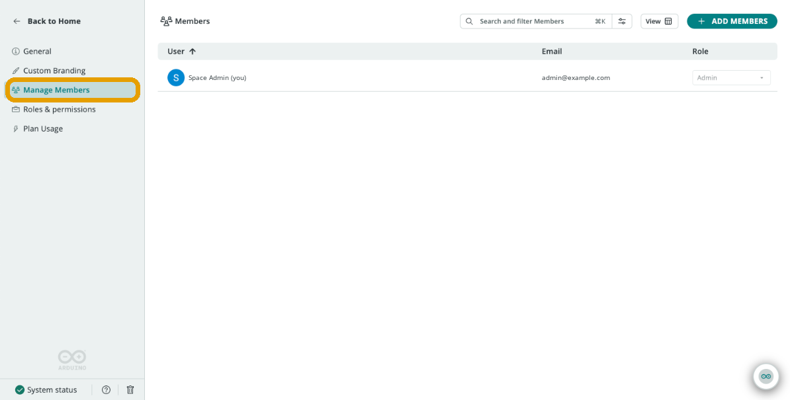
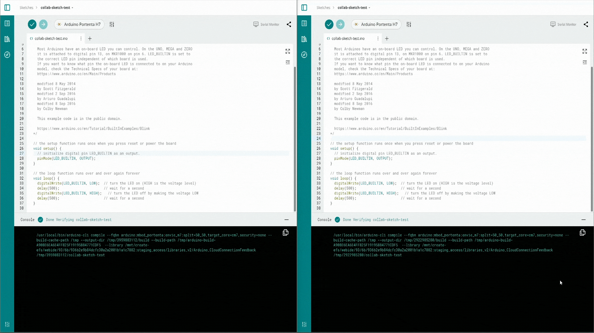

**Arduino® Cloud for Business** refers to the Arduino Cloud **Team** and **Enterprise** plans, built for companies, system integrators, and industrial clients that need to deploy, operate, and maintain connected devices as a team. On top of the core Arduino Cloud workflow (devices, Things, Cloud Variables, dashboards, and the Cloud Editor), these plans add shared workspaces with role-based access control, tools to manage devices at scale, data export to your own infrastructure, and white labeling.

This page gives an overview of the capabilities that matter most in professional settings, with a link to the detailed documentation for each one. For plan contents and prices, see [Arduino Cloud Plans](https://cloud.arduino.cc/plans).

If you're new to Arduino Cloud, start with the [Quickstart](/arduino-cloud/get-started/quickstart-first-project) to learn the core concepts, then come back here to see how they scale to an organization.

## Benefits for Professional Use

- **From prototype to production on one platform.** The Things, dashboards, and sketches you build during prototyping are the same ones you deploy and maintain in the field.
- **Team collaboration with controlled access.** Everyone works in the same shared space, and each member's role defines exactly what they can view and change.
- **Lower maintenance cost.** Update, monitor, and recover devices remotely instead of sending someone on site.
- **Repeatable deployments.** Capture a working setup once and replicate it for every new site, customer, or machine.
- **Your data, your tools.** Export historical data to your own storage and connect Arduino Cloud to your systems through APIs and integrations.
- **Your brand.** Present the platform to customers and users under your own identity.
- **Security by design.** Hardware-backed device identity, encrypted communication, and ISO/IEC 27001 certified services.

## Use Cases and Applications

| Setting | Example Applications |
|---|---|
| **Industrial monitoring** | Track machine status, energy consumption, and production metrics across plants, with alerts when values go out of range. |
| **Predictive maintenance** | Collect sensor data such as vibration or temperature, export it for analysis, and act before a failure occurs. |
| **Smart buildings and facilities** | Monitor and control lighting, HVAC, and air quality across multiple buildings from shared dashboards. |
| **Agriculture** | Monitor soil, greenhouse, and weather conditions at remote sites and control irrigation remotely. |
| **Connected products** | Ship devices to customers with branded dashboards and the IoT Remote app, and keep their firmware up to date over the air. |
| **System integration** | Manage separate installations for many clients, replicating the same setup with templates and keeping each client organized with tags and Smart Folders. |
| **Research and prototyping teams** | Share devices, sketches, and data within a team, and move validated prototypes into pilot deployments. |

## Key Capabilities

### Shared Spaces, Roles & Permissions

A **shared space** is a workspace for your organization, where all members access the same Things, devices, dashboards, and sketches. Every member has a role (**Admin**, **Editor**, **Service**, or **Viewer**) that defines which resources they can view and which actions they can perform. Permissions are enforced in the same way in the web app, the IoT Remote app, the CLI, and the API.

This lets you give engineers full editing access, give field technicians operational access to devices and recovery, and give customers or stakeholders read-only access to dashboards, all within the same space.

Learn more in [Spaces](/arduino-cloud/spaces-plans-account/spaces) and [Members, Roles & Permissions](/arduino-cloud/spaces-plans-account/members-roles).

### Fleet and Device Management at Scale

Once you move beyond a handful of boards, Arduino Cloud helps you keep a fleet under control: attach **tags** (key/value labels such as `location: rome`) to devices and Things, then search and filter the lists by tag, status, or type. Provision many devices at once from the [Arduino Cloud CLI](/arduino-cloud/developer-tools/cli-commands) instead of using the setup wizard one board at a time.

This is useful when you need to answer questions like "which devices in plant B are offline?" or when you onboard a new batch of devices for a customer.

Learn more in [Manage Devices at Scale](/arduino-cloud/devices/manage-devices-at-scale) and [Devices Overview](/arduino-cloud/devices/devices-overview).

### Over-the-Air (OTA) and Mass Updates

With **OTA updates**, you upload a new sketch to a board that's already connected to Arduino Cloud, without a USB cable. From the CLI, you can update many devices in one operation. This is essential for devices installed in hard-to-reach places, and for rolling out bug fixes and new features across a deployed fleet.

Learn more in [Upload Over the Air](/arduino-cloud/sketches-editor/upload-over-the-air) and [Manage Devices at Scale](/arduino-cloud/devices/manage-devices-at-scale#update-many-devices-over-the-air).

### Templates to Replicate Setups

Save a working Thing, dashboard, and Trigger setup as a **custom template**, then apply it to each new device instead of rebuilding it. With the CLI, you can clone Things and dashboards and apply templates to many devices in a batch. This is how you standardize installations across sites, customers, and product lines.

Learn more in [Custom Templates](/arduino-cloud/templates/custom-templates) and [Clone and Bulk-Create](/arduino-cloud/templates/clone-bulk-create).

### Dashboards and Sharing

**Dashboards** visualize your data and control your devices with widgets such as charts, gauges, switches, maps, and schedulers. You can share a dashboard with other Arduino Cloud accounts, for example a customer or a system integrator, without giving access to the rest of the space. Dashboards are also available on phones and tablets through the [IoT Remote app](/arduino-cloud/iot-remote-app/iot-remote-app-overview).

Learn more in [Working With Dashboards](/arduino-cloud/dashboards/dashboards) and [Share Dashboards](/arduino-cloud/dashboards/share-dashboards).

### Smart Folders

A **Smart Folder** is a saved set of search and filter rules, such as "all Things tagged `customer: acme`" or "all offline devices". Arduino Cloud keeps the folder up to date automatically as resources are added or change. Use Smart Folders to group resources by project, customer, or location without maintaining folders by hand.

Learn more in [Organize Resources With Smart Folders](/arduino-cloud/spaces-plans-account/smart-folders).

### Space Statistics and Spaces Overview

**Space Statistics** show at a glance how a space is used: number of Things, devices, and members, ingested data records, and Trigger activations. If you work in more than one space, the **Spaces Overview** adds up these values across all your spaces, compares plan usage side by side, and lists every device in a single table. This helps you plan capacity and spot spaces that are close to their plan limits.

Learn more in [Space Statistics](/arduino-cloud/spaces-plans-account/space-statistics) and [Spaces Overview](/arduino-cloud/spaces-plans-account/spaces-overview).

### Custom Branding and White Labeling

Replace Arduino's branding with your own logo and interface colors, and enable a custom URL and social sign-in. Custom branding is applied in the Arduino Cloud web app and in the IoT Remote app, so you can offer the platform to your customers as part of your own product.

Learn more in [Custom Branding](/arduino-cloud/spaces-plans-account/custom-branding).

### Data Export and AWS S3

Download the historical data of your Things as CSV files, query it through the API, or set up the **AWS S3 Exporter** to send data automatically to your own AWS S3 bucket on a schedule. This makes Arduino Cloud data available to your data warehouse, analytics, and reporting tools, and lets you keep it beyond your plan's retention period.

Learn more in [Historical Data & Export](/arduino-cloud/things-data/historical-data-export) and [AWS S3 Exporter](/arduino-cloud/integrations/aws-s3).

### APIs, SDKs, and CLI

The **REST API** gives programmatic access to devices, Things, properties, and dashboards, with official SDKs for JavaScript, Python®, and Go. The **Arduino Cloud CLI** brings the same operations to the terminal, which is ideal for scripting provisioning, OTA updates, and template deployment. Use them to integrate Arduino Cloud with your own backend, mobile app, or CI pipeline.

Learn more in [Developer Overview](/arduino-cloud/developer-tools/developer-overview), [REST API & SDKs](/arduino-cloud/developer-tools/rest-api-sdks), and [CLI Commands](/arduino-cloud/developer-tools/cli-commands).

### Collaborative Coding

Members of the same shared space can work on the same sketch in the Cloud Editor. The area another member is editing is highlighted, so the team stays in sync.

Learn more in [Collaborative Coding](/arduino-cloud/sketches-editor/collaborative-coding).

### Security and ISO 27001

Boards with a secure element are provisioned with hardware-backed keys, so their credentials never leave the device, and data between devices and Arduino Cloud is encrypted. Arduino Cloud services are certified to **ISO/IEC 27001**, the international standard for information security management.

Learn more in [Security Considerations](/arduino-cloud/security-privacy/security-considerations), [Device Identity & Secrets](/arduino-cloud/security-privacy/device-identity-secrets), and [ISO 27001](/arduino-cloud/security-privacy/iso27001).

## Getting Started

1. Choose a Team or Enterprise plan on the [Arduino Cloud Plans](https://cloud.arduino.cc/plans) page. For a tailored plan, [contact the Arduino team](https://www.arduino.cc/pro/contact-us).
2. [Create your shared space](/arduino-cloud/spaces-plans-account/spaces) and [invite your team](/arduino-cloud/spaces-plans-account/members-roles#inviting-a-new-member).
3. [Add your devices](/arduino-cloud/devices/devices-overview) and create [Things](/arduino-cloud/things-data/things) for them.
4. Build [dashboards](/arduino-cloud/dashboards/dashboards) and save your setup as a [custom template](/arduino-cloud/templates/custom-templates) to replicate it.

## Related Articles

- [Spaces](/arduino-cloud/spaces-plans-account/spaces)
- [Members, Roles & Permissions](/arduino-cloud/spaces-plans-account/members-roles)
- [Plans, Limits & Quotas](/arduino-cloud/spaces-plans-account/plans-limits-quotas)
- [Manage Devices at Scale](/arduino-cloud/devices/manage-devices-at-scale)
- [AWS S3 Exporter](/arduino-cloud/integrations/aws-s3)
- [Custom Branding](/arduino-cloud/spaces-plans-account/custom-branding)
