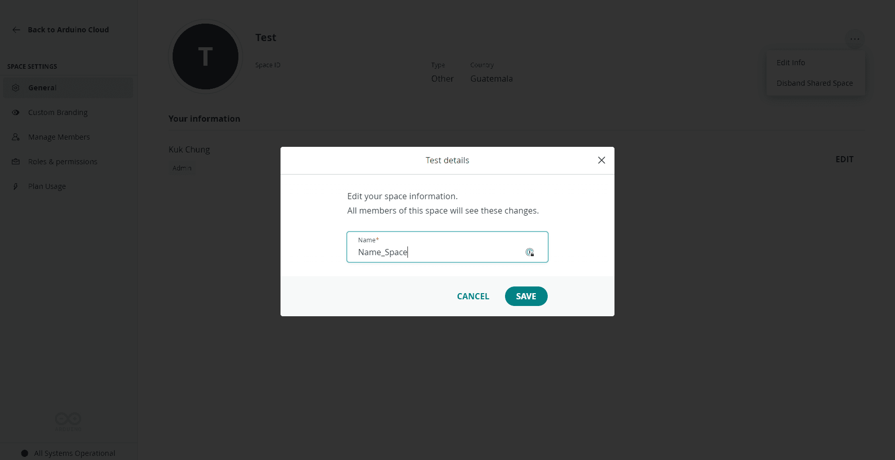
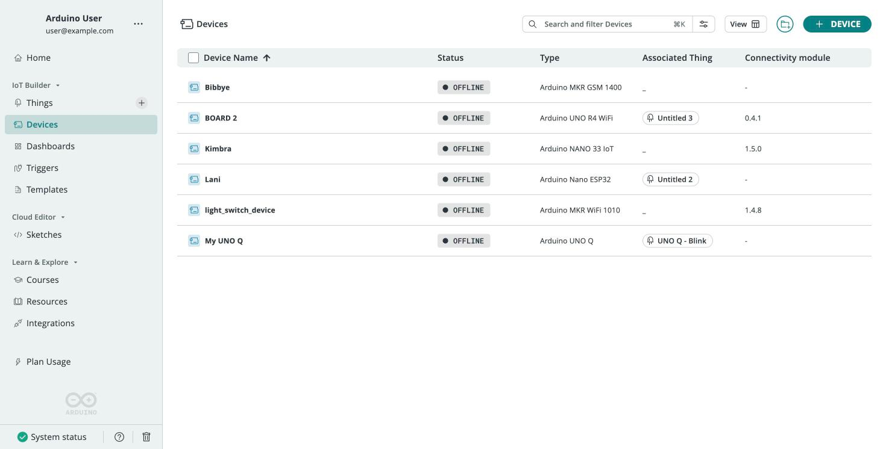

**Arduino Cloud for Business** is the plan tier built for companies and
industrial deployments — adding shared workspaces, Role-Based Access Control
(RBAC), fleet-scale device management, data export, custom branding, and
enterprise security on top of everything in the standard Arduino Cloud. This
page is a setup checklist for getting a team and a device fleet onto the
platform, with each step linking to its detailed guide.

If you're new to Arduino Cloud, start with the
[Quickstart](/arduino-cloud/get-started/quickstart-first-project) to learn the
core concepts — Devices, Things, Cloud Variables, and Dashboards — then return
here to roll them out across an organization.

## Setup Checklist

### 1. Create a Shared Space

A Business plan comes with a private **My Cloud** space and a **Shared Space**
for your team. The Shared Space can have any number of members who all access
its Things, devices, and dashboards. Name it during activation (editable later
under **Space Settings → General**).

→ [Spaces](/arduino-cloud/spaces-plans-account/spaces)

### 2. Invite Members and Assign Roles

From **Space Settings → Manage Members**, invite your team by email and assign
each a role. RBAC gives the admin precise control over what each member can do:

| Role | Can Do |
|---|---|
| **Admin** | Full control: Things, dashboards, devices, members, and billing. |
| **Editor** | Create/edit Things, variables, dashboards, devices, and sketches. |
| **Service Account** | Dedicated to API Keys/webhooks — link it to a non-personal email. |

<Alert type="note">

Keep at least one **Service Account** per Shared Space, tied to a shared
(non-personal) email, so API Keys aren't lost when an individual's account is
removed.

</Alert>

→ [Members & Roles](/arduino-cloud/spaces-plans-account/members-roles)

### 3. Provision and Tag a Device Fleet

Add devices through the Cloud UI for a handful of boards, or the
[Arduino Cloud CLI](/arduino-cloud/apis-cli/cli-devices) to provision many at
once. Boards with a secure element are provisioned using their hardware-backed
keys, so credentials never leave the device. Tag devices to organize and
filter large fleets.

→ [Manage Devices at Scale](/arduino-cloud/devices/manage-devices-at-scale)

### 4. Build Dashboards

Create [Dashboards](/arduino-cloud/dashboards/dashboards) to visualize and
control your fleet, then share them with members or embed them externally.
RBAC controls who can view versus edit each dashboard.

### 5. Set Up Data Export

Stream historical data to your own storage for analytics and long-term
retention. Export on demand, or pipe it continuously to object storage.

→ [Historical Data Export](/arduino-cloud/things-data/historical-data-export)
· [AWS S3 Exporter](/arduino-cloud/integrations/aws-s3-exporter)

### 6. Apply Custom Branding

Personalize the environment with your logo, a custom URL/subdomain, and social
sign-in (white labeling) from **Space Settings → Custom Branding**. Basic
options cover your logo and the Arduino logo toggle; advanced options enable a
custom domain and authentication.

→ [Custom Branding](/arduino-cloud/spaces-plans-account/custom-branding)

### 7. Review Security & Compliance

Arduino Cloud uses hardware-backed device identity, encrypted data exchange,
and is certified to **ISO/IEC 27001**. Review your organization's security
posture before going to production.

→ [Security Overview](/arduino-cloud/security-privacy/security-overview)
· [ISO 27001](/arduino-cloud/security-privacy/iso-27001)

## Purchasing and Add-Ons

The Business plan is sold as an **Enterprise Base Plan** (devices in multiples
of 50) with optional **add-ons** for additional needs. For a tailored
deployment, [contact the Arduino team](https://www.arduino.cc/pro/contact-us).

<Alert type="info">

Each Business subscription includes one Shared Space and one private space.
Additional spaces require purchasing another plan. See
[Plans, Limits & Quotas](/arduino-cloud/spaces-plans-account/plans-limits-quotas).

</Alert>

## Next Steps

- [Spaces](/arduino-cloud/spaces-plans-account/spaces)
- [Members & Roles](/arduino-cloud/spaces-plans-account/members-roles)
- [Manage Devices at Scale](/arduino-cloud/devices/manage-devices-at-scale)
- [Security Overview](/arduino-cloud/security-privacy/security-overview)

## Trademark Acknowledgments

- **Wi-Fi®** is a registered trademark of Wi-Fi Alliance.
- **LoRa®** is a registered trademark of Semtech Corporation.
